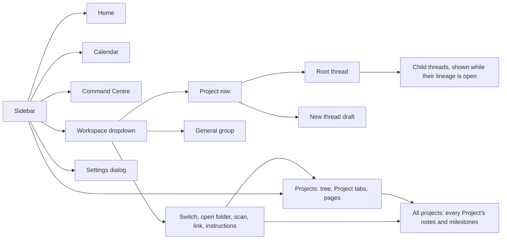

# Tenon Workbench v1 navigation map

- Status: implemented (sidebar-only navigation, roadmap Phase 4)
- Companion: [`PRODUCT-BRIEF-V1.md`](./PRODUCT-BRIEF-V1.md)
- Roadmap: [`t3-parity-roadmap`](../../implementations/t3-parity-roadmap/implementation.md)
- Updated: 2026-10-30

## Navigation model

The sidebar shows one workspace at a time: an opened folder, chosen from the
workspace dropdown at the top of the sidebar. Home, Notes, Calendar and
Projects have no workspace picker of their own and follow this selection. Its
notes, Project cards and calendar live in that folder. The workspace's Projects are the folders inside its `projects` folder (any letter
case) plus folders linked from elsewhere on the computer. A Project's threads
run in its folder. Threads from other workspaces never show. The left sidebar
is the only navigation. There is no tab strip and no separate workspace page.

When a workspace's folder was moved or deleted, the dropdown marks it **Folder
not found**. Selecting it shows the missing path in the sidebar with **Locate
folder…** (pick the folder's new place; it replaces the workspace) and **Remove
from list** (drops the workspace; nothing on disk changes). Threads stay with
the old path, so a relocated workspace starts without them.

## Sidebar

The sidebar has two columns: a navigation rail that is always shown, at every
window width, and a Projects panel beside it. Below 768 px the Projects panel
is hidden and the rail remains.

1. **Rail**, a gradient column distinct from the Projects panel's: **Home**,
   **Projects**, **Calendar**, **Command Centre** and **Settings** as icons whose label
   slides out on hover (the current page gets a pill highlight; Settings opens
   the Settings dialog). A new thread starts from `mod+n`, a Project's **+**,
   or Home's composer.
2. **Workspace** panel. The heading is a dropdown: the opened folders (the
   current one checked), **Open folder as workspace**, **New Project** (opens the
   Projects page's New Project form, `/projects?new=1`), **Add project…**, **Scan for projects**,
   **Add project…**, **All projects** (`/projects/overview`) and **Workspace
   instructions** (the workspace's default `AGENTS.md`). The rail's **Projects** opens the Projects page. Next to it, the
   folder button also opens **Add project…** and the other button scans again.
   **Add project…** is a dialog over the current page (no route change): type or
   paste a folder path (folder suggestions from the server), or **Browse…** with
   the system picker on desktop with a local server. The folder may be anywhere;
   it is linked through `POST /second-brain/projects/link`. Each workspace is also scanned once per app session when
   it is first shown; if that scan fails, a toast says so and it runs again the
   next time the workspace is shown. If the Project list cannot load, the
   panel shows **Request failed** with **Retry**.
   - **Group by** is a row of text tabs, **Project**, **Attention** and
     **Recent**, with an underline that slides to the chosen one (arrow keys
     move between them). The choice is remembered for the window. Attention
     shows how many threads are waiting for approval. Groups sit flat on the
     panel, and one highlight slides to the selected row. Attention has **Needs
     you**, **Running** and **Other threads**; Recent has **Today**,
     **Yesterday** and **Earlier**. Those groups start open, and empty ones
     don't show. In Needs you and Running each thread is a card that names its
     Project (or General) and, when it waits for approval, says so; a running
     card has a thin line moving along its top edge, still with reduced motion.
   - A thread waiting for approval shows a warning triangle and a running thread
     shows an accent dot, on its row and on its group's header. A root shows the
     most urgent state of itself and its child threads, even when they aren't
     listed.
   - One group per active Project, sorted by name, expandable. Expanding lists
     its root threads flat under the header (no guide lines; the header's **+**
     starts a new thread): pinned threads first (most
     recently pinned first, with a pin icon), then the rest newest first.
     Child threads (`parentID`) nest under their
     parent while that parent or one of its children is open.
     A thread belongs to the Project whose folder holds it (the deepest one for
     nested folders).
   - **General**: threads elsewhere in the workspace folder, at its root or in
     a subfolder that is not a Project.
   - Threads in folders outside the workspace and its linked folders belong
     to another workspace and are not listed. Home still lists recent threads
     from every folder.
3. **Settings** at the bottom opens the settings dialog.

Row actions:

| Row | Actions |
|---|---|
| Project | Open project (`/projects?project=<id>`), archived threads, instructions, **Remove from workspace…** (after a confirmation: unlinks a linked folder, archives the card of a folder inside the workspace; files are never touched) |
| Thread | Rename (also double-click), pin / unpin, fork, archive, delete. While the menu has focus, `R`, `P`, `F`, `A` and `Delete` (or `Backspace`) run these items; each item shows its key |

Pins are stored on the thread (`metadata.pinned`, the pin time) so they survive
restarts. Pinned threads sort first inside their own group (a Project or
General); pinning a child thread does not move it out of its parent.

**Archived threads** opens a dialog listing a folder's archived threads (up to
the 500 most recently updated), each with **Unarchive**. It is on a Project's
menu (its thread directory), the General row's menu (the workspace folder
itself, so threads archived in its non-Project subfolders are not listed) and
the Command Centre page.

### Desktop widget

A small window on the desktop, outside the app window, toggled with Ctrl+Alt+Space (Cmd+Option+Space on macOS), or Ctrl+Alt+W (Cmd+Option+W) when another app already uses that,
or **Show or hide the desktop widget** in the command palette. It shows one face at a time: **Note** (Enter
adds the text to the vault's Inbox), **Status** (threads that need you, running and just finished; Review
opens one in Tenon) or **Command** (the Command Centre's latest exchange and a reply box). A status update or a
Command Centre reply switches it, never while you type; after a quiet minute it returns to Note. Its close
button hides it; **Open in Tenon** brings the main window forward on that thread.

### Undo

Archive thread, rename thread, delete thread, archive Project and unlink
folder show a toast with **Undo** for 5 seconds. While such a toast is open, `mod+z` undoes the most
recent one, unless focus is in a text field or editor, which keeps its own undo.

- Archive and rename happen at once; undo unarchives the thread or restores
  the previous title. Archive Project undo restores the previous status.
  Unlink folder undo links the folder again and restores the card's status.
  Archiving from the Projects page also shows a toast with **Undo**.
- Delete is deferred: the row (and its child threads) hides at once, and the
  hard delete (`session.remove`) runs only when the toast expires. If the app
  closes before then, the thread is not deleted.

`mod+b` or the titlebar button hides and shows the Projects panel; the rail
stays. The current Project and the
expanded Projects are remembered per window.

## Titlebar

The titlebar is window chrome only: the sidebar toggle, back and forward
(when enabled in Settings), the update pill, and the native window controls.

## Routes

| Route | Shows | Sidebar highlight |
|---|---|---|
| `/` | Home | Home |
| `/projects`, `/calendar`, `/command` | That page | That item |
| `/command?thread=<id>` | Command Centre with that thread open | Command Centre |
| `/routines` | Routines (linked from the Command Centre) | None |
| `/activity` | Redirects to `/command` | Command Centre |
| `/projects?project=<id>&section=<tasks\|pages\|threads\|log\|settings>` | A Project as one page, scrolled to that section (an older `&tab=` maps to its section) | Projects |
| `/projects?page=<path>`, `/projects?new=1` | A page full width; the New Project form | Projects |
| `/notes…` | Redirects to the same view under `/projects` (Notes merged into Projects) | Projects |
| `/projects/overview` | All projects: every Project's notes and milestones | Projects |
| `/new-thread?project=<id>&draftId=<id>` | Draft composer in the Project's thread directory | The Project |
| `/server/<server>/session/<id>` | A thread | The Project whose folder holds the thread's directory, else General |

Redirects keep old links working: `/brain` and `/workspaces` go to `/`,
`/new-session?draftId=<id>` goes to the new-thread route, `/<dir>/session/<id>`
goes to the server-scoped thread URL on the selected server, and
`/<dir>/session` opens a new draft in that folder. Any other path goes to `/`.

## Drafts

A draft is an unsent thread. It is stored per window with its server, thread
directory and Project, and its composer content is kept in `drafts.sqlite`.
Sending a draft replaces it with the new thread and opens it, except
`mod+alt+Enter`, which sends in the background and leaves the draft open and
empty. On the first
start after upgrading, drafts from the retired tab strip are imported and the
per-window `tabs`, `tabs.recent`, `tabs.info` and `tabs.closed` keys are
deleted.

## Keyboard shortcuts

| Key | Action |
|---|---|
| `mod+n` / `mod+t` | New thread in the current Project (else in the workspace folder) |
| `mod+shift+a` / `mod+shift+backspace` | Archive the open thread |
| `mod+shift+y` | Toggle auto-accept of permission requests in the open thread |
| `mod+shift+n` | Open a folder as a workspace |
| `mod+b` | Toggle the sidebar |
| `mod+j` | Toggle the Command Centre strip (not on the Command Centre page) |
| `alt+up` / `alt+down` | Previous / next visible thread in the sidebar |
| `mod+shift+[` / `mod+shift+]` | Previous / next Project |
| `mod+[` / `mod+]` | Back / forward |
| `mod+k` | Command palette (also lists Go to Home, Projects, Calendar and Command Centre) |
| `mod+z` | Undo the last sidebar action while its undo toast is open (not in text fields) |

On the Projects page `mod+s` saves the open page from anywhere on the page,
including the preview and fullscreen. In the note editor `mod+b` and `mod+i`
format bold and italic instead of their global meaning.

Composer keys (handled inside the prompt editor, listed read-only in Settings →
Shortcuts):

| Key | Action |
|---|---|
| `Enter` | Send (while the agent works: steer or queue per Settings → General) |
| `shift+Enter` | New line |
| `mod+Enter` | Send with the opposite delivery for this message |
| `mod+alt+Enter` | Send into a new thread in the same Project, in the background |
| `mod+s` | Stash the prompt; restore or delete from the composer's stash menu |
| `ArrowUp` | Previous prompt from history (empty composer) |

The desktop File menu uses `Cmd+N` for a new thread, `Cmd+Shift+N` to open a
folder as a workspace and `Cmd+Alt+N` for a new window. `mod+shift+t` and
tab-closing `mod+w` were removed with the tab strip; `mod+t` now starts a new
thread. In-session panels keep their own `mod+w`. Global shortcuts also fire
while the integrated terminal has focus, so `mod+t` and `mod+n` there start a
thread rather than reaching the shell.

## Deep links

The app shell handles `tenon://open-project?directory=<path>` (opens the
folder as a workspace and selects it) and `tenon://new-session?directory=<path>&prompt=<text>`
(opens a draft in that folder's Project, or in the folder itself).

## Pages

- **Home** is a dashboard: start a thread, today's events and tasks (tick a task
  in place, as on Calendar), active Projects, resume and running threads. With no Projects, **Create Project**
  opens the Projects page's create form (`/projects?new=1`). Sending from Home's composer opens
  the new thread and sends the message in one step. Home's box stays usable while its data loads, so it is a plain
  text box: its **+**, or typing `/` or `@`, moves the text to the full composer on a draft.
- **Project picker** (the folder chip in every composer: Home, drafts and threads; the Feedback
  workshop's switcher): a search field, then **Recent** (up to three Projects with the latest thread
  activity) and **Workspace** (General and the rest), each with its folder's branch, and **Add a project
  folder…**. The chip and the current Project take the accent container. Picking one starts a draft there
  carrying what's typed; a thread keeps its own folder.
- **Projects** (Notes and the old Projects page, merged 2026-11-03; one page
  per Project since the workshop's variant B). With nothing open it lists
  **Projects** (name, outcome, progress; **All projects** first), **Archived**
  (folded) and **General** (pages tied to no Project), with search, **New page**
  and **New Project**. A Project is one page, tasks on the left and context on
  the right (stacked below 1100px):
  - a header with the title, a status chip, a **···** menu (Pause/Resume,
    Archive with Undo, Save current state, Project settings) and **Start work**;
  - **Tasks** has an "Add a task" line with a date chip and a Task/Milestone
    switch, an Open/All switch, and the tasks grouped under the milestone
    listed before them (each heading shows its date and "n of m done"), with a
    checkbox, a status pill (a menu), a date chip and a row menu (Rename,
    Delete) per item, Undo after a tick or delete, and the timeline;
  - the right rail holds **Progress** (progress, next milestone, blocker as a
    warning chip), **Pages** with a **New page** tile, **Threads** with **New
    thread**, and **Log**.

  Dates, status and kind use the app's own popover, menu and switch, never
  native controls. A page opens full width, and Back returns to the Project.
- **All projects** (`/projects/overview`) shows every Project of the workspace
  on one page, in the Projects order, then a **Workspace** group for notes and
  calendar items linked to no Project. Each group shows the status, progress,
  next milestone, up to five upcoming events and open tasks, and up to five
  recent notes; **Show all** opens the Project's calendar or notes, and a note
  opens on the Projects page. A filter narrows notes and items by title; a Project whose
  name matches keeps everything.
- **Calendar** shows events and tasks. Today and Week are hour grids
  (07:00–22:00, widened to fit events) with all-day events and open tasks in a
  strip above; clicking a day's header opens it in Today. Agenda lists items by
  day, with the date on the left. Clicking an event or task, in any view and in
  the Tasks view, opens it read-only in the side panel; **Edit** opens the form
  (a task's Edit opens it in the Tasks view). Ticking a task completes it at
  once, Google tasks included, with an **Undo** toast. The page scrolls as one
  area. Its Google Calendar & Tasks panel
  connects one or more Google accounts: one **Sign in with Google** button when
  the build ships its own OAuth client, else (or under **Use your own OAuth
  client**) the client ID and secret fields. Once an account is connected the
  panel lists each account with its access, last sync, queued or failed
  changes and its own **Disconnect**; **Add account** shows the sign-in form
  again, and Google lets the user pick a different account. **Sync now** syncs
  every account. A new event or task's **Save to** offers Local and each
  account with read and write access.
- Pages (on the Projects page) hold global notes and Project notes. A page's file name keeps
  the title's letters and digits in any script. If a save finds the note
  changed on disk, **Reload from disk** replaces the edits with the saved copy.
- **Command Centre** replaced Activity. It lists only its own threads (never
  Project threads) with rename, archive and delete on each row, searches memory,
  opens **Archived threads** and links to **Routines**, whose rows switch a
  routine on or off, open its page and run it now. On every other page a handle above the bottom edge
  opens the K3 strip (also `mod+j`; Esc closes it) with the latest reply, a
  composer and **Open full**. On a thread the strip sits on top of the composer.
- **Settings** contains General, Shortcuts, Servers, Providers, Models and
  Harnesses. Harnesses has **Set up built-in agents**. It opens the agent
  setup dialog. The dialog lists Codex, Claude Code and OpenCode under
  **Ready** and **Set up**, in the Providers row style, with **Install**,
  **Connect** or **Manage**. **Connect** opens that agent's sign-in or API-key
  view. On first run Home opens the same dialog
  once, unless every built-in agent is already installed and signed in.
- **Thread** shows the timeline and composer. Each finished agent turn folds
  its tool and reasoning steps into one "Worked {duration}" row. The row stays
  open when a step failed. While the turn runs, the row shows a live ticker:
  the current step with a spinner and timer, the two steps before it, and
  "Show all" to open the full list. While the agent reasons, the current step
  reads "Thinking" with the topic it's on, which slides in as the topic
  changes. The
  side panel has **Review** and **Details** tabs, plus open files. Details
  replaced the Context tab and follows the Thread board's design: four tiles
  (tokens, context used, messages, harness), a context breakdown bar (system,
  messages, tools), then a details list of the session's totals per harness
  (model, provider, context window, input, output, cache hit, cost, times).
  Values the harness doesn't report are left out. Subagents and tool counts
  show only when there are any, and raw messages open from a button. The side panel keeps its own width (420px by default) and
  the chat takes the rest. Hide it with the arrow in its tab row, the
  titlebar button, `mod+shift+r`, or by dragging its edge past the minimum.
  While hidden, a slim rail at the right edge shows the changed-file count
  and reopens the panel; context use lives on the composer's ring, whose menu opens Details. Opening the panel under
  1100px wide closes the Projects panel, as does opening Calendar's side panel. Split diffs need an 800px panel;
  a narrower panel shows unified diffs.
