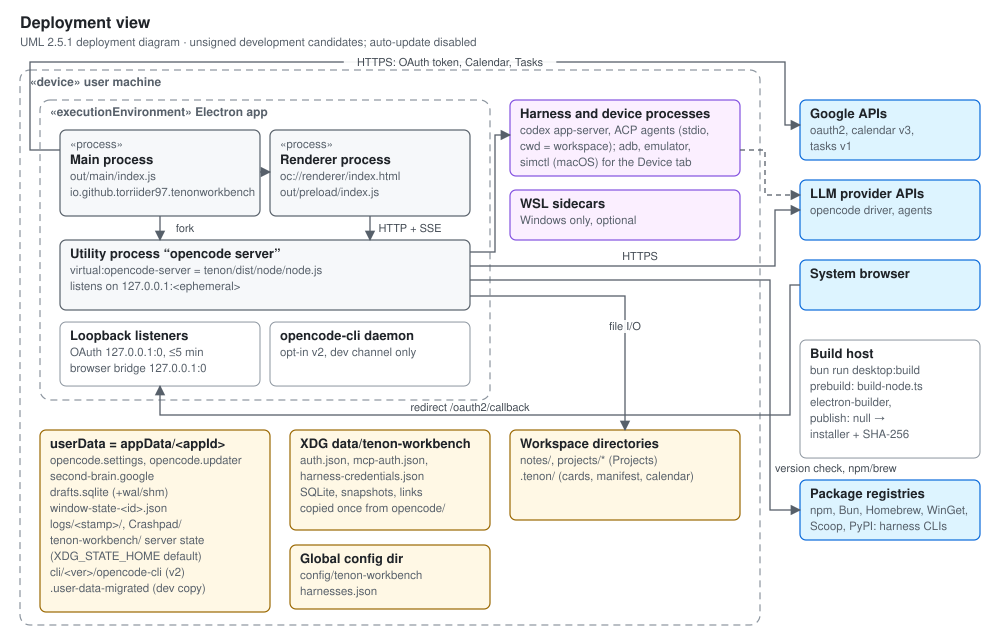

# Electron release operations

The active application lives in `tenon/`. Required checks run locally (see
`AGENTS.md`); the GitHub Actions workflows in `.github/workflows/` are disabled
in the repository settings to avoid Actions charges, and `ci.yml` runs only on
manual dispatch. Root Tauri/Cargo/pnpm commands are retired; the former
procedure is kept in [the archive](archive/tauri/release-operations.md).



## Local checks

Use Bun 1.3.14 and Node.js 24. Install with `bun install --frozen-lockfile`
inside `tenon/`, then run these commands from the repository root:

```sh
bun run typecheck
bun run lint
bun run check:generated
bun run test
bun run test:engine
bun run build
```

The engine suites include operating-system and subprocess tests. Report their
actual result for each platform; a successful renderer build is not equivalent
to passing those tests. The inherited linter currently allows warnings.

## Unsigned Windows candidate

The **Unsigned Electron release candidate** workflow is disabled. Re-enable it
in the repository's Actions settings before running it manually. It builds
the development channel, packages the Windows app, writes SHA-256 checksums,
and retains the installer and checksum file as workflow artifacts for 14 days.
It does not publish a GitHub release or configure an update feed.

Locally on Windows, `bun run desktop:build` builds and packages the app with
publishing disabled. Output is under `tenon/packages/desktop/dist/`.
The packaged app starts its local server in the user's home folder and, on
Windows, reads the current PATH from the registry at launch, so harness CLIs
installed since sign-in are found without signing out.
The build downloads the pinned upstream CLI for the optional development
sidecar and bundles the fork's local server. These are separate runtimes.
The local server comes from `tenon/packages/tenon/script/build-node.ts`
(entry `src/node.ts`). The fork doesn't build or ship its own `opencode` CLI
binary, and the desktop app has no "Install CLI" action.

Locally on macOS, run `bun run build` and then
`bun run --cwd tenon/packages/desktop package:mac --publish never`
(add `--dir` for just the `.app`). Local macOS output goes to
`~/Library/Caches/tenon-workbench/dist/`, not `dist/`: iCloud and other File
Provider syncs keep adding Finder metadata to bundle folders under
`~/Documents`, and `codesign` rejects it. When no Developer ID Application
identity is in the keychain and neither `CSC_LINK` nor `CSC_NAME` is set, the
config signs the app ad-hoc and skips notarization. Without a valid
signature, Apple Silicon kills the app at launch with
`SIGKILL (Code Signature Invalid)`, because the fuse step changes the Electron
binary. An ad-hoc build runs only on the machine that built it, or after the
user opens it through Gatekeeper on another Mac.

The product display name is Tenon Workbench (renamed from Second Brain OS on
2026-10-15). The application IDs are
`io.github.torriider97.tenonworkbench[.dev|.beta]` and the URL scheme is
`tenon:`; see [Desktop identity change](#desktop-identity-change).
Core data paths moved to `tenon-workbench` folders; see
[Storage migration](#storage-migration-opencode--tenon-workbench).

## Dictation engine (Rust)

The composer's mic runs `tenon-dictation`, a Rust binary in
`tenon/packages/dictation` built on Handy's stack (`transcribe-cpp`,
`handy-recorder`, `earshot`; credits in `THIRD_PARTY_NOTICES.md`). Build it
before packaging; `electron-builder.config.ts` copies
`target/release/tenon-dictation[.exe]` (or `$CARGO_TARGET_DIR/release/...`)
into the app's `resources/dictation/` folder and warns when it is missing, in
which case the packaged app's mic reports that the engine is unavailable.
In development the app runs the same release build from
`tenon/packages/dictation/target/release/`; `TENON_DICTATION_ENGINE` points it
at another binary.

Both platforms need Rust 1.88 or newer and CMake (transcribe-cpp compiles
whisper/ggml from source). Run `bun run --cwd tenon/packages/desktop build:dictation`
(`cargo build --release --manifest-path ../dictation/Cargo.toml`), and
`cargo test` inside `tenon/packages/dictation` for the protocol tests.

- **Windows (MSVC):** install Visual Studio 2022 Build Tools with the C++
  workload, then build from a shell set up by
  `VC\Auxiliary\Build\vcvars64.bat`. The Build Tools' CMake and Ninja live under
  `Common7\IDE\CommonExtensions\Microsoft\CMake\{CMake\bin,Ninja}`; put both on
  `PATH` and set `CMAKE_GENERATOR=Ninja`. Keep the cargo target directory on a
  short path outside OneDrive (for example `CARGO_TARGET_DIR=C:\Users\<you>\.tdc`):
  with long-path support off, the CMake try-compile fails in a deep
  `OUT_DIR`, and it also failed through transcribe-cpp-sys's short
  `%LOCALAPPDATA%\tcs` junction on the 2026-11-02 build machine. Setting
  `LOCALAPPDATA` to an unusable path for the cargo process skips that junction.
  The build links the static CPU backend, so no DLLs ship beside the `.exe`.
- **macOS:** install the Xcode command-line tools and CMake (`brew install cmake`).
  Apple Silicon builds with Metal; Intel Macs build the CPU backend. The binary
  is signed with the app (hardened runtime, `entitlements.plist` grants
  `com.apple.security.device.audio-input`), and `Info.plist` carries
  `NSMicrophoneUsageDescription` for the first microphone prompt.

Speech models are not bundled. Settings › Dictation downloads Whisper Small,
Whisper Turbo or Parakeet V3 (the GGUF files Handy uses, from Hugging Face,
checked against their SHA-256) into `<userData>/dictation/models/`. Downloads use
Electron's `net.fetch`, so they follow the system proxy. An interrupted download
leaves `<model>.part` there and the next attempt resumes it.

## Bundled ripgrep

`desktop/scripts/prebuild.ts` downloads the pinned ripgrep release for the build
target (`RUST_TARGET`, or the host) into `desktop/resources/ripgrep/`, checks it
against the SHA-256 in `core/src/ripgrep/release.ts`, and skips the download when
`.version` there already matches. So a package build needs GitHub the first time,
and a failed download or mismatch stops the build. `electron-builder.config.ts`
copies `rg[.exe]` into the app's `resources/ripgrep/` folder; on macOS it is signed
with the app, like the dictation engine. Not yet proved on a signed and notarized
macOS candidate: check `resources/ripgrep/rg` runs and passes notarization on the
next one. To move to a new ripgrep, change `VERSION` and all the `sha256` values
together.

At runtime `preferAppEnv` sets `TENON_RIPGREP_PATH` in packaged builds. The sidecar
looks for `rg` on `PATH` and in its `bin` folder, then at that path, and only then
downloads the same verified archive. A failed download is retried on the next
search. LSP server auto-install still fetches unpinned releases.

## Desktop identity change

Earlier builds used upstream OpenCode Desktop's identity. Current builds use
their own:

| Item | Before | Now |
| --- | --- | --- |
| App ID (prod, beta, dev) | `ai.opencode.desktop`, `.beta`, `.dev` | `io.github.torriider97.tenonworkbench`, `.beta`, `.dev` |
| Package name (deb, rpm, `extraMetadata.name`) | `opencode*` (rpm), `@tenon/desktop` | `tenon-workbench`, `tenon-workbench-beta`, `tenon-workbench-dev` |
| Windows install folder | `%LOCALAPPDATA%/Programs/@opencode-aidesktop` | derived from `tenon-workbench*` |
| Deep-link scheme | `opencode://` | `tenon://` (same `open-project` and `new-session` hosts) |

The app ID sets Electron `userData` (`%APPDATA%/<appId>` on Windows,
`~/Library/Application Support/<appId>` on macOS, `~/.config/<appId>` on
Linux), the Windows AppUserModelId, the NSIS install GUID, and the Linux
executable, desktop file, `StartupWMClass` and metainfo ID. The upstream
Tauri `.dat` import (`desktop/src/main/migrate.ts`) and the hidden
`opencode-desktop.desktop` Linux launcher were removed.

Upgrade consequences:

- On Windows the new build installs beside the old "Tenon Workbench Dev",
  because the GUID and folder differ. Uninstall the old one in Settings >
  Apps.
- Taskbar and Start pins must be created again.
- `opencode://` links no longer open Tenon Workbench.
- Automatic updates stay disabled (`UPDATER_ENABLED=false`, `publish: null`),
  so there is no update-feed continuity to keep.

`userData` copy (`desktop/src/main/user-data-migration.ts`), run once after
`app.setPath("userData")` and the single-instance lock, before logging and the
stores open:

- Only packaged dev builds copy from `%APPDATA%/ai.opencode.desktop.dev`. The
  release workflow only built dev candidates. Beta and prod start fresh
  because their old folders belong to upstream OpenCode Desktop.
- Unpackaged runs (`bun run dev`) use their own ID,
  `io.github.torriider97.tenonworkbench.dev.local`, for `userData`, the
  AppUserModelId and the single-instance lock. They start with fresh settings,
  never change an installed dev build's saved windows, workspaces or theme, and
  can run while it is open.
- Not copied: `Cache`, `Code Cache`, `GPUCache`, `DawnGraphiteCache`,
  `DawnWebGPUCache`, `Crashpad`, `logs`, `cli`, `DevToolsActivePort`,
  `Singleton*`, `lockfile`.
- The copy goes to a temporary sibling folder and is renamed into place. If
  the target already exists (the single-instance lock usually creates it
  first), files are merged and existing ones are kept. If an entry can't be
  moved, the copy stays in `<appId>.migrating-*`, no marker is written, and
  the log names the entries. The old folder is never modified.
- A `.user-data-migrated` marker is written last. Fresh installs are marked
  too.
- On failure the app logs "user data migration failed; retrying on next
  start" and tries again on the next launch.
- On the development machine it copied 351 KB in 50 ms from a 505 MB folder
  that was almost all caches.
- The copied `userData` includes the old core state folders, so the
  [storage migration](#storage-migration-opencode--tenon-workbench) continues
  from there.

Verify after the first launch of a dev build:

1. `%APPDATA%/io.github.torriider97.tenonworkbench.dev` exists and contains
   `.user-data-migrated`.
2. Settings, drafts and Workspaces from the old build appear in the app.

Rollback: uninstall the new build if needed and reinstall the previous one.
Its `userData` folder is unchanged. Anything the new build wrote stays in the
new folder.

## Storage migration (opencode → tenon-workbench)

Builds that include `core/src/legacy-storage.ts` store core data under
`tenon-workbench` instead of `opencode`:

| Root   | Path                                                                                           |
| ------ | ---------------------------------------------------------------------------------------------- |
| Data   | `$XDG_DATA_HOME/tenon-workbench` (default `~/.local/share/tenon-workbench`)                          |
| Config | `$XDG_CONFIG_HOME/tenon-workbench` (default `~/.config/tenon-workbench`)                             |
| State  | `$XDG_STATE_HOME/tenon-workbench` (the desktop app sets `XDG_STATE_HOME` to Electron `userData`)  |
| Cache  | `$XDG_CACHE_HOME/tenon-workbench`                                                                 |

Upstream OpenCode keeps using its `opencode` folders.

The thread database lives in the data folder. Installed builds pin its name
by desktop channel (`desktop/src/main/database-name.ts`): `tenon-dev.db`
for dev, `tenon-beta.db` for beta and `tenon.db` for prod (builds before the
Tenon rename used `opencode-*.db`; see below). Without the
pin, the server names it after the channel it was built with, which falls back
to the git branch (`tenon-<branch>.db`), so each build from another branch
showed an empty thread list. Builds before this change left their threads in
those branch-named files; they stay on disk and are not merged. Unpackaged
`bun run dev` runs keep the per-branch name, so they never write to an
installed build's database. A set `TENON_DB` (environment or login shell)
overrides the pin.

On the first start of such a build, the server copies each legacy `opencode`
data, config and state folder to its `tenon-workbench` path, then starts
normally:

- Each root is done once: completion is recorded by a
  `.legacy-storage-migrated` marker file in the `tenon-workbench` folder, written
  last. A fresh install with no legacy folder is marked too, so a later
  upstream OpenCode install is never imported.
- If the `tenon-workbench` folder already exists without the marker (for example
  empty folders created by a test run), the copy is merged into it. Files
  already there are kept.
- Credentials (`auth.json`, `account.json`, `mcp-auth.json`), databases,
  `storage/` and `plans/` are copied. Afterwards the two apps have separate
  credentials and databases. If the shared `opencode.db` held upstream
  OpenCode sessions, Tenon Workbench's copy holds them too.
- Not copied: `snapshot` (undo and diff for past turns), `bin`, `log`,
  `repos`, `tool-output` and `worktree` from data; `node_modules` from config;
  `locks` from state; any `*.tmp`. Existing worktrees keep working at their
  legacy paths; new ones go under `tenon-workbench/worktree`. ripgrep, LSP
  binaries and the models cache are downloaded again when needed.
- Legacy folders are never modified.
- On the development machine the copy took about 13 s for about 92 MB, mostly
  small files under `config/skill-libraries`. Later starts are unaffected.
  The desktop sidecar stall timeout is 60 s
  (`SIDECAR_START_STALL_TIMEOUT` in `desktop/src/main/server.ts`).
- If the copy fails, startup stops with "Could not copy Tenon Workbench data from
  X to Y. The original folder is unchanged."

Before the first launch, quit every older Tenon Workbench build and upstream
OpenCode. Copying a SQLite database that another process is writing can capture
an inconsistent state.

Verify after the first launch:

1. The `tenon-workbench` data, config and state folders each contain
   `.legacy-storage-migrated`, and no `*.migrating-*` folder is left beside
   them.
2. Existing sessions, projects and provider sign-ins appear in the app.
3. New server logs are written under `tenon-workbench/log`.

Rollback: quit the app and run the previous build. It reads the unchanged
legacy `opencode` folders. Anything the new build wrote after migration stays
in `tenon-workbench` and is not visible to the previous build.

Re-run the migration: quit the app, then delete `.legacy-storage-migrated` in a
`tenon-workbench` folder to fill in missing files from the legacy folder (existing
files are kept), or rename the whole `tenon-workbench` folder for a clean copy.
Start the app.

## Tenon rename (opencode → tenon file names)

Builds from the Tenon rename on use Tenon names for files they own and move
the old ones once, keeping any file that already has the new name:

- The desktop main process renames `opencode.settings`, `opencode.updater` and
  `opencode.<scope>.dat` in `userData` to `tenon.*` before any store opens
  (`desktop/src/main/store-rename.ts`).
- The server renames `opencode*.db` (with `-wal` and `-shm`) to the matching
  `tenon*.db` before opening it (`Database.adoptLegacyFile`). Pre-migration
  backups keep their `opencode.db.pre-*.bak` names.
- The renderer moves `opencode.*` and `opencode-theme-*`/`opencode-color-scheme`
  browser storage keys to `tenon.*`/`tenon-*` (`migrateLegacyLocalStorage`,
  `app/public/oc-theme-preload.js`). The browser build's IndexedDB drafts
  database keeps its `opencode-drafts` name.
- The repository's project ID is written to `.git/tenon`; `.git/opencode` is
  still read.
- `OPENCODE_*` variables, `opencode.json`, `.opencode/` and `x-opencode-*`
  headers keep working ([upstream notes](opencode-upstream.md)).

Rollback to a build from before the rename: that build looks for the old
names, so quit the app and rename the files back (`tenon.settings` →
`opencode.settings`, `tenon.*.dat` → `opencode.*.dat`, `tenon*.db` and its
`-wal`/`-shm` → `opencode*.db`) before starting it, or it opens with empty
settings and no threads. Nothing is deleted, so a later upgrade picks the files
up again.

## Desktop startup and quit

`desktop/src/main/index.ts`, `server.ts` and `sidecar-supervisor.ts`:

- A second launch takes the single-instance lock right after setting
  `userData`, hands its `tenon://` links to the running app, and quits before
  the `userData` copy, logging and the crash reporter.
- Windows open as soon as Electron is ready and show a splash until the local
  server passes its health check, or the 30 s health wait ends. The server
  start itself can take up to the 60 s stall timeout, for example during the
  first-start storage copy.
- The login-shell environment probe runs in the background with a 5 s timeout.
  It tries `-il`, then `-l` when `-il` fails or times out (a login shell skips
  `.zshrc`), so a slow interactive config can add up to 5 s more. When neither
  loads, the app environment is used and PATH gets `/opt/homebrew/bin`,
  `/usr/local/bin`, `~/.local/bin`, `~/.bun/bin` and `~/.opencode/bin` appended
  (`fallbackPath`), so harness CLIs and npm are still found. The server is
  spawned after the probe finishes.
- If the server exits after it was ready, it is restarted on the same port and
  password after 1, 2, 4, 8 and 16 s, at most 5 times in 10 minutes. Restarts
  are logged in the `utility` log; no IPC event tells the renderer, which
  reconnects through its own health checks. After the limit, restart the app.
- On quit, the app waits up to 8 s for the server to stop (it is killed after
  6 s), then exits.
- Uncaught exceptions and unhandled rejections in the main process are written
  to the main log.

## Database migrations and backups

The database (`tenon.db`) cannot be rebuilt. When a build has schema migrations that an
existing database has not applied yet, the server first writes a consistent
snapshot (`VACUUM INTO`) next to it, named
`tenon.db.pre-<first pending migration id>.bak` (mode `0600`). It keeps the
newest three backups and deletes older ones. In-memory and new databases are
not backed up.

Each migration runs in its own `immediate` transaction with foreign keys off.
A migration that fails, including one that adds a foreign key violation, rolls
back alone: earlier migrations from the same start stay committed, and startup
stops. If the database holds migration ids newer than the running build (a
downgrade), the server logs "database was migrated by a newer build" and
continues.

If the backup cannot be written (for example, the disk is full), no migration
runs and startup stops. Free space next to `tenon.db` (old `*.bak` files
can go) and start again. Leftover `*.tmp` files from an interrupted backup are
removed on a later backup once they are an hour old.

Restore a backup: quit the app, move `tenon.db`, `tenon.db-wal` and
`tenon.db-shm` aside, copy the backup to `tenon.db`, and start the build
that matches it. Data written after the backup is lost.

Migration authors: foreign keys are off while migrations run, so
`ON DELETE CASCADE` does not fire. Delete child rows explicitly, or the foreign
key check fails the migration.

## Release limits

Automatic updates are disabled. Before enabling them, configure the fork's
own signed release feed and verify update and rollback behavior. Do not point
this fork at OpenCode's desktop releases.

This workflow produces unsigned development candidates only. macOS and Linux
packaging settings remain in the desktop package but have not been validated
by this Windows candidate workflow. A successful build does not establish
clean-machine installation, platform signing, or Google OAuth readiness.

Never bundle workspace data, local databases, credentials, `.env` files, logs,
or recovery archives. The one exception is the Google Desktop OAuth client: when
`tenon/packages/desktop/.env.local` sets `MAIN_VITE_GOOGLE_CLIENT_ID` and
`MAIN_VITE_GOOGLE_CLIENT_SECRET` (see `.env.example`), the build compiles both
values into the main process so the Calendar page offers one-click Google
sign-in. Without them the page asks for the user's own client. The same
Google client signs in Gmail accounts (Settings › Accounts). For Outlook mail,
`MAIN_VITE_MICROSOFT_CLIENT_ID` names a public Microsoft identity client
(no secret; platform "Mobile and desktop applications" with the redirect
`http://localhost`); without it the Outlook button is disabled and IMAP
still works. The desktop main bundle now includes `imapflow` and its
dependencies for IMAP. Build from
`tenon/packages/desktop` (as the scripts do): electron-vite reads the env
file from the working directory.

Preserve canonical files and existing application data when upgrading. Donor Tauri databases have no automatic import path; see
[the donor record](archive/tauri/README.md).
