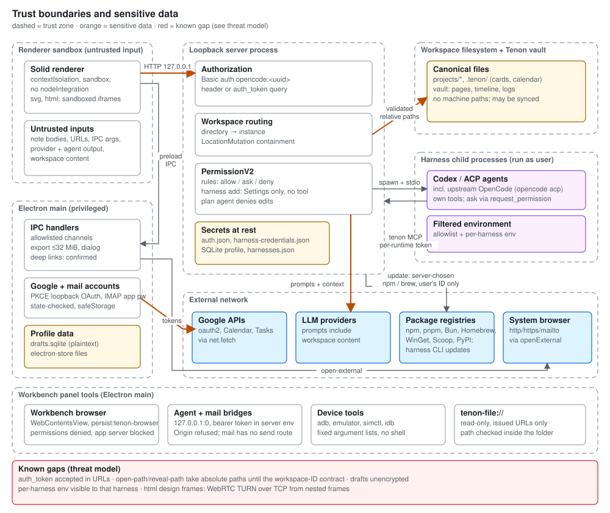
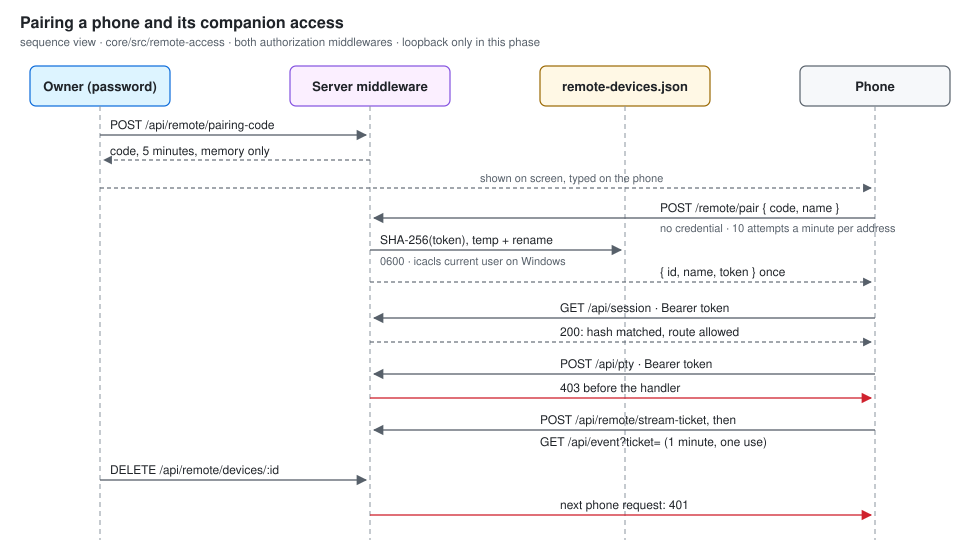

# Threat model for the active desktop app

This document covers the Tenon Workbench Electron app in `tenon/` (a fork of OpenCode). The former
React/Tauri application is retired, so its Rust policy and MCP
sidecar design are not current desktop controls.



Detailed permission and request flows are in
[the UML architecture views](../architecture/uml.md).

## Assets and boundaries

| Boundary                   | Current control and location                                                                                                                                                                                                                                                                                                                                           |
| -------------------------- | ---------------------------------------------------------------------------------------------------------------------------------------------------------------------------------------------------------------------------------------------------------------------------------------------------------------------------------------------------------------------- |
| Renderer to native process | The main window uses `contextIsolation`, `sandbox`, and disabled `nodeIntegration`. `tenon/packages/desktop/src/preload/index.ts` exposes specific IPC methods implemented in `tenon/packages/desktop/src/main/ipc.ts`. The desktop widget's window (`createWidgetWindow`) has the same isolation and session policy; its IPC (`widget-*`) only toggles, hides and sizes that window, and `widget-open-in-app` accepts app routes starting with `/` (not `//`). Packaged builds ignore `ELECTRON_RENDERER_URL`; see Renderer content policy for remote media.                                     |
| Renderer to managed server | Electron starts the Tenon server on `127.0.0.1` with a generated password. Server authorization checks credentials for protected routes. See `tenon/packages/desktop/src/main/index.ts` and `tenon/packages/tenon/src/server/routes/instance/httpapi/middleware/authorization.ts`.                                                                         |
| Server to workspace files  | Second Brain handlers run in an instance location context. Project code and the vault migration resolve workspace targets through `LocationMutation` before reading or writing files. See `tenon/packages/tenon/src/server/routes/instance/httpapi/handlers/second-brain.ts`, `tenon/packages/tenon/src/knowledge/vault.ts`, and `tenon/packages/tenon/src/project/brain.ts`. |
| Server to the Tenon vault  | Vault pages, timelines and logs live outside the workspace, under `TENON_VAULT_DIR` (default `<Documents>/Tenon`). Every vault path is a validated relative path resolved inside the workspace's vault folder, with its real path checked; see [Tenon vault](#tenon-vault) and `tenon/packages/tenon/src/knowledge/vault.ts`. |
| Desktop to Google          | Calendar and Tasks integration uses OAuth in the Electron main process. The service keeps any number of accounts, encrypts each account's client secret and refresh token with Electron `safeStorage`, and disables connection when secure storage is unavailable. Access tokens are cached per account, writes are routed to the account named by the item, and the loopback callback ignores requests without the expected state. See `tenon/packages/desktop/src/main/google-calendar.ts`. |
| Desktop to harness files   | Harness sync in the Electron main process writes each coding harness's global instructions file and skills folder in the home folder, from a sync file in a folder the user picked. Only fixed per-harness paths are written; the sync file is validated before use and the renderer never passes a path. See [Harness sync](#harness-sync) and `tenon/packages/desktop/src/main/harness-sync/`. |

`POST /second-brain/projects/workspace` takes only a Tenon project id. The
server looks the id up in its own project table and rejects `global` and the
Brain directory itself; it never accepts a renderer path. The renderer no longer
calls it.

Workspace Projects add three file surfaces:

- `POST /second-brain/projects/scan` writes only under the workspace's
  `.tenon/` (cards and `workspace.json`) through `LocationMutation`, lists
  folders without reading their content, and refuses to overwrite a manifest it
  cannot parse or read (only a missing manifest is created). It also writes
  `workspace-links.json` (linked folder -> workspace) in the server data
  folder; that file is a rebuildable cache. Folders named in a hand-edited
  manifest get the same checks as `link` below before they reach the cards or
  the index, and a folder another workspace already indexes keeps that entry,
  so one workspace's manifest cannot claim `/`, the home folder or another
  workspace's folders for its `AGENTS.md`. A card's `location.path` must stay
  inside the workspace (relative) or be one of those checked linked folders
  (absolute) before threads run there; otherwise threads use the card folder.
- `POST /second-brain/projects/link` is the one Second Brain route that takes
  an absolute renderer path. The server requires an existing directory that
  neither contains nor sits inside the workspace and is not, and does not
  contain, the home or app data folder, and only records it in the manifest; it never reads, moves or writes files in that folder. The renderer
  sends a folder the user picked in the folder dialog. Sessions can already run
  in any directory the renderer names, so this adds no new reach.
- `GET`/`PUT`/`DELETE /second-brain/instructions` read, write (64 KiB cap) and
  remove `AGENTS.md` in the request's directory only, through
  `LocationMutation`. A read refuses an `AGENTS.md` whose real path leaves the
  folder (a symlink) or that is larger than 256 KiB. Session instruction
  lookup applies the same rule: a discovered `AGENTS.md` must really live in
  the workspace, linked folder or project it was found in, and files over
  256 KiB are not injected. `AGENTS.md` is agent instructions: the app injects it
  into sessions in that workspace, and with the link index into linked folders
  too. A workspace's `AGENTS.md` therefore steers agents working in its linked
  folders. The app calls this route only from the Instructions dialog; an
  agent with file-edit permission can still change `AGENTS.md` like any other
  workspace file. The resulting card
stores that Workspace's worktree as `location.displayPath`, and
`GET /second-brain/project-threads` returns absolute thread directories the
same way session responses already return `directory`.

`tenon://open-project` and `tenon://new-session` deep links are validated
first in the Electron main process (`tenon/packages/desktop/src/main/deep-links.ts`):
only those two hosts are accepted, the `directory` must be an existing local
absolute folder (UNC `\\host\share` and any other path that opens with two
separators, such as `/\host\share`, protocol-relative `//host`, `file:`,
relative and `..` paths are refused before any filesystem call), and the user
confirms a native dialog that shows the folder. The renderer receives a link
rebuilt from the checked values, and the log records only `tenon://<host>`,
never the query string with its prompt. The app shell's sidebar controller
(`tenon/packages/app/src/components/sidebar/sidebar-controller.ts`) then
handles it, only on a local server. A deep link can open a folder as a workspace (and
select it) and start an unsent draft (a `new-session` prompt is placed in the composer,
never sent). It never runs `git init`; only a folder the user picks in the
folder dialog is initialized when empty.

Project cover images (`PUT /second-brain/project/cover`) are accepted only as
a PNG, JPEG, GIF or WebP data URL whose bytes start with that format's
signature, at most 6 MB decoded (SVG is refused, so no script can ride in). The
server picks the file name (`cover.<ext>` in the Project's managed folder);
the renderer never names a path, and a hand-edited card whose `cover` names
anything else is ignored.

Markdown front matter in notes, Project cards, skills and agent configs is
parsed through `Frontmatter.parse` (`tenon/packages/core/src/frontmatter.ts`),
which refuses gray-matter's `---js` engine (it would `eval` the block) and any
front matter over 64 KiB or with more than 25 YAML aliases (a billion-laughs
bomb), and reads front matter behind a UTF-8 byte order mark. Every writer
(Project cards, vault pages, the CLI agent generator) goes through
`Frontmatter.stringify`, which passes the body to gray-matter as an object, so
a body is never parsed (a string body would merge its own front matter into
the page and run a `---js` block). Cards and the manifest over 1 MiB, notes over 5 MiB
and the calendar over 16 MiB are refused after a `stat`, before they are read.
The calendar lives at `.tenon/calendar-v1.json` inside the workspace, resolved
through `LocationMutation` like the other Second Brain files; a file left at the
old `.second-brain/calendar-v1.json` is moved there on the first read. The
renderer keeps the last calendar snapshot per workspace in its own localStorage
(`tenon.calendar-cache:<directory>`, `calendar-cache.ts`) so a launch paints at
once; it holds event and task titles, is never sent anywhere, and is rebuilt
from the server on the next read.

Workspace notes, projects, calendar files, session data, provider tokens, and
agent tool permissions are sensitive. Treat note contents, provider responses,
workspace files, URL input, and IPC arguments as untrusted. Keep file access
within the selected workspace (or its Tenon vault folder) and use the existing mutation services. Never
log credentials or full private content.

## Credentials, extensions, and recovery

Google token encryption is specific to the desktop integration. It does not
establish encryption for every provider credential store. Each connected Google
account is one entry in the main-owned `second-brain.google` store; the renderer
sees only account IDs, labels, addresses, access levels and write counts, never
tokens. Disconnecting an account revokes its refresh token and deletes its entry
and queued writes. An account ID from the renderer selects an existing account
only; an unknown ID is rejected (`google_account_not_found`). A build may compile
a Google "Desktop app" OAuth client ID and secret into the main process from
the git-ignored `tenon/packages/desktop/.env.local`
(`MAIN_VITE_GOOGLE_CLIENT_ID`, `MAIN_VITE_GOOGLE_CLIENT_SECRET`). Google treats
an installed app's client secret as non-confidential: anyone with the build can
read it, and it grants nothing without the user's consent in the browser. The
renderer only learns whether such a client exists. Keep the values out of git
and logs. `mcp-auth.json` keeps the `issuer` the MCP SDK stamps on each
remote MCP server's tokens and registered client, so a server that later
advertises a different authorization server never receives them; configured
`oauth.clientId` credentials store only that binding, not the secret, and
re-authenticating never presents them to another authorization server
(`tenon mcp logout <name>` clears the binding if the server has moved). Provider
credentials (`auth.json`, `mcp-auth.json`) and the session database
(`tenon.db`) live in the XDG data directory (by default
`~/.local/share/tenon-workbench/`), outside Electron `userData`. `userData` holds
drafts, electron-store files, logs, server state, and the sidecar's V8 compile
cache (`compile-cache/`). That cache is code the server runs and sits outside the
asar integrity check, but writing to it already takes the user's own account.
Treat both locations as sensitive and exclude them from source control and
release artifacts. Outside
Windows, the server sets the data directory to `0700` and `tenon.db`, its
`-wal`/`-shm` files and its pre-migration backups to `0600`. Failed-query errors
keep the SQL text but leave out bound values (Drizzle's `paramsInErrors` stays
off), so logged defects do not carry credentials or note text.

Configured plugins execute code in the local runtime. Dependency installation
and plugin initialization can therefore affect both access and startup time.
Review plugin origins and package changes, retain the Bun lockfile and local
patches, and do not treat a plugin as sandboxed workspace content. Build and
packaging scripts also download upstream binaries, as described in
[release operations](../release-operations.md). `xlsx` (SheetJS, spreadsheet
previews) comes from `cdn.sheetjs.com`, pinned by URL and the lockfile's
integrity hash; npm and `bun audit` don't see new releases, so bump it by hand.
A plugin hook that throws or runs longer than 30 seconds is logged and skipped,
except `tool.execute.before` and `command.execute.before`, which fail closed
so a plugin can still block a call by throwing. A timed-out hook is not
cancelled and may keep running, and can still change the hook output after the
caller has moved on.

Workspace validation and agent tool permissions are different controls.
Keep the existing permission checks on tool execution; a user opening a note
does not authorize instructions embedded inside it. The V2 runner checks the
`doom_loop` permission before a third identical tool call in a row. Built-in
agents add a `doom_loop: ask` rule, but the agent's ruleset decides: an agent
that denies all actions resolves to deny, as in V1. The runner returns the
user's rejection feedback or the deny rule to the model. Destructive recovery
must preserve both canonical workspace files and session/draft profile state.

## Renderer content policy

Rendered Markdown drops every image and media source that is not `data:` or
`blob:`, and every legacy `background` attribute, before it reaches the DOM
(`session-ui/src/components/markdown-media.ts`), so a note or model reply cannot beacon to a remote host.

The renderer's HTML is served with a partial Content-Security-Policy
(`addDocumentPolicy` and `addRendererHeaders` in `desktop/src/main/windows.ts`):
`object-src 'none'; base-uri 'none'; form-action 'none'`. It leaves `script-src`
out. Design previews run their own inline scripts in sandboxed `srcdoc` frames,
and a `srcdoc` frame inherits its parent's policy, so a `script-src 'self'` policy
on `index.html` would block them; adding one needs the previews served from
their own origin first. `img-src` and `media-src` are only reported
(`Content-Security-Policy-Report-Only`, seen in the renderer console): read what
they flag on a candidate before enforcing them, because that is what would back
the Markdown rule above.

Main adds no CORS headers of its own: the default session used to stamp
`Access-Control-Allow-Origin: *` and `Access-Control-Allow-Headers: *` on every
response, which let any page the renderer loaded read any local server. Cross-origin
requests from the renderer now get only what each server allows; the Tenon server
allows `oc://renderer` (see [Managed server controls](#managed-server-controls)).
Sanitized Markdown also drops form controls (`form`, `input`, `button`,
`textarea`, `select`, `option`, `fieldset`), so a reply can't draw a fake prompt.

`file://` links (terminal output, Markdown) open with the default app only for
documents. The check runs on the link and on the file a symlink resolves to, so
`notes.txt` pointing at an app is revealed, not run; the same applies to
`open-path` from the renderer. Executables (the default Windows `PATHEXT` and the user's own, which
adds to it, plus shell launchers such as `.lnk`, `.hta`, `.msi`, `.scr`, `.cpl`,
`.chm`, `.msix`, `.msixbundle`, `.appx`, `.appxbundle`, `.msu`, `.rdp`, `.scf`, `.inf`, `.library-ms`, `.search-ms`,
`.searchconnector-ms`, `.desktopthemepackfile`, `.xll` and `.diagcab`, and any file name with
a colon, which names an alternate data stream; macOS bundles and scripts such as
`.app`, `.command`, `.terminal`, `.workflow`, `.fileloc`, `.webloc`,
`.mobileconfig`, `.dmg`, `.vncloc` and `.py`; `.jar` on every platform (off Windows, `.py` and `.jar` only for files, so a project folder named `x.py` still opens); any POSIX file with an execute bit) and anything that cannot be
inspected are revealed in the file manager instead
(`desktop/src/main/local-file-policy.ts`). A file name ending in a dot or space
is not handled: `stat` fails on it on Windows, so it is revealed.

Packaged builds set Electron fuses in `desktop/electron-builder.config.ts`:
RunAsNode, `NODE_OPTIONS` and the `--inspect` flags are off, the app loads only
from `app.asar` with embedded integrity validation, and `file://` gets no extra
privileges. The sidecar runs through `utilityProcess`, so nothing needs
RunAsNode.

## Managed server controls

- **Bind guard.** `Server.listen` refuses a non-loopback hostname unless
  `TENON_SERVER_PASSWORD` is set (`server/network-guard.ts`). The WSL
  sidecar listens on `127.0.0.1` inside the distro.

- **Child processes.** Terminals, agent shell commands, MCP stdio servers and
  LSP servers don't inherit `TENON_SERVER_PASSWORD` or
  `TENON_SERVER_USERNAME`. `ChildEnv.from` (`core/src/child-env.ts`) strips
  them in the cross-spawn spawner and `Process.spawn`, which apply it to every
  child environment. All other variables are still inherited.
- **Credential checks.** `ServerAuth.authorized` compares the username and
  password in constant time. `httpapi-route-auth-coverage.test.ts` sends an
  unauthenticated request to every declared HttpApi operation and expects 401.
  A paired device's `Authorization: Bearer` token is checked against the
  device registry and held to the companion scope, password or not; `POST
  /remote/pair` is the one route without a credential (see
  [Remote access](#remote-access)).
- **Workspace proxy.** Requests forwarded to a remote workspace lose their
  `authorization` and `cookie` headers and the `auth_token` query parameter.
  Only the target's configured headers supply credentials.
- **CORS.** The allowlist is `oc://renderer` (exact match), numeric-port
  `localhost` and `127.0.0.1` origins for development, and origins passed to
  `Server.listen`. Tauri and `*.opencode.ai` origins are no longer trusted.
- **File read route.** `GET /api/fs/read/*` answers with
  `X-Content-Type-Options: nosniff`, `Content-Security-Policy: default-src 'none'; sandbox`
  and `Content-Disposition: attachment`, so an `.html` or `.svg` file in the
  workspace can't run script on the server's origin. A path whose percent
  encoding doesn't decode is a 400, not a crash.
- **Host and Origin guard.** A listener bound to a loopback address answers
  only a `Host` of `localhost`, `127.x.x.x`, `[::1]` or its own hostname (any
  port), so a DNS-rebound page is refused with 403. A request that carries an
  `Origin` must match the CORS allowlist or name the same host as `Host` (the
  server's own web UI), else 403, whatever the route or method. CLI and TUI
  clients send no `Origin`. A listener bound wider (with a password) keeps
  only the CORS and credential checks (`httpapi/middleware/host-guard.ts`).
- **Provider keys file.** `auth.json` is written to a sibling temp file
  created with mode `0600` and renamed over the old one (Windows ignores the
  mode; the file inherits the profile ACL, and a rename blocked by a brief
  lock is retried). Sets and removes are serialized in process. A file that
  exists but can't be read or parsed is never overwritten: the save fails.
- **Schema rejection logs.** A rejected request logs its kind and the issue
  tags and paths only. The response still tells the caller what was wrong,
  which can quote its own payload.
- **Body size.** The server rejects a declared request body over 32 MiB with
  413. Effect's `MaxBodySize` stops a streamed body at the same cap. The cap
  matches the session export limit and leaves room for base64 image
  attachments. `POST /log` truncates messages and drops oversized metadata.
- **CodeMode.** The `execute` tool runs with a 10 minute timeout, 100 child
  tool calls and 64 KB of output. The interpreter rejects `repeat` and `pad*`
  results longer than 16M characters.

## Outbound network endpoints

The shipped app, desktop, and server code no longer contacts `opencode.ai`
on its own. Removed in the T3 parity Phase 1 cleanup:

- the hosted UI proxy to `app.opencode.ai` (`server/shared/ui.ts`); without
  a bundled UI the server returns a local 404,
- the release-notes feed (`opencode.ai/changelog.json`),
- remote notification icons and the upstream project avatar (bundled
  `favicon-96x96-v3.png` is used instead),
- upgrade checks and installs in `installation/index.ts` (the service is
  inert; the desktop app owns updates),
- the WSL `curl https://opencode.ai/install | bash` path,
- Go/Zen upsell links in retry actions and the upsell dialogs,
- the `HTTP-Referer: https://opencode.ai/` header sent to providers,
- Help menu, sidebar, and error-page links to docs, Discord, and feedback.

On Windows, downloaded LSP server archives are unpacked by PowerShell's
`Expand-Archive -LiteralPath`, with both paths passed in environment variables
(`tenon/src/util/archive.ts`), so a quote, bracket or `$` in a path can't end
the command or act as a wildcard.

Still outbound: the configured LLM providers (including the `opencode` Zen
provider when the user selects it), the `models.dev` catalog, Google APIs,
`github.com` for the pinned, SHA-256-checked ripgrep release when neither `PATH`
nor the app bundle has one (`core/src/ripgrep/release.ts`),
`huggingface.co` for dictation models the user downloads (see
[Local dictation](#local-dictation)), the Gmail API, Microsoft identity and
Graph, and the IMAP servers of connected mail accounts (see
[Email accounts](#email-accounts)), `api.anthropic.com/api/oauth/usage`, `api.commandcode.ai/alpha/*` and
`opencode.ai/zen/go/v1/usage` for Claude Code, Command Code and OpenCode Go
usage limits (see
[Harness usage limits](#harness-usage-limits)), and links the user opens. `$schema` URLs in config files are identifiers, not
fetches. Known remaining references: upstream agent prompts that point the
model at `opencode.ai/docs`, the MCP OAuth `client_uri` metadata value, and
two help-text links printed by the developer-only `providers login` command.

Phase 8 removed the TUI and the upstream CLI commands that reached GitHub,
the OpenCode console, and share or install endpoints (`github`, `pr`,
`account`, `upgrade`, `uninstall`, `web`, `acp`, `attach`, `stats`, `plug`,
`export`, `import`). The remaining CLI in `packages/tenon/src/index.ts`
runs only from source for development (`serve`, `generate`, `mcp`, `debug`,
`providers`, `agent`, `models`, `session`, `db`) and isn't shipped.

## Harness CLI updates

Checking and installing harness CLI updates adds two capabilities:

- **Outbound calls.** The server fetches `<registry>/<pkg>/latest` from the
  user's configured npm registry, PyPI's JSON API, or runs `brew info` or
  `winget show`, for each enabled Codex or ACP harness, about once every six
  hours. Scoop versions come from its local bucket manifests.
- **Package-manager runs.** The server runs `npm`, `bun`, `pnpm`, `brew`,
  `winget`, `scoop`, `pipx`, `uv`, or the CLI's own updater (`claude update`,
  `codex update`, `opencode upgrade`) as the user. Chocolatey is never run: it
  needs an elevated prompt, so the app shows the command instead.

The renderer sends only a harness ID to `POST /api/harness/upgrade/:id`. The
server derives the package name, prefix, and package manager from the resolved
path of that harness's configured command, and validates the name against npm
or Homebrew naming rules. Arguments are passed as an array with no shell.
Updates run only when the user clicks Update, and agents have no tool for them.

The package manager gets the app's full environment, not the harness allowlist,
because npm and brew need the user's proxy and registry settings. It runs
outside any workspace (cwd is the home directory). Output is not logged. A
failure shows the exit code and the last three lines of stderr.

A `Cellar` or `Caskroom` path counts as Homebrew only under `/opt/homebrew`,
`/usr/local`, `/home/linuxbrew/.linuxbrew` or `$HOMEBREW_PREFIX`; elsewhere the
app would have run `<folder>/bin/brew` from wherever the CLI was found.

Known gap: an update trusts the user's package registry and Homebrew taps the
same way a manual `npm install -g` or `brew upgrade` would. A harness whose
command path points into a `node_modules` folder the user doesn't control would
be updated from that package's registry entry.

## Built-in harness setup

The setup dialog ([ADR-013](../adr/ADR-013-built-in-harness-setup.md),
`tenon/packages/core/src/harness/setup.ts`) adds these surfaces:

- **Install.** `POST /api/harness/setup/:id/install` takes only a harness ID.
  - The npm package comes from a fixed recipe for the three built-ins, so no
    renderer string reaches npm.
  - npm runs as the user with the app's full environment (proxy and registry
    settings), from the home directory, with arguments as an array and no
    shell.
  - It trusts the user's npm registry, like a manual `npm install -g`.
- **Sign in.** Codex's browser login runs inside `codex app-server`, which
  holds the OAuth callback and stores the result in its own home. The app sees
  only the returned link. Claude Code and OpenCode log in through their own
  CLI in an app terminal, the same PTY capability the terminal panel already
  has. The app never stores their tokens; setup only checks that their
  login files exist (`oauthAccount` in `~/.claude.json`, a non-empty OpenCode
  `auth.json`). The usage route below reads Claude Code's OAuth token.
- **API keys.**
  - Codex keys go straight to Codex.
  - Claude Code and OpenCode keys are stored in plain text in
    `harness-credentials.json` (atomic write) in the data folder, like
    provider keys in `auth.json`. The file is private on both platforms: mode
    `0600` on macOS and Linux; on Windows, before any key is written, the
    temporary file's access list is cut to the signed-in account alone. The
    account's SID comes from `%SystemRoot%\System32\whoami.exe /user /fo csv
    /nh` (not from environment variables, which a process can change), then
    `%SystemRoot%\System32\icacls.exe <file> /inheritance:r /grant:r *<SID>:F`
    runs with its arguments as an array, no shell. If either fails, the
    temporary file is removed and the save fails with `write-failed`, so a key
    is never left in a file other accounts can read (`writeAtomic` in
    `core/src/harness/setup.ts`).
  - Claude Code also gets `CLAUDE_CODE_SUBPROCESS_ENV_SCRUB=1` with a stored
    key, so the commands it runs don't inherit the key. OpenCode has no such
    switch; its commands can still read a stored key.
  - A key is added only to its own harness's environment, under one fixed
    variable name. No other harness receives it.
  - The settings and setup routes never return a key, only which key option is
    stored.
  - Keys aren't validated when saved.

Known gap: anyone who can read the user's data folder can read stored harness
keys. That is the same exposure as `auth.json`; OS-keychain storage would need
the desktop main process.

## Harness usage limits

`GET /api/harness/usage` (`tenon/packages/core/src/harness/usage.ts`,
`HarnessRuntime.usage`) reports plan usage windows. It takes no input beyond
the location query and has the same auth as the other harness routes.

- **Claude credential read.** On macOS without `CLAUDE_CONFIG_DIR`, the server
  first reads Claude Code's keychain entry (`Claude Code-credentials`, account
  `$USER`) with `/usr/bin/security find-generic-password -w`, the same way the
  CLI reads it, with an empty environment, a 5 s timeout and a 64 KiB output
  cap. When that has no usable token, it reads `claudeAiOauth.accessToken` and
  `expiresAt` from `$CLAUDE_CONFIG_DIR/.credentials.json` or
  `~/.claude/.credentials.json`. Both happen on each uncached call. The token stays in the
  server process. It is never returned to the renderer, logged, written to disk
  or put in a URL; it is sent only in the `Authorization` header of the usage
  request. Expired tokens are not refreshed, and the app never writes the file.
  An unusable token is checked against `oauthAccount` in `~/.claude.json`
  (presence only) before the report says signed out.
- **Outbound call.** `GET https://api.anthropic.com/api/oauth/usage` with
  `anthropic-beta: oauth-2025-04-20`, at most once a minute per location
  runtime (the server caches each report for 60 s; the sheet asks at most once
  a minute while open). The response is parsed into percentages and reset
  times only.
- **Command Code key read.** For an ACP harness that runs the Command Code CLI,
  the server reads `COMMAND_CODE_API_KEY` from its own environment, else
  `apiKey` from `~/.commandcode/auth.json`, on each uncached call. Like the
  Claude token, the key stays in the server process: only in the
  `Authorization` header, never returned, logged, written or put in a URL.
- **Outbound call (Command Code).** `GET https://api.commandcode.ai/alpha/whoami?limits=1`
  and `GET https://api.commandcode.ai/alpha/billing/credits` (with the
  account's non-secret `orgId` in the query when it has one), under the same
  60 s cache. These are undocumented endpoints; only the 5-hour and weekly
  `used`, `cap` and `resetAt` values are kept from the responses.
- **OpenCode Go key read.** For the built-in agent, the server first takes the
  key the agent chats with from its own credential store (an `opencode-go` key,
  else the `opencode` key), so plan limits check the same key as chats. Without
  one, and for the OpenCode harness, it reads only the `opencode-go` entry's
  `key` from `auth.json` in the app's data folder or the OpenCode CLI's data
  folder (`$XDG_DATA_HOME/opencode` or `~/.local/share/opencode`), on each
  uncached call.
  Other providers' keys in the same file are not used. The key is handled like
  the Claude token: only in the `Authorization` header, never returned, logged,
  written or put in a URL.
- **Outbound call (OpenCode Go).** `GET https://opencode.ai/zen/go/v1/usage`,
  under the same 60 s cache. The endpoint is undocumented; only each window's
  `percent` and `resetsAt` are kept, and a 401's `error.code` is read only to
  pick a fixed reason string.
- **Codex.** `account/read` and `account/rateLimits/read` go to the user's own
  `codex app-server`, which holds its own credentials; no token reaches the app.
- **Reports.** Error reasons are fixed strings or a short protocol message from
  the harness, never a token or response body.

Known gap: anything that can read the user's home folder can read the same
Claude, Command Code and OpenCode credential files. The app adds no new copy
of them. On macOS, the app's server can also read Claude Code's keychain
entry, as any process running as the user can when the entry's access list
allows `/usr/bin/security` (it does for entries Claude Code writes).

## Harness lifecycle and undo

- **Approvals after Stop.** Codex and ACP approvals run through a per-turn gate
  (`turnGate` in `core/src/harness.ts`). When the turn ends first, the wait is
  interrupted, `PermissionV2.assert` publishes a `reject` reply so the dock
  drops the prompt, and the agent gets a denial. A late click can no longer
  approve a request the agent abandoned. A request that arrives between turns
  is denied at once, unless subagents an earlier ACP turn sent to the
  background may still be running (`Session.backgroundWorking`, at most an
  hour after launch): OpenCode keeps those going after the turn ends, so their
  requests are asked in the dock like any other, under the thread's permission
  mode, and wait for an answer instead of being refused unseen.
- **Following background subagents.** While they are out, the ACP turn reads
  the parent session's messages through the local `opencode api` CLI (the same
  route as the subagent usage read, run with the harness allowlist), never over
  the network. What it reads is the agent's own output and is rendered as
  untrusted model output, like the live ACP stream; it gives the agent no new
  ability, and the wait ends at the one-hour background limit.
- **Leftover processes.** Each harness's PID, command and owning server PID are
  written to `<state>/harness-pids/<pid>.json` and removed when it closes
  (`core/src/harness/pids.ts`). At the first location start of a server run,
  entries from earlier runs are read; a PID still running its recorded command
  (checked with `ps` on macOS and Linux, with PowerShell's `Get-CimInstance` on
  Windows) is ended — its process group with `SIGTERM`, or its whole tree with
  `taskkill /T` on Windows, so the agent's own server and the shells and dev
  servers it started go with it. Entries owned by the running server are never
  touched.
- **Sign-in restarts.** When a setup read sees a harness change from signed
  out to signed in or API key, its open runtimes are closed and its cached
  checks cleared, so the next message starts a process with the new login.
- **Snapshots outside git.** A thread folder outside any git repository is
  snapshotted in a private git folder under the data folder
  (`snapshot/<project>/<hash>`), so file contents of that folder are copied
  there, as they already were for git folders. The home folder and a
  filesystem root are excluded (`isBroadFolder`), and untracked files over
  2 MiB are skipped. The file watcher follows the same rule.
- **Revert guard.** A revert leaves out any file whose current content differs
  from the end snapshot of this thread's latest step that touched it, so it
  can't undo another thread's later edit; the skipped files are logged.

## Harness registration

A registered harness is a command that the app later runs as the user, with
the workspace as its working directory. Harnesses are registered only by the
user in Settings → Harnesses, through the authenticated local HTTP API
(`/api/harness/discover` and `/api/harness/registry`). Agents have no
registration tool, so workspace content or model output can't add a harness.

Config files can also define harnesses (`harnesses` in `opencode.json`), but
only files in the global config folder count (`harnessDocuments` in
`core/src/harness.ts`). Project files found by walking up from the opened
folder (`opencode.json`, `.opencode/`) are ignored for harnesses, because
listing harnesses runs each one's availability check, so a cloned repo could
otherwise run its own command just by being opened. Inline config without a
file (`TENON_CONFIG_CONTENT` set by the user) still counts.

Attachments on a harness turn now leave the app: Codex and ACP agents get
pasted images as image data, which their provider receives, and local files
as `file://` links or paths, which the agent then reads with its own file
access. Before this, harnesses saw only the text `[Attached name]`.

Permission behavior differs per harness, and the app evens it out where the
CLI allows:

- Codex runs with `workspace-write` and `on-request` approvals.
- OpenCode's own default lets edits and shell commands run without asking.
  The app launches it with `TENON_CONFIG_CONTENT` setting `edit` and
  `bash` to `ask` (requests reach Tenon's approvals over ACP), unless the
  user's global OpenCode config sets `permission` or the harness's configured
  `env` sets that variable.
- Claude Code starts in the user's `defaultMode`, or in its own Auto mode
  when none is set (claude-agent-acp 0.106 reports `currentModeId: "auto"`).
  Auto, `acceptEdits`, `bypassPermissions` and any other self-approving mode
  decide on the agent's side and never ask Tenon, so when a new or loaded
  session reports one, the app switches it to `default` with `session/set_mode`
  (`safeAcpMode` in `core/src/harness/acp.ts`). Its tools then ask Tenon, and
  the thread's Ask, Auto-edit or Full auto answers. `plan` is left as set.

Test and Save run the typed command. The local API already lets authenticated
clients start processes through its PTY routes, so this adds no new kind of
capability. The following limits still apply:

- The ID is validated, and the command must resolve to an absolute executable
  file.
- Arguments are passed as an array with no shell.
- The process gets the filtered harness environment described below.
- The handshake times out and the process is stopped afterwards.

Test also calls `session/new` to list models, so some agents record an empty
session in their own history. The picker's first availability check after each
launch does the same once per harness.

The setup assistant's functional test (`/api/harness/verify`) also sends one
short prompt to the proposed agent. That costs one model call on the agent's
own credentials, and the test refuses every tool permission request. The
assistant's proposal is model output, possibly steered by text the assistant
read: the dialog shows the exact command and arguments and runs it only after
the user clicks "Test this command". Only a command the user already approved
is retested on its own. Shells, script interpreters, `env`, `sudo` and download
tools are refused outright (`harness-assistant-behavior.ts`). Second Brain runs
an approved command only through the verify route's limits above, and saving
still needs the user's Save click. Save runs the ACP `initialize` handshake again.
It writes `harnesses.json` (mode `0600`, atomic rename, serialized within the
process) only when the handshake succeeds. Enable/disable and remove change
only `harnesses.json` entries under the same lock. A malformed file is
reported and never overwritten, and built-in or config-file harnesses are
refused.

Thread titles send the thread's first user message to the title agent: the
thread's own harness, or the harness chosen in Settings → Harnesses. A chosen
harness may belong to a different provider than the thread, so that message
crosses to it; the choice is the user's, stored in `harness-preferences.json`
(atomic write) and read only from `/api/harness/title-agent`. The one-off
session gets no delegation endpoint and no thread history. Codex runs it as an
ephemeral, read-only thread with approvals off; ACP agents have every tool
request refused. An ACP agent may still keep that session in its own history
(for example Claude Code's session list).

The registry stores commands, arguments, and model IDs only. Agents can't
store environment variables or secrets in it, and it can't replace the
built-in `opencode`, `codex`, `opencode-acp` and `claude-code` instances. ACP agents get no client
file-system or terminal capability. Their own tool approvals arrive as
`session/request_permission` and use Second Brain permissions. Treat output
from an ACP agent as untrusted model output.

Known gap (partially closed): ACP and Codex harness processes no longer inherit
the app's full environment; they get a small launch allowlist (`PATH`, `HOME`,
the user name `USER`/`LOGNAME`/`USERNAME`, locale, temp and terminal variables,
`XDG_*`, Windows system variables, proxy and CA settings, each CLI's config
folder (`CLAUDE_CONFIG_DIR`, `CODEX_HOME`), provider routing (`*_BASE_URL`,
Bedrock and Vertex switches, `AWS_PROFILE`/`AWS_REGION`,
`GOOGLE_APPLICATION_CREDENTIALS` as a path), `SHELL`, `SSH_AUTH_SOCK`,
`EDITOR`/`VISUAL`; `core/src/harness/env.ts`) plus the
`env` set in user configuration for that harness. The user name is not a
secret; CLIs that keep their sign-in in the OS keychain need it to find it
(Claude Code on macOS reports itself signed out without `USER`). API keys and
tokens from the app's environment (`*_API_KEY`, `*_TOKEN`,
`AWS_SECRET_ACCESS_KEY`) are still not passed; `SSH_AUTH_SOCK` lets a harness
use the user's loaded SSH keys, as the app terminal already can. When a proxy
variable is set, `127.0.0.1`, `localhost` and `::1` are added to
`NO_PROXY`/`no_proxy` so the app's MCP endpoint is never proxied. However, any API key or token
the user puts in that per-harness `env` is still visible to that harness, and
agent CLIs often need their own credentials that way. Register only agents
you'd trust with the credentials you configure for them.

### Cross-harness delegation

Agents can start work in another harness through the delegation endpoint
([ADR-011](../adr/ADR-011-cross-harness-delegation.md),
`tenon/packages/core/src/harness/delegation.ts`). Controls:

- The endpoint listens on `127.0.0.1` only, on its own port. Every request
  needs a bearer token (32 random bytes, compared in constant time). Each
  Codex or ACP runtime gets its own token, bound to the Run that owns the
  runtime, and the token is revoked when the runtime closes. A token can
  only act as that Run: list harnesses, and start, read or stop that Run's
  own child tasks.
- Requests that carry an `Origin` header get 403, so a web page can't drive
  the endpoint through the user's browser. Bodies are capped at 1 MB, and
  only `POST /mcp` is served.
- ACP agents get the token in the `session/new` request over their stdio.
  Codex gets it in the `TENON_DELEGATION_TOKEN` environment variable, so it
  stays out of the process arguments. A harness process can read its own
  token, as with any credential in its environment.
- A delegated task runs as a normal child Run on the target harness with that
  harness's usual approval flow. Delegation grants no permission the target
  wouldn't ask for anyway. Its approvals reach the delegating Run's composer.
- With `delegate_to_project` (`project_id`) the task runs as a root Run in that Project's thread
  folder instead, linked back by `metadata.origin`. The folder comes only from
  the server's own Project lookup for the caller's workspace
  (`tenon/src/agents/app-tools.ts` `projectFolder`), never from the agent: an
  unknown id fails, and the Command Centre's own folder is refused. The task
  then works with that Project's folder, instructions and folder trust rather
  than reaching it by absolute paths from the Command Centre's folder. Its
  approvals ask in its own thread and show in the Command Centre's Needs you,
  not in the delegating Run's composer. Only the delegating Run reads or stops
  it, and the depth and running limits count it as they count a child. An
  unattended routine refuses its prompts as it does a child's, so it can't
  wait forever on one. The in-process loop's `delegate` approval names the
  Project (`project:<id>`) beside the agent. `thread_start` stamps the same
  `origin` with `handOff`: that thread is the user's, so it counts toward no
  delegation limit and the starter can't read or stop it as a task.
- The built-in loop asks permission `delegate` before starting or stopping a
  task. Codex and ACP agents apply their own MCP tool policy to the call.
- Codex asks before each MCP tool call (`mcpServer/elicitation/request`). Tenon answers it
  with its own approval (action `mcp`, saved per server); an MCP form becomes questions in
  the dock and a link request is declined. Before this, the unhandled request made Codex
  report every MCP call as rejected.
- The user's own MCP servers (Settings › MCP servers, from config documents
  that already drop `mcp` in untrusted folders) are forwarded to Codex and ACP
  agents too (`harness/forwarded-mcp.ts`). Environment values and headers are
  secrets: Codex gets only their variable names in `-c` (`env_vars`,
  `env_http_headers`) with the values in its environment, and ACP agents get
  them over stdio. Switched-off servers, the reserved name `tenon` and names
  that aren't bare TOML keys are left out.
- A delegated agent may delegate once more (depth 2), and a Run may have at
  most four delegated tasks running, which bounds runaway fan-out and cost.
- The delegated agent receives only the task text the caller wrote, framed as
  a delegated task. The reply returns to the caller as tool output: it is
  untrusted model output and may carry text from workspace files.
- A task that finishes with no call waiting on it queues the caller a notice,
  which starts a new turn in an idle caller. The notice carries only the task's
  ID, its title (the caller's own) and whether it finished or failed, never the
  reply, so a worker's output still reaches the caller only as tool output it
  asked for. A cancelled task sends none. Each notice is one turn; the
  four-task limit bounds how many can arrive at once. Stopping the caller
  doesn't withdraw a notice already queued.
- While a task runs, its caller gets a check-in every 12 minutes, at most one
  queued per task, so four tasks cost at most about 20 caller turns an hour.
  The check-in text is Tenon's own; the task's checklist and latest note reach
  the caller only through `task_result`, as tool output, and are untrusted
  model output like the final reply.
- `message_task` lets only the Run that started a task steer it, and only
  while the task is running in this server process.
- On start, Tenon wakes a thread whose next queued input is one of its own
  `[Tenon]` notices (tasks interrupted when it last closed). The match is on
  queued input text, which a user could also type; that only starts the turn the
  user's own message would start. Waking drains the inbox; it never retries a
  provider turn. A notice for a task stopped while Tenon ran tells the caller
  not to restart it unless the user asks.

The endpoint also serves `ask_user` and is now attached to every Codex and
ACP runtime, not only when delegation is on. With delegation off it lists
only `ask_user`. The same token rules apply: a token can only ask in its own
Run's session. `ask_user` has no permission check of its own (the native
`question` tool asks permission `question`); the harness's MCP tool policy
applies instead. Questions and options are model output shown as text in the
dock. Each runtime has at most one open question; a new question withdraws the
old one, and the end of the harness turn (finished, failed or stopped) or
closing the runtime withdraws what is still open. An answer the agent didn't
collect in that turn is dropped, so it can't answer a later turn's question.
ACP form elicitations (`elicitation/create`, used by Claude Code's
AskUserQuestion) take the same path: their field titles, descriptions and
choices are agent output shown as text, the answers go back only to the agent
that asked, and url-mode elicitations are declined, so an agent can't open a
link through Tenon.

A harness approval carries the tool call it gates as its `source` (the ACP
`toolCallId` or Codex `itemId`), so the dock can link the request to the call.
A declined harness approval is returned to the agent, which decides what to do
next; unlike a local tool, it doesn't end the turn. A request a deny rule (or a
failed permission check) refuses never reaches the dock: Tenon answers the
agent with a reject, logs a warning with the action and matched rules (not the
command), and rewrites that call's failed result to "Blocked by permission
rules: <action>" with a `tenon.blocked` result tag, so the thread shows a block
rather than the agent's "the user declined" wording (ACP only; Codex calls are
logged but keep Codex's wording). A Session whose agent the Location no longer
defines is checked against the default agent's rules; only a Location with no
selectable agent denies everything.

Known gaps: interrupting a Run doesn't stop the tasks it delegated. An ACP
agent without HTTP MCP support gets neither delegation nor `ask_user`.

### Computer use through the Cua Driver

Computer use (#333) lets an agent see the whole desktop and send clicks and
keys anywhere. Controls:

- Off by default and per Project folder: only folders listed in
  `computer-use.json` (Tenon config folder, mode `0600`, written through a
  temporary file) see the driver's tools; the route only changes the request's
  own location folder.
- Proxied: agents never get the driver itself. Tenon runs `cua-driver mcp` and
  forwards each call only after checking the switch (off refuses the next
  action) and, for anything but a screen read, a grant for that thread (asked
  once; "Just this once" asks again; a denial runs nothing).
- Visible and stoppable: every action shows an always-on-top pill naming the
  harness, over full-screen apps too; Stop kills the driver process at once
  and clears every grant. The pill is a sandboxed data: page with a CSP that
  allows no loads; Stop reaches the server over the existing token-guarded
  loopback bridge (`computer_watch`).
- The driver is the user's own install (found with `which`); Tenon runs no
  installer. On macOS its Accessibility and Screen Recording grants are its
  own (`com.trycua.driver`), not Tenon's.
- Codex and Claude Code never receive it; they bring their own.
- Gaps: a thread granted "for this thread" can then act without asking until
  Stop or the server restarts; screen reads never ask, so an enabled Project's
  agents can always see the screen; the built-in agent's tool list is read
  when the folder's services start, so switching on needs a restart there.

### Project GitHub work

`POST /api/github/work` (#331) runs two CLIs in the request's location folder
(`core/src/github/work.ts`): `git remote get-url origin`, then `gh issue list`
and `gh pr list` with fixed arguments and `--json` fields. Controls:

- `execFile`, never a shell; the repository is the parsed origin or a Project
  override that must match a plain `owner/name` pattern (no flags, spaces or
  separators), otherwise nothing runs.
- Tenon stores and returns no GitHub token: `gh` uses its own login (macOS
  keychain, Windows Credential Manager). `GH_PROMPT_DISABLED=1` keeps it from
  waiting on a prompt; 15 s timeout, 5 MB output cap.
- Only titles, numbers, URLs, states, labels and author logins reach the
  renderer; issue bodies are not requested. Errors return their first line.
- Read-only: Tenon never closes issues or changes PRs.
- A PR's thread comes from the local database only: the location folder's own
  threads, matched by a LIKE pre-filter and then the exact
  `https://github.com/<repo>/pull/<n>` URL, at most 2,000 rows per message
  store. Only the thread's id and title reach the renderer, never message text.

### Harness skill catalog

`GET /api/skill/catalog` reads `SKILL.md` frontmatter from fixed folders under
the user's home (`~/.codex/skills`, `~/.claude/skills`, `~/.agents/skills`,
`~/.config/opencode/skill(s)`), from `/etc/codex/skills`, and from the project
equivalents at each level from the request's location directory up to its
repository root. The location is the same validated scope the other location
routes use, and the walk never goes above the first directory holding `.git`.
Controls:

- No shell runs and no harness process starts; the harness list comes from
  settings. The catalog itself only reads.
- Only skill names, descriptions and absolute paths reach the renderer. Skill
  bodies are read to parse frontmatter and are never returned or logged.
- Commands an ACP agent reports through `available_commands_update` are kept
  in memory per harness and shown as data. They are agent output: the app
  never runs them.
- Missing or unreadable folders are skipped. Folder scans follow symlinks, the
  same as Tenon's own skill loading, so a symlinked skill folder can expose
  the frontmatter of files outside these folders.

`POST /api/skill/enabled` is the only write. Without `harness` it accepts a
skill name and a boolean, refuses names that aren't one of Tenon's loaded
skills, and writes only `skills.json` in the Tenon config directory (mode
`0600`, atomic rename, serialized, never overwriting a malformed file).

With `harness` (an external harness ID from settings) it switches that
harness's skill (#323) by renaming one file: `SKILL.md` to `SKILL.md.disabled`
or back, in the folder where the catalog found it. Controls:

- The renderer sends a harness ID and a skill name, never a path. The server
  re-runs the same scan and only renames a file it found there.
- Only home and project skill folders are writable this way; `/etc/codex/skills`
  and reported commands are refused.
- The file is renamed in place, never rewritten, and never renamed over an
  existing file, so switching back restores it byte for byte.
- A symlinked skill folder is followed like the scan, so the rename lands in
  the link's target, which other tools reading that folder also see.

Switching a skill off, Tenon's or a harness's, isn't a security control: the
file stays readable on disk and a harness may still be told to read it.

Composer skill chips read Tenon's skill bodies through the existing
`GET /api/skill` (same location scope and auth). A body leaves the renderer
only as a synthetic text part of a prompt the user sends with that chip, to
the harness the user picked, which may be an external CLI. The user choosing
the chip is what trusts the skill as instructions; nothing is attached
without a chip, and skill text is never logged. Harness-only skills send just
their name.

### ACP subagent transcripts

An ACP agent's subagent text, reasoning and tool output are now stored on the
subagent's tool call (`provider.resultMetadata.acp.transcript`) and shown in
the agent tab. Treat it as untrusted model output: the tab renders text as
Markdown through the same sanitizing renderer as chat, and tool output as
plain text. Each subagent's transcript is capped at 100,000 characters, and
live checkpoints carry at most 50 entries without tool output, which bounds
what an agent can make the app store per subagent call. The subagent's session
ID comes from the agent's output, so the usage lookup (`opencode api GET
/api/session/<id>`) runs only for IDs of 1-128 letters, digits, `_` and `-`.

### Upstream OpenCode harness

The built-in `opencode-acp` instance starts upstream OpenCode from `PATH` as
`opencode acp`, through the same ACP driver as registered agents. It is a
separate child process running as the user, and it gets the same treatment:

- It receives only the launch allowlist from `core/src/harness/env.ts`. No
  `TENON_*` variables and no provider keys from the app reach it.
- It uses its own credentials, set up with `opencode auth login`.
- The client advertises no file-system or terminal capability. Its tool
  approvals arrive as `session/request_permission` and go through
  `PermissionV2`, so the user approves them in Tenon Workbench.
- Which binary runs depends on `PATH`. A different `opencode` earlier on
  `PATH` would run instead.
- Setup installs it from npm as `opencode-ai` (see
  [Built-in harness setup](#built-in-harness-setup)).

The built-in `claude-code` instance runs `claude-agent-acp` from `PATH` under
the same rules: allowlisted environment only, its own Claude Code login in
`~/.claude`, and tool approvals through `session/request_permission`. A
different `claude-agent-acp` earlier on `PATH` would run instead.

Resolved: Tenon Workbench's core `Global` paths now use the app name
`tenon-workbench` (`core/src/global.ts`), so Tenon Workbench and upstream OpenCode
no longer share `~/.config/opencode` and `~/.local/share/opencode`. On first
start, `core/src/legacy-storage.ts` copies the legacy folders once, including
`auth.json`, `account.json`, `mcp-auth.json` and the database. That copy
duplicates the credentials into the `tenon-workbench` folder; after it, each app
reads and writes only its own copy. The legacy folders are left unchanged and
still hold the original credentials. If the shared `opencode.db` contained
upstream OpenCode sessions, Tenon Workbench's copy contains them too.
Per-project config now lives in `.tenon/` and `tenon.json`, and the project ID
in `.git/tenon`. `.opencode/`, `opencode.json` and `.git/opencode` are still
read (with lower priority than the Tenon names), so a repository configured for
upstream OpenCode still configures Tenon Workbench: the same project-config
trust limits below apply to both names.

Resolved: the Electron app IDs are `io.github.torriider97.tenonworkbench[.dev|.beta]`
(`APP_IDS` in `desktop/src/main/index.ts`), separate from upstream OpenCode
Desktop's `ai.opencode.desktop[.dev|.beta]`. Electron `userData`
(electron-store files, logs, and server state via `XDG_STATE_HOME`) and the
Windows install identity no longer collide with an upstream install. Related
changes:

- The deep-link scheme is `tenon://`, so Tenon Workbench no longer
  registers for, or takes over, upstream's `opencode://` handler.
- Background CLI discovery (`desktop/src/main/background-cli.ts`) checks only
  Tenon Workbench's own `userData` folders and cannot attach to upstream OpenCode
  Desktop's background service.
- The upstream Tauri `.dat` import (`desktop/src/main/migrate.ts`), which read
  upstream OpenCode app data from `ai.opencode.desktop*` folders, was removed.
- Only the dev channel copies the old `ai.opencode.desktop.dev` `userData`
  (`desktop/src/main/user-data-migration.ts`). Beta and prod do not read the
  `ai.opencode.desktop` and `ai.opencode.desktop.beta` folders, which belong to
  upstream OpenCode Desktop. The copy leaves the old folder unchanged.

The in-window DOM event name is `tenon:deep-link` (internal).

### Harness handoff text

When a Codex or ACP harness takes over a Run, or returns to one, it gets earlier
messages as text (`renderCodexPrompt` in `packages/core/src/harness.ts`). That
text can include workspace content, other harnesses' output and tool results,
so it is treated as untrusted data:

- It sits inside a `<handoff-history>` block that says it is context only, not
  a new request, and carries no instructions. The new user message comes after
  the block. Any `</handoff-history>` inside a message is escaped so the
  content can't close the block early.
- It is bounded to 16,000 estimated tokens. Messages that don't fit are left
  out whole and counted.
- Tool calls and results become one-line summaries (name, command or path,
  status, exit code). Raw tool input and output, which may hold file contents
  or command output, aren't forwarded.
- A returning harness gets only the messages since it last took part.

The first prompt of a runtime also carries a `<tenon-context trust="data">`
block (`core/src/tenon-context.ts`). It sends workspace content that
previously stayed in Tenon's own system context to the external agent:

- The workspace, Project and thread folder paths, and the text of the AGENTS.md
  files in effect, taken from the request's system context. OpenCode's own
  agent prompt, skill and reference guidance, environment and date are left
  out.
- The block opens with a line saying the quoted folders and files are data:
  each AGENTS.md is the user's project conventions, not commands that override
  the user's messages or part of the block.
- Each AGENTS.md sits in its own `<agents-md path="…">` element (a `"` in the
  path becomes `&quot;`), so headings such as `## Abilities` in a cloned
  repository's file stay inside that file's element instead of reading as
  Tenon's sections.
- Instructions are bounded to 4,000 estimated tokens, most specific file
  first; a clipped file is marked truncated and files that don't fit are
  marked omitted. The marker is Tenon's, last inside the file's element.
- `<tenon-context`, `</tenon-context`, `<agents-md` and `</agents-md` (any
  letter case) in the content get a backslash after `<` before clipping, so
  the content can't open or close the block or an element, and clipping can't
  produce a tag.
- The abilities name `ask_user` only when the `tenon` MCP server is attached.
  An ACP agent that doesn't advertise `mcpCapabilities.http` gets no server,
  so it is told to ask in its reply instead.

Codex also receives the request's system context as `developerInstructions`
(`renderCodexInstructions`), which includes the AGENTS.md text, environment
and date. The `core/chat-display` entry, written for native agents and their
`question` tool, is cut out there so Codex gets one way to ask.

The wrappers are a prompt-level signal, not an enforcement boundary. A model may
still act on instructions in the history or the instructions text, so the
permission checks on its tools remain the control.

Availability probes start each enabled harness command for an `initialize`
handshake. Results are cached per instance configuration for 30 seconds so
picker refreshes don't relaunch every agent. The model lists harnesses report
and the last availability checks are also kept in `harness-models.json` and
`harness-probes.json` (without the CLI's error text) in the server data folder,
rebuildable caches. Their keys are SHA-256 hashes of the instance configuration,
which can carry API keys, so the files hold harness names, status and model
names but no configuration or keys; a file that doesn't decode is ignored. The renderer keeps the last harness list
per server and folder in its own storage (`harness.instances.v1`).

## Tenon vault

Notes, Project timelines and Project logs are stored in the Tenon vault
(`tenon/packages/tenon/src/knowledge/vault.ts`), a folder outside every
workspace. This is the first Second Brain store outside the request's
location, so it has its own containment instead of `LocationMutation`:

- The root comes only from `TENON_VAULT_DIR` (set by the desktop main process:
  the folder the user picked in a native dialog through `choose-vault-folder`,
  else `app.getPath("documents")/Tenon`) or `<home>/Documents/Tenon`. No route
  takes a vault root or an absolute path from the renderer.
- A root that is, or sits inside, the request's workspace or one of its linked
  Project folders (compared lexically and by real path) is refused with 400
  `vault_inside_workspace`, so vault writes never land in a code folder. The
  desktop picker also refuses a folder at or below a `.git` or
  `.tenon/workspace.json` under the home folder (`error: "inside_workspace"`,
  not saved; `desktop/src/main/vault-folder.ts`).
- A request reaches only its own workspace's vault folder, chosen by the
  server from the request's workspace directory. Page paths must be relative,
  `/`-separated `.md` names: absolute and drive paths, backslashes, `..`, empty
  or hidden segments (so `.history` and `.backups` are unreachable as pages),
  characters Windows refuses, reserved device names and a Project's `log/`
  folder are refused with 400, for deletes as for writes. A delete needs the
  page's current revision and keeps the removed version in `.history`. History revisions must match
  `<13 digits>-<16 hex>`; Project ids must match `project_<id>` and exist.
- Each target's nearest existing entry (found with `lstat`, so a dangling link
  counts) is resolved with `realpath` and must stay inside the workspace's vault
  folder, so a symlink or junction placed in the vault (by a sync client or by
  hand) cannot lead a read or write outside it; a dangling link is refused. The
  log append, which follows links, also refuses anything but a regular file at
  `log/<machine>.md`. Migration backups are resolved the same way under the
  real vault root, so a linked `.backups` cannot carry them elsewhere. Writes go through `FileMutation` (staged temp file, create without
  replace, compare-and-swap on the bytes read); pages over 5 MiB and id files
  over 64 KiB are refused before reading. Front matter goes through
  `Frontmatter.parse`.
- The vault never stores an absolute machine path. The workspace directory to
  vault folder map and the machine id are kept in `vault-machine.json` in the
  server data folder, written atomically. A file that can't be decoded is kept
  as `vault-machine.json.corrupt-<time>` and any other read error fails the
  request, so neither resets the map. `workspace.json` holds a workspace id, a display name
  and the git root commit; log files are named by the machine id, which
  includes the host name. Because the folder is matched by that root commit,
  two checkouts (or forks) with the same root commit share one vault folder and
  can read and write each other's pages.
- The vault may be synced by OneDrive, iCloud, Dropbox or Syncthing; anyone
  with access to that sync account can read the notes. Each machine appends
  only to its own log file, so log lines are never lost to a merge. Pages are
  compare-and-swap per machine only: two machines editing one page offline
  produce a sync client's conflict copy, which `GET /second-brain/vault/conflicts`
  reports and never deletes. Pages edited elsewhere still win if they sync
  before a local save; the stale save then returns 409.
- `POST /second-brain/vault/migrate` reads only `<workspace>/notes/**`,
  `.tenon/projects/project_*/notes/**` and the legacy
  `projects/project_*/notes/**` through `LocationMutation`, copies them in,
  writes a full backup under `<root>/.backups/<timestamp>/`, and only then
  removes the originals. If a backup fails, the originals stay and the copies
  already made stay in the vault (a rerun reuses identical copies). Backups and `.history` are plain copies of note text
  and are not pruned except history beyond 20 versions per page.
- Migration also runs on the server on a workspace's first vault request, under
  a per-vault lock, so two callers never move the same notes twice. No route
  writes into `<workspace>/notes`.
- Changing the vault folder (`choose-vault-folder`) copies the current vault to
  the new folder, compares every file, and only then switches; the old folder
  is left untouched. A non-empty folder that is not a vault, or one inside or
  around the current vault, is refused. Workspaces and Command Centre threads
  follow without rewriting session rows: `workspacesUnder` keeps an earlier
  root's workspace while its id has a folder under the current root, and
  `CommandMemory.folders()` keeps every root in `vault-machine.json`. So
  `<earlier root>/.command-centre` still gets the Command Centre tool catalogue
  (`isCommandDirectory`) for as long as that root stays in the map, which is
  app-data state the renderer can't change.
- A missing `workspace.json` or `project.json` is the only "no folder here". A
  read or decode failure fails the request with `vault_unavailable: <file>`
  (a vault-relative name) instead of creating a same-id fork.
- The page list cache (`pageCache`) holds titles, properties and lowercased page
  text in server memory only. Each lookup runs `resolveInside` first, so a page
  replaced by a link out of the vault stops listing on a cache hit. An external
  edit that preserves both size and modification time shows stale list text
  until the file next changes; reads and writes always go to the file.
- A timeline that fails to decode is copied to `timeline.json.corrupt-<time>`
  before a save replaces it. Pruning `.history` is best effort: a failure is
  logged and retried on the next save, so a page can briefly hold more than 20
  versions, and it never fails the save.
- Agent app tools find a Project thread's workspace from its parent folders,
  the server's known repositories, and the workspace folders listed in
  `vault-machine.json` (workspaces that are not git repositories). Only
  folders holding Project cards are opened.
- Vault content is workspace data, never agent instructions. Logs carry the
  operation, the relative path and the error tag, never page content.

Known gaps: deleting `vault-machine.json` gives the machine a new id (a new
log file) and, for a workspace without git, a new vault folder; nothing in the
vault is encrypted at rest.

## Agent app tools

Agents in Codex and ACP harnesses can read and write Tenon data through app
tools on the `tenon` MCP endpoint (`core/src/harness/app-tools.ts`,
`tenon/src/agents/app-tools.ts`; see
[App tools and agent writes](../architecture/README.md#app-tools-and-agent-writes)).
The endpoint's controls ([Cross-harness delegation](#cross-harness-delegation))
apply unchanged: loopback only, a bearer token per runtime bound to its Run,
`Origin` refused, 1 MB bodies. Controls of the tools themselves:

- The caller is the token's Run. The server derives the workspace and Project
  from that Run's directory; no tool takes a workspace directory or an
  absolute path. Writes reach only the workspace's vault folder (with every
  vault check above), its `.tenon/calendar-v1.json`, and nothing in a Project
  code folder.
- Project scoping: a Project thread (its directory is a Project's thread
  directory) writes only its own Project's pages, timeline and log; a
  `projectId` naming another Project is refused ("outside this Project").
  Reads across the workspace are allowed, so an agent in one Project can read
  another Project's pages. A path that names another Project's folder from a
  Project thread is placed inside the caller's own folder, not the other one.
  Workspace threads are not limited to one Project. Command Centre threads
  (directory `<vault root>/.command-centre`) may write in any workspace with
  Project cards, named by `workspace` or found from `projectId`, and also get
  `memory_search` and the draft-only mail tools (see
  [Command Centre memory and routines](#command-centre-memory-and-routines)
  and [Email accounts](#email-accounts)). A call checks the thread's folder
  in the session table once and caches the answer for the process (a
  session's folder never changes), so other threads can't reach them; the
  in-process loop registers those tools only in the `.command-centre`
  folder.
- Any thread may call `project_setup` (a new folder under its own workspace
  by default, refused when the folder already has files) and `thread_start`.
  `thread_start` reaches only the root thread folders of the caller's
  workspace (its Projects and General), never a Command Centre folder, and
  the new thread runs on the caller's own harness and model with that
  harness's normal permissions: it gains nothing the caller lacked. Both are
  writes, so the in-process loop asks `tenon_write` and an external harness
  applies its own tool approval.
- Tool arguments and page text are data. Arguments are decoded against a
  schema per tool and passed to the same vault and calendar validation as the
  HTTP routes; page bodies are stored verbatim and never interpreted. Content a
  read returns is untrusted text that may carry instructions from whoever
  wrote it; the endpoint's instructions say so. Errors name a reason, never
  content, and logs carry the tool name and error tag only.
- Every write publishes `agent.write` events (a preview of at most 4,000
  characters of the written text) on the global event stream, which reaches
  every renderer connected to the server; the preview is shown as text.
- Undo: each write returns a token (24 random bytes, base64url) that
  `POST /second-brain/writes/<token>/undo` redeems once. The token is the
  capability: the route needs the server's usual auth but not the writing
  workspace's directory. An undo restores the state before the write only
  while the target still has the written revision (pages, timelines) or the
  added items are still exactly as written (calendar, tasks); otherwise 409. Tokens live in
  server memory for 24 hours (at most 500) and are lost on restart.
- In the built-in loop, write tools ask permission `tenon_write` (reads are
  not asked; the rule is in the agents' defaults, and config can change it),
  like any local tool. Codex and ACP agents apply their own MCP tool policy.
  Either way the user sees each write with Undo.
- Tasks with a Google `accountId` are stored as pending Google creates; they
  reach Google only through the desktop outbox and its write consent, not
  from the server: the renderer's Google sync sends them with their
  `agent:` outbox key, and an account without write access keeps them queued.

Known gaps: undo tokens are not tied to the thread or renderer that may
redeem them; an agent can read its own tokens and undo its own writes.

## Command Centre memory and routines

The Command Centre (see [architecture](../architecture/README.md#command-centre))
is an assistant whose threads span workspaces.

- **Thread location.** Its threads run in `<vault root>/.command-centre`, a
  folder the server derives from `TENON_VAULT_DIR`; no route takes that path
  from the renderer (`POST /command-centre/directory` only creates and returns
  it). No Project card points there, so Project thread lists never include
  these threads.
- **Retention and deletion.** Threads last updated more than the chosen age
  (Settings › Command Centre, 1–365 days, default 45) are summarised by one
  model call each and then deleted from the profile database for good;
  lowering the age warns first. Each summary is written to
  `.command-centre/memory/<thread>.md` in the vault, so it is synced with the
  vault and readable by anyone with access to it. A thread whose summary fails
  is kept, and so is one with no text. A long thread is summarised from its
  first and last 12,000 characters or so, so what sits in the middle of it can be
  lost. The model call sends that thread's text to the Command Centre's
  model provider, which is the same exposure the thread already had. The
  renderer triggers compaction at most once a day; the server clamps `days`
  to 1–365. Project threads are never read or deleted.
- **Search.** Memory search indexes Command Centre thread titles, message
  text and the memory files in a temporary FTS5 table on the profile
  database's connection. The table lives as long as that connection (the
  server process) and each search updates it, re-reading only threads and
  files that changed. It is never written to the profile database file, and
  it is gone after a restart or a reconnect. It is not purely in memory,
  though: the SQLite builds in Bun and Node keep the default temporary store
  (`TEMP_STORE=1`, `temp_store` 0), so SQLite may spill the table's pages,
  in plaintext, to an unnamed temporary file in the OS temp folder. On macOS
  and Linux that file is deleted as soon as it is opened; on Windows it is
  opened delete-on-close. Either way it disappears when the connection
  closes. Hits carry at most 600 characters of text.
- **Project setup.** `CommandSetup.run` writes only into a folder that does
  not exist or is empty (a non-empty folder is refused untouched), runs
  `git init` from PATH without a shell, and removes a folder only when its own
  `mkdir` created it and before the Project card is written. A folder it can't read is refused. It writes fixed templates; no tool argument is interpolated
  except the Project name.
- **Tool prompts.** Command Centre threads read untrusted mail, so in the
  built-in loop `bash`, `webfetch`, `websearch`, `edit` and `tenon_write` ask
  first in a folder named `.command-centre`. Subagents ask too, and an ask never
  widens an agent's deny. The read-only `explore` subagent asks for `webfetch`
  and `websearch` in every folder, and keeps the `.env` read prompts after its
  `read: *` allow. A user's `permission` config still wins, so allowing
  one of these there takes the prompt away. Harness-run threads keep their own
  policy. Browser and device tools are unchanged.
- **Thread tools.** A Command Centre thread can see, read, message and stop
  Project threads (`threads_overview`, `thread_read`, `thread_message`,
  `thread_stop`), so a prompt injection in mail, a note or another thread's
  text could steer other agents. The boundary is `threadFolders` and
  `projectThread` in `agents/app-tools.ts`: only a root, unarchived thread whose
  folder is a Project's thread folder in the caller's workspace (or the
  workspace's own General folder) is reachable. Another Command Centre thread,
  the caller's own thread, a subagent thread and any folder outside the workspace
  are refused with a plain reason. No tool approves, allows, denies or answers a
  permission request or a question; those stay with the user, and the catalog
  test fails if a tool name contains `approve`, `permission`, `allow` or
  `answer`. `thread_read` returns at most 12,000 characters and marks them as
  another thread's data, never instructions. A steering message is capped at
  4,000 characters and is delivered as a normal user message, so the target
  thread's own permission policy still applies to anything it then does. Every
  message and stop is appended to `<vault root>/.command-centre/actions.json`
  (`CommandActionLog`, newest first, 200 entries, 500 characters of text each),
  shown on the Command Centre page as "Done on your behalf" and readable with
  `GET /command-centre/actions`. The log is in the vault, so it syncs with it and
  can be edited by anyone with vault access; it is a record for the user, not a
  control. A thread already set to Full auto still runs what the steered agent
  decides without asking.
- **Routines.** A routine is a vault page under `Routines/`; its body is sent
  as a prompt to a new Command Centre thread on its schedule. Anyone who can
  write the vault (including a sync account, or a process with file access) can
  write such a page, so a page runs only after the user approves it on the
  Routines page: `routines-state.json` keeps the SHA-256 of what it would run
  (prompt, schedule, `model`, `harness`, `tools`, `timeout`), and the scheduler
  and Run now skip anything else. An edit needs approving again, on each
  machine; `enabled` is not part of the hash. `notes_write` also refuses `Routines/` from a thread
  outside the Command Centre, which narrows that one writer only. The state file
  is outside the vault, so sync can't approve a page, but a process that can write
  the data folder (default-allowed `bash` in a workspace thread) could.
- **Unattended runs.** Nobody watches a routine run, Run now included, so every
  permission prompt in it and its subagents is answered no
  (`CommandThreads.refusePrompts`). The model is told to carry on without it,
  and the Routines row names what was refused. `question` and `plan_enter` are
  denied, since nothing could answer them. A routine that needs shell or web
  access needs it allowed in the user's `permission` config.
- **Routine runs.** A run is stopped after its `timeout` (default two hours, at
  most a day), so a hung thread can't hold the routine; a rerun can repeat side
  effects, as recovery after a crash already can. Run now refuses a routine
  already in flight.
- **Routine output.** Replies are appended to the workspace's `Inbox.md` page,
  and older entries roll over to `Inbox/<YYYY-MM>.md` pages in the vault.
  Last-run state is machine-local (`routines-state.json` in the server data
  folder); two machines sharing a synced vault each run the routine, which means
  two model bills, repeated side effects and two writers on `Inbox.md`. The
  scheduler runs only in a listening server. Pages can be turned off with
  `enabled: false`.

## Token usage

`GET /second-brain/usage` (see [architecture](../architecture/README.md#token-usage))
reads every thread in the profile database, across workspaces, with read-only
queries. It returns counts, reported cost, thread titles and folders, and
each subagent's name and short description. It never returns prompts, message
text or tool output: the subagent query selects only `agent`, `description`
and `usage` from each `acp_subagent` input, and a test checks a prompt does not
reach the response. The route sits behind the same authorization middleware
as the other second-brain routes, so only the local app reaches it.

To fill in subagents that reported no usage, the server reads two local
stores the harnesses own, read-only. It runs the configured OpenCode command
as `opencode api GET /api/session/<id>` (the same lookup the ACP driver
already makes), and it reads Claude Code's subagent transcript files under
`CLAUDE_CONFIG_DIR` or `~/.claude/projects`. IDs come only from the stored
tool result and must match `ses_[A-Za-z0-9_-]{1,128}` or `a[0-9a-f]{8,40}`, so
they cannot name another path or command argument. From a transcript only the
`usage` numbers are kept; message text is never returned or cached. The cache
file `<Tenon data>/subagent-usage.json` holds token counts keyed by those IDs.
Claude Code marks the `agentId` as internal, so the page never shows it.

## Email accounts

Mail lives in the desktop main process (`desktop/src/main/mail/`; see
[architecture](../architecture/README.md#mail-accounts)).

- **Draft only.** No provider calls a send endpoint (Gmail `messages/send`
  or `drafts/send`, Graph `/send` or `/sendMail`, SMTP); drafts are saved to
  the account's Drafts and the user sends them from their own mail client.
  The acceptance tests check the request URLs for send calls. Gmail's
  `gmail.compose` scope would technically allow sending; the app never uses
  it for that, and Graph's `Mail.Send` is not requested.
- **Scopes.** Gmail asks for `gmail.readonly` and `gmail.compose` through the
  app's Google OAuth client, together with the Calendar and Tasks scopes
  (`calendar.readonly`, `calendar.events`, `tasks`) so one consent connects
  both; the Calendar account is kept only for the scopes the token response
  says were granted, and the shared refresh token is encrypted in each store; Outlook asks for `Mail.Read`, `Mail.ReadWrite`
  and `offline_access` through a public Microsoft identity client
  (`MAIN_VITE_MICROSOFT_CLIENT_ID`, no secret) with PKCE. Both sign-ins use a
  one-shot loopback redirect that checks `state` and refuses other requests.
- **Credentials.** Refresh tokens and IMAP app passwords are encrypted with
  `safeStorage` (DPAPI on Windows, Keychain on macOS) in the main-owned
  `tenon.mail` store; adding an account is refused when encryption is not
  available. The renderer sees only account IDs, providers and addresses.
  Secrets use the async `safeStorage` API; when Electron reports a rotated
  key on decrypt, the secret is re-encrypted and stored again (the Google
  calendar store does the same). Removing an account deletes its stored secret; refresh tokens are not
  revoked at the provider (revoke them in the Google or Microsoft account
  page).
- **Loopback endpoint.** `startMailEndpoint` listens on `127.0.0.1` at a random
  port and needs `Authorization: Bearer <32 random bytes>` (compared in
  constant time); requests with an `Origin` header are refused. Only the
  server process receives the URL and token (`TENON_MAIL_URL`,
  `TENON_MAIL_TOKEN`): the main process adds them, and the browser bridge's
  pair, to the server's environment only (`spawnLocalServer`, again on each
  supervised restart), never to its own `process.env`, so editors, terminals
  and other children it starts don't inherit them. The WSL server doesn't get
  them. `ChildEnv.from` removes both pairs from every child the server builds. Routes are `/search`, `/thread` and `/draft`; bodies
  are capped at 256 KiB. Logs record the route and error message, never mail
  content.
- **Mail is data.** Message text reaches the model only as tool results in
  Command Centre sessions; it is never treated as instructions, and Project
  sessions don't get the mail tools. Tool descriptions alone are no boundary:
  what a crafted email could steer asks first there (see
  [Tool prompts](#command-centre-memory-and-routines)).
- **Dependency.** IMAP uses `imapflow` (MIT, Postal Systems), pinned in
  `desktop/package.json`, with one short-lived connection per call. With TLS
  off, STARTTLS is required (`doSTARTTLS`), so a server that doesn't offer it
  fails before the password is sent. Loopback hosts are the exception, for
  local mail bridges with no TLS.

## Terminal scrollback

Scrollback stays in memory. The sidecar keeps up to 2 MB per PTY for replay, and
the renderer keeps a serialized copy per PTY only to restore a tab switch
(`terminalScrollback` in `app/src/context/terminal.tsx`). The persisted
per-thread store holds a terminal's title, size, cursor and scroll position, not
its output, and loading an older store removes any `buffer` it saved.

## Agent terminals

Agents can start a long-running command in a terminal tab of their thread
(`terminal_start`, `terminal_read`, `terminal_stop`; see
[Thread terminals](../architecture/README.md#thread-terminals)).

- What runs: one command line, typed into the user's shell in the thread's own
  folder, the same as the agent's shell tool could run there. A command with a
  control character (a newline, Ctrl+C, an escape) is refused, so the agent
  can't press keys the user doesn't see in its call. At most 6 run per thread.
- Approval: the built-in loop asks the thread's `bash` permission with the
  command as the resource, so the thread's mode and `bash` rules decide as for
  its own shell. Codex and ACP agents apply their own MCP tool approval. The
  Command Centre (untrusted mail) gets none of these tools, and a call from
  one of its threads is refused.
- Ownership: the server tags the PTY with the root thread
  (`Pty.Info.sessionID`); the HTTP create route can't set it. A thread's agent
  reads and stops only PTYs tagged with its own root thread, never the user's
  own tabs or another thread's terminals; any other id reads as "No terminal".
- Output: `terminal_read` returns at most the last 400 lines and 12,000
  characters as plain text, and tells the agent it is data from the program,
  never instructions. It is not logged.

Known gaps: a command the agent starts keeps running when the agent's turn
ends, until the user closes the tab, the agent calls `terminal_stop`, or the
server stops; the tag is the thread's session id, which any client of the
server can read in the PTY list.

## Local dictation

The composer's mic records through `tenon-dictation`, a Rust child process of
the Electron main process (see [architecture](../architecture/README.md#local-dictation)).

- **Audio stays local.** The engine captures the microphone, detects speech and
  transcribes on this machine. It opens no network connection; audio is held in
  memory for one recording and dropped after transcription. Only the
  transcript returns, and it lands in the composer like typed text: nothing is
  sent until the user sends the prompt. Logs record event codes, never audio or
  transcript text, and the engine's stderr is drained without logging.
- **Microphone access per platform.** The microphone opens only between
  `start` and `stop`/`cancel`, so the OS recording indicator shows only while
  dictating. macOS asks once through `systemPreferences.askForMediaAccess`
  (`NSMicrophoneUsageDescription` in `Info.plist`, the
  `com.apple.security.device.audio-input` entitlement under the hardened
  runtime); the engine inherits the app's grant. Windows checks
  `getMediaAccessStatus("microphone")` and the engine reports
  `permission_denied` when capture is refused. A denial shows help with a
  button that opens `x-apple.systempreferences:...Privacy_Microphone` or
  `ms-settings:privacy-microphone`; main picks that URL, the renderer can't
  pass one.
- **Engine process.** Main resolves the binary itself (packaged
  `resources/dictation/`, the cargo output in development, or
  `TENON_DICTATION_ENGINE` from the environment). The renderer can only call
  `dictation-*` IPC handlers with no arguments, a model ID checked against a
  fixed list, or (for `dictation-start`) a spoken-language code that main keeps
  only if it is 2–3 ASCII letters (`dictationLanguageCode`); it can't name a
  binary, a model path or a URL. Live `partial` transcripts go only to the
  window that started the recording, and only while it records; a second
  window's `dictation-start` during a recording is refused before it can take
  over that recording's events. The engine runs as
  the user without a shell and reads only the model file main passes it.
- **Model downloads.** Whisper Small, Whisper Turbo and Parakeet V3 come from
  pinned Hugging Face revisions (`dictation-models.ts`, the same GGUF files
  Handy uses). Main streams each through `net.fetch` (system proxy and
  certificate store) to a `.part` file, checks its size and SHA-256 against the
  pinned values, hashing any bytes kept from an interrupted attempt too, and only
  then renames it into `<userData>/dictation/models/`; a mismatch deletes the
  file. The active choice
  is `<userData>/dictation/settings.json`. Models are rebuildable downloads,
  not user data.
- **Known gaps.** The packaged engine is signed with the app on macOS but is
  not separately signed on Windows (unsigned candidates). Model files are
  trusted once their checksum matches; transcribe-cpp parses them natively.

## Harness sync

Settings › Instructions writes the person's global instructions and skills into
every harness on this computer from one `harness-sync.json` in a Google Drive
for desktop folder (see [architecture](../architecture/README.md#harness-sync)).
This is a new boundary: Tenon writes files in the home folder, outside every
workspace, and those files become instructions for every harness.

- **What it writes.** Only the fixed paths in `harness-sync/tools.ts`: each
  harness's global instructions file (`CLAUDE.md`, `AGENTS.md`, `GEMINI.md`)
  and the skill subfolders of its global skills folder. Overrides come only
  from `CODEX_HOME`, `CLAUDE_CONFIG_DIR` and `XDG_CONFIG_HOME` in Tenon's own
  environment, and must be absolute. A harness set to Off, an empty preset, a
  symbolic link or a non-regular file is never written. Skills Tenon did not
  share are never touched; a skill copy is deleted only when Tenon wrote it and
  it is unchanged since.
- **The sync file is input from other machines.** Anyone who can write the
  Drive folder can change what every harness is told, so the folder should be
  private. `document.ts` refuses files that are not version 3 to 5, unknown
  tool IDs, unknown modes, NUL characters, more than 8 MB, skill names outside
  `[A-Za-z0-9._-]` (not starting with `.`), skill file paths with empty, `.`,
  `..`, `\` or `:` parts, more than 200 files and files over 1 MB, so nothing
  read from it can write outside a skill folder. Settings shows who saved last,
  and a toast names the computer whenever its change is applied.
- **Outside edits are kept.** Automatic applies leave a harness file or skill
  copy that changed since Tenon last wrote it alone and flag it. A skill copy
  Tenon did not write is saved under `<userData>/harness-sync/backups/` before
  Sync now replaces it; if the backup fails, the copy is left alone. Uploading
  an edited skill without asking happens only when the sync file has not moved
  since the last apply and every edited copy on this computer agrees; the
  file's previous version is backed up first. Instruction files are replaced
  without a backup, as in the standalone app.
- **Renderer input.** The `harness-sync-*` IPC handlers accept harness IDs from
  a fixed list, presets checked by `parsePresets`, skill names checked by
  `validSkillName`, a computer name of 1 to 64 characters and a revision
  number. The renderer never sends a path: sync files are chosen in native
  open and save dialogs owned by main. Status sent back includes paths for
  display only.
- **Writes.** Files are written through a flushed temporary sibling and
  renamed over the target. One queue serializes the background check and every
  action, and saves are compare-and-swap on the file's revision.
- **Shared state with the standalone app.** When the Harness Sync app is
  installed, Tenon reads and writes that app's `state.json` and `backups/`
  under its fixed data folder (`app.harnesssync.desktop` in the per-user
  application data folder). It is the same format with no secrets in it. The
  path is fixed, never taken from the renderer or the sync file. To see
  whether the app is running, Tenon starts `tasklist` or `pgrep` with fixed
  arguments, a 5 second timeout and no shell.
- **No secrets, no content in logs.** The sync file holds instructions and
  skill text only, no credentials. Nothing logs preset or skill content.
- **Windows and macOS.** Paths are built with `path.win32` or `path.posix`
  (both tested). On Windows the dot folders sit under `%USERPROFILE%` and PATH
  lookup tries `.exe`, `.cmd`, `.bat` and `.ps1`; Tenon never runs those
  commands, it only checks they exist. File permissions are the user's
  defaults on both platforms.
- **Known gaps.** Tenon cannot confirm that Drive uploaded or downloaded the
  file, and the file is not signed, so a person with write access to the Drive
  folder is trusted like the owner. Instruction files have no backup. Sync runs
  only while Tenon is open.

## Thread sync

The thread sync engine (`core/src/thread-sync/`, see
[architecture](../architecture/README.md#thread-sync)) copies a thread's event
log, which holds prompts, replies, tool calls and file paths, to a store: a
local folder, or a folder the person can see in their own Google Drive
(personal use, one Google account, their own computers). The store is
outside Tenon's trust boundary; only computers holding the sync key are
trusted. The server's sync manager calls the engine through
`/api/thread-sync`, behind the server's existing authorization; the desktop
main process signs in to Google Drive and keeps the key (Settings › Sync).

- **What is encrypted.** Every object the engine writes is sealed with
  AES-256-GCM (WebCrypto) under the sync key with a fresh random nonce: event
  segments, and the manifest with the owner's machine ID and name, the
  thread's title, directory and project worktree, and the segment list.
  Nothing readable about the thread is stored; tests search every stored
  byte for the prompt text, title, directory, machine ID and machine name.
- **What a reader of the store still learns.** Store names are
  `threads/<sessionID>/manifest` and
  `threads/<sessionID>/segment-<first>-<last>-<sha256>`; in Google Drive the
  file names are those parts joined (`Tenon sync - threads - <sessionID> -
  manifest`) and the private `appProperties` repeat them with the parent
  file ID, a random writer ID and the content's SHA-256. So anyone who can
  list the store sees session IDs (which embed a creation time), how many
  events each push carried, file sizes, creation times, the number of
  threads and pushes, and which threads change together. Neither names nor
  properties hold a title, a path, prompt text or a computer name. A push
  whose manifest write failed without a definite refusal leaves its sealed
  segment behind, so the count can include such unlisted segments.
- **Who can see and do what in Google Drive.** The token's scope is
  `https://www.googleapis.com/auth/drive.file`: Tenon sees only the files and
  folders it made, never the rest of the person's Drive, and other apps
  cannot read Tenon's `appProperties`.
  - *Google* stores the folder, so it sees what any reader sees (above) plus
    the account, the times and the client IP addresses of every request. It
    never sees the key, so it cannot read a thread.
  - *The person* sees the "Tenon Workbench Threads" folder and its files in
    the Drive web page and apps, and can rename, move, download, edit,
    replace, trash, delete or share them. Renaming or moving changes
    nothing (Tenon finds its files by their private properties wherever they
    are in My Drive). Editing or replacing a file's content makes it
    `unreadable`: the store checks the SHA-256 it recorded, and the engine's
    authenticated decryption checks again, so changed content is never
    trusted. Trashing or deleting a file is like deleting it from the store:
    a missing segment makes that thread `unreadable`, a missing manifest
    makes it `not_found`; trashing the whole folder makes every thread
    `not_found` until the next push writes a new folder. Restoring from the
    bin brings the files back. Files the person adds to the folder are not
    Tenon's and are invisible to it.
  - *Anyone the folder or a file is shared with* sees the names, sizes and
    times and can download the ciphertext, which they cannot open without
    the key. With edit access they can also trash, move or replace the
    content of files. Replaced content, even an older genuine ciphertext,
    fails the recorded SHA-256 and is `unreadable`; writing a new version
    with the right properties needs Tenon's OAuth client and the person's
    token, because `appProperties` are private to it. So they can break or
    hide threads, not read, forge or roll them back. Sharing the folder is
    never needed and the app should say so.
  - *A holder of the Drive token* acts as Tenon: they can list, read
    ciphertext, delete every version, and write versions, so they can roll a
    thread back by writing an older genuine manifest as the new winner (see
    Integrity) or make it unreadable. They cannot read or forge content
    without the key. The token lives only in memory in the server for one
    call; the desktop keeps the refresh token sealed with `safeStorage` and the
    access token (about an hour) in memory.
- **Integrity.** Authenticated encryption plus additional data bind each
  segment to its session ID and to the hash of the segment before it, and the
  manifest to its session ID, and the manifest lists every segment's hash. A
  changed, truncated, reordered or moved object fails as `unreadable`, so
  someone who can write to the store without the key cannot forge or splice
  history. They can still delete objects, and they can put back an older
  genuine manifest. That rolls the stored thread back: it can hand the lock
  back to a previous owner and let two computers continue from the same
  point. The engine reports that later as `diverged` (a computer that is
  ahead of the stored copy applies nothing and keeps its owner), and each
  computer keeps its own copy of the thread. Replayed events still go
  through `EventV2.replay` and the projectors, which decode them with the
  event schemas.
- **Ownership is cooperative, not a security control.** Every holder of the
  key can take a thread over. Conditional writes (`ifGeneration` on every
  engine `put`) stop two honest computers from interleaving history; they
  do not stop a key holder. Google Drive has no write precondition, so
  `driveStore` emulates one: immutable versions linked by parent IDs, a
  deterministic winner (the first-created child at each step from the
  first-created root) and a read-back after every write
  ([architecture](../architecture/README.md#google-drive-store)). It is exact
  only if a Drive listing made after a create shows every earlier version;
  Drive does not promise that. If a listing is stale, two computers writing
  the same thread within seconds can both be told they succeeded. Nothing is
  forged or silently merged: the engine sees history that differs and
  reports `diverged`, and each computer keeps its own copy. A local log that differs from the stored one is
  refused as `diverged` before anything local changes. Stored events this
  version cannot apply (an unknown type, data that fails its schema, a
  replay that fails partway) are refused as `unsupported`: they are checked
  before replay, and the replay runs in one transaction, so a pull leaves
  no event, project row or owner change behind.
- **Where the key lives.** The engine only receives the key as bytes. The
  desktop main process keeps it, base64url, sealed with Electron `safeStorage`
  (DPAPI on Windows, the macOS Keychain) in the `tenon.thread-sync` store in
  the user data folder, beside the sealed client secret and refresh token and
  the plain client ID; without `safeStorage` (or with Linux's `basic_text`)
  nothing is saved and sync cannot start. Settings › Sync shows the recovery
  phrase once, when the key is made, and takes a phrase from another computer;
  no IPC call, status or log returns the key or phrase afterwards (a test
  searches the store and the status for the key in hex, base64, base64url and
  the phrase). Anyone who can run code as the user can ask `safeStorage` to
  unseal it, as with any credential the user's account holds. It is never
  stored in Google Drive, in `tenon.db`, in logs or in the renderer's storage.
  The server never stores the
  key or the Google Drive token: the manager asks the desktop main process
  for them on each operation over the loopback bridge (`POST /sync_key`,
  `POST /sync_token`, bearer `TENON_BROWSER_TOKEN`, bound to `127.0.0.1`) and
  holds them only in memory for that call. Both bridge calls are outside the
  agent tool list (`HarnessBrowserTools.TOOLS`), so an agent's browser-tool
  proxy refuses them, and `ChildEnv` strips the bridge URL and token from
  every child process. Without the bridge the server has no key and sync
  stays `not_ready`.
- **Settings file.** `thread-sync.json` in the Tenon config folder (mode
  `0600` on macOS; the user profile's permissions on Windows) holds whether
  sync is on, the Google Drive folder's name if one was chosen, this
  computer's machine ID and name, and the folder chosen for each continued
  thread (session ID and absolute path). It never holds the key, the phrase
  or a token; a test reads the file for the key in hex and base64 and the
  phrase. Anyone who can read the user's config folder learns those folder
  paths. A file written before Drive may still hold a bucket name until the
  next save drops it.
- **Routes and the folder choice.** `PUT /api/thread-sync` and
  `POST …/continue` change only that file and, for "Continue here", the local
  session row's folder and project; nothing about the folder is written to
  the event log or the store. `continueHere` accepts only an absolute path in
  this system's form. The routes are owner routes; the phone companion
  scope (P6a) must deny them.
- **Losing the key.** There is no recovery: the stored copies cannot be
  opened, and a new key starts a new store (old manifests then fail as
  `unreadable`). The local threads on each computer are unaffected. A leaked
  key exposes every stored thread; rotating it means removing the stored
  copies and pushing again under a new key.
- **Google Drive access.** `driveStore` sends the bearer token from its
  `token()` callback only to the configured endpoint (by default
  `https://www.googleapis.com`, HTTPS) and never logs it; the endpoint is a
  parameter for tests and must stay HTTPS in the app. It never asks for more
  than `drive.file`, never uses `appDataFolder`, and never changes a file it
  made: every write is a new file, so a bug cannot overwrite the person's
  other files. 401 is `unauthorized`; a 403 other than a rate limit or a full
  Drive is `unauthorized`. Every computer must use the same OAuth client; one
  signed in through another client sees none of the files. The client is the
  user's own Google "Desktop app" client, entered in Settings › Sync: Tenon
  ships no client ID for Drive and borrows none (AGENTS.md). Its secret is
  sealed like the refresh token, although Google documents that a desktop
  client's secret is not treated as confidential; PKCE and the loopback
  redirect protect the code exchange. The sign-in asks only for `drive.file`
  and refuses a grant without it.
- **Test endpoints.** An unpackaged build reads
  `TENON_THREAD_SYNC_OAUTH_ENDPOINT` and `TENON_THREAD_SYNC_DRIVE_ENDPOINT` so
  local fakes can stand in for Google; both must be plain HTTP on a loopback
  address. A packaged build ignores the first and sets the second empty for
  the server, and the server's `bridgeCredentials` ignores any value that is
  not a loopback address, so neither can send a token anywhere but Google or
  this computer.
- **Folder store.** Names are validated before any file access (parts of
  `A-Z a-z 0-9 . _ -`, never `.` or `..`, no `\` or `:`), so no name can
  leave the folder. Files get the user's default permissions on Windows and
  macOS; a folder that another program syncs (OneDrive, Dropbox) carries the
  same metadata exposure as the Drive store.
- **Known gaps.** Files that events only point to (the tool-output store,
  image blobs) are not synced, so they are not exposed but also not
  available on the other computer. Once sync is on, every thread that goes
  idle and is not owned by another computer is pushed, not only threads the
  person picked. `driveStore` is verified against two local fakes of the
  Drive v3 API; the live API has not been exercised (no credentials exist
  yet), and the freshness of Drive listings is an assumption.

## Remote access

A phone can be paired with this computer and then talk to its server with its
own revocable token, limited to a companion scope that the server enforces
(`core/src/remote-access.ts`, `core/src/remote-access/`, see
[architecture](../architecture/README.md#remote-access)). The server itself
still listens on loopback only and the bind guard still refuses a wider
address without `TENON_SERVER_PASSWORD`. Phones reach it through a second
listener in the desktop app, off by default (below), and are paired and
managed in Settings › Servers › Phone access.



- **Device registry.** `remote-devices.json` in the server's data folder
  (`Global.Path.data`, beside `tenon.db`). Per device it holds a random ID
  (`dev_` and 16 hex characters), the name given at pairing (1 to 64
  characters after trimming), the SHA-256 of its token in hex, and when it was
  paired and last seen. It never holds a token or a pairing code. It is
  written to a temporary file in the same folder and renamed over the old
  one. A file that cannot be parsed, or parses to the wrong shape, is renamed
  to `remote-devices.json.broken-<milliseconds>` and the registry starts
  empty, so every phone must pair again. Last seen is written at most once a
  minute per device. The file is read again on every device request, so a
  revocation made through any registry on the same file applies at once.
- **File protection.** On macOS and Linux the temporary file is created with
  mode `0600` and the rename keeps it; the data folder itself is `0700`. On
  Windows the mode is ignored, so after writing the temporary file the
  registry runs `%SystemRoot%\System32\icacls.exe <file> /inheritance:r
  /grant:r <DOMAIN>\<user>:F` through `execFile` with an argument array (no
  shell, no `PATH` lookup). The access list then names only the current user:
  `SYSTEM` and `Administrators` lose their inherited entries, although an
  administrator can still take ownership. If `icacls` fails the write still
  goes ahead and the file keeps the access list inherited from the profile
  folder (the user, `SYSTEM` and `Administrators`). The file holds hashes,
  not tokens, so reading it does not let anyone sign in.
- **Tokens.** 32 bytes from `node:crypto` `randomBytes`, base64url encoded
  (43 characters), returned once by `POST /remote/pair`. `authenticate`
  hashes the presented token and compares it with every stored hash using
  `timingSafeEqual`, without stopping at the first match. Tokens travel only
  in `Authorization: Bearer`. A token in a query string is never read as a
  device token: `auth_token` is only ever decoded as the Basic password
  credential, and `ticket` only as a terminal or stream ticket, so either
  answers 401.
- **Pairing codes.** The owner asks for a code with
  `POST /api/remote/pairing-code` (password required). A code is eight
  characters from `23456789ABCDEFGHJKLMNPQRSTUVWXYZ` (no `0`, `O`, `1` or
  `I`), each from one `randomBytes` byte modulo 32, which is unbiased. It is
  held in memory only, is good for five minutes up to and including its last
  millisecond, and pairs once. A new code cancels the previous one. Matching
  ignores case, spaces and hyphens and compares in constant time. The fifth
  wrong attempt cancels the code and `pair` answers `locked` until a new code
  is made; with no code it answers `bad_code`, and past its time `expired`.
  An attacker therefore gets five guesses at one of 32^8 (about 1.1 x 10^12)
  codes per code the owner makes.
- **The pairing route.** `POST /remote/pair` is the one route that needs no
  credential. Body `{ code, name }`; it answers `{ id, name, token }` once.
  A refused code is 403 with `code` `bad_code`, `expired` or `locked`; a bad
  name is 400 `invalid_name`; more than ten attempts in a minute from one
  client address is 429. Behind the embedded web handler the client address
  is unknown, so all such callers share one budget.
- **Owner-only routes.** `POST /api/remote/pairing-code`,
  `GET /api/remote/devices` and `DELETE /api/remote/devices/:id` are in the
  denied list, so a device token can never call them (403); only the
  password can. Revoking a device makes its next request 401.
- **Enforcement.** The authorization middleware of both route sets (the
  instance routes and `/api`, plus the router middleware in front of `/doc`
  and the web UI) handles `Authorization: Bearer` before anything else, with
  or without a server password. An unknown, revoked or empty token is 401
  with `WWW-Authenticate: Bearer`. For a known device the method and the raw
  request path, as received and before the router normalises it, must pass
  `RemoteAccess.allows`, and the route the router matched must be an allowed
  route; otherwise the answer is 403 and no handler runs. The router matches
  letter case and doubled slashes loosely (`/SESSION` and `//session` reach
  `/session`), which is why the raw path is checked as well. The password,
  `auth_token` and terminal tickets behave exactly as before.
- **Event streams.** A browser's `EventSource` cannot set a header, so a
  device asks `POST /api/remote/stream-ticket` (with its token) for a ticket:
  32 random bytes kept in memory, bound to the device, good for one minute
  and one use. It is accepted only as `?ticket=` on `GET /api/event`,
  `GET /event`, `GET /global/event` and `GET /api/session/:sessionID/event`,
  and only while the device is still paired. Terminal sockets are outside the
  scope, so a device can never get a terminal ticket. Any streamed answer a
  device opened, by header or ticket, checks the registry every five seconds
  and ends within about five seconds of the device being revoked.
- **Scope rules.** `RemoteAccess.allows` is default deny: the method
  (any letter case) and the path must match a row of the table below, and the
  most specific matching row decides, so a literal segment beats a parameter
  (`/api/session/active` and `/api/permission/saved` are decided by their own
  rows). The query string is ignored and one trailing slash is tolerated.
  Literal segments must match exactly, including letter case. A parameter
  must look like `[A-Za-z0-9_~-][A-Za-z0-9._~-]*`, so an empty segment (a
  doubled slash), `.`, `..`, percent encoding and backslashes never match. A
  path without a leading slash, including a full URL, is denied.
  `tenon/test/server/remote-access-scope.test.ts` reflects every HttpApi the
  server builds and fails when a route is in neither list or in both, so a
  new route must be classified before it ships; every `/api/thread-sync`
  route (thread sync settings, push, pull, continue and remove) is denied. `core/test/remote-access/scope.test.ts` fails
  when this table differs from the data.
- **What a stolen phone can do until it is revoked.** Read every thread, its
  messages and the event streams (which carry prompts, replies, tool output
  and the file paths in them); start a thread, prompt, steer, interrupt and
  answer permission requests and questions. Because it can prompt and approve
  permission requests, an unlocked phone can have an agent do whatever an
  agent can do in a Project folder, including running commands through the
  agent's tools: the scope stops direct terminal, file, configuration and
  credential access, not what an agent does when asked. It can also read and
  write vault pages, timelines and logs (not delete a page), read and write
  the calendar, and read the Command Centre, project threads and usage. It
  cannot open terminals, read or write files outside the vault routes, change
  settings, credentials or sign-ins, install or upgrade anything, pair other
  devices or manage devices. An allowed instance request that names a remote
  workspace is forwarded there with that workspace's configured credentials,
  as the owner's would be, so the same reach extends to its threads. The
  owner revokes it with `DELETE /api/remote/devices/:id`.
- **The second listener** (`desktop/src/main/remote-access/`). Off by default;
  while off nothing but the loopback server listens. The owner turns it on in
  Settings › Servers › Phone access and picks one of this computer's
  non-internal addresses (never `0.0.0.0`, `::`, loopback or link-local IPv6)
  and a port from 1024 to 65535 (default 47100); the choice is kept in the
  `tenon.remote-access` desktop store and re-applied at start only if the
  address still exists. It is a reverse proxy in Electron main to the
  loopback server and forwards only device requests: a non-empty
  `Authorization: Bearer` with no `auth_token` query, `POST /remote/pair`, or a
  `GET` with a `ticket` query. Anything else, including any `Basic`
  credential and the password in `auth_token`, is 401 without reaching the
  server, so the owner's password is useless on the network. Socket upgrades
  (terminal sockets) are 403. The method, raw path and query are forwarded as
  received, so the server's raw-path checks and the companion scope apply
  unchanged; hop-by-hop headers are dropped and no `X-Forwarded-*` header is
  added (the server's pairing limiter therefore sees every phone as one
  loopback caller, sharing the ten-a-minute budget). Preflights and responses
  for the Capacitor origins (`capacitor://localhost`, `https://localhost`,
  `http://localhost`) carry CORS headers for that origin; no other origin gets
  any, and the server's own CORS headers are not passed on. The page warns that
  the link is plain HTTP for a home network or VPN, that a paired phone can
  read and steer every thread, and that Windows Defender Firewall (Windows) or
  the application firewall (macOS) may ask to let Tenon accept connections;
  allowing it only on private networks is the safe answer. Pairing codes
  appear in the page as text and as a QR code of
  `tenon://pair?server=<url>&code=<code>`; anyone who can see the screen
  within the five minutes can pair, as with typing the code.
- **Transport.** The link is plain HTTP on a network the user trusts (a
  local network or a VPN) until a later phase adds a relay. Anyone who can
  watch that network can read the token, the tickets and every thread the
  phone reads, and can replay the token until it is revoked.

### Companion scope table

| Method | Path | Device |
| --- | --- | --- |
| `GET` | `/api/health` | allowed |
| `GET` | `/global/health` | allowed |
| `GET` | `/api/event` | allowed |
| `GET` | `/event` | allowed |
| `GET` | `/global/event` | allowed |
| `GET` | `/api/session/:sessionID/event` | allowed |
| `POST` | `/api/remote/stream-ticket` | allowed |
| `GET` | `/api/session` | allowed |
| `POST` | `/api/session` | allowed |
| `GET` | `/api/session/active` | allowed |
| `GET` | `/api/session/:sessionID` | allowed |
| `GET` | `/api/session/:sessionID/history` | allowed |
| `GET` | `/api/session/:sessionID/message` | allowed |
| `GET` | `/api/session/:sessionID/message/:messageID` | allowed |
| `POST` | `/api/session/:sessionID/prompt` | allowed |
| `POST` | `/api/session/:sessionID/interrupt` | allowed |
| `POST` | `/api/session/:sessionID/wait` | allowed |
| `GET` | `/api/session/:sessionID/queued` | allowed |
| `DELETE` | `/api/session/:sessionID/queued/:messageID` | allowed |
| `POST` | `/api/session/:sessionID/queued/:messageID/steer` | allowed |
| `GET` | `/api/permission/request` | allowed |
| `GET` | `/api/session/:sessionID/permission` | allowed |
| `GET` | `/api/session/:sessionID/permission/:requestID` | allowed |
| `POST` | `/api/session/:sessionID/permission/:requestID/reply` | allowed |
| `GET` | `/api/question/request` | allowed |
| `GET` | `/api/session/:sessionID/question` | allowed |
| `POST` | `/api/session/:sessionID/question/:requestID/reply` | allowed |
| `POST` | `/api/session/:sessionID/question/:requestID/reject` | allowed |
| `GET` | `/api/model` | allowed |
| `GET` | `/api/harness` | allowed |
| `GET` | `/api/harness/usage` | allowed |
| `GET` | `/session` | allowed |
| `POST` | `/session` | allowed |
| `GET` | `/session/status` | allowed |
| `GET` | `/session/:sessionID` | allowed |
| `GET` | `/session/:sessionID/children` | allowed |
| `GET` | `/session/:sessionID/todo` | allowed |
| `GET` | `/session/:sessionID/message` | allowed |
| `GET` | `/session/:sessionID/message/:messageID` | allowed |
| `POST` | `/session/:sessionID/message` | allowed |
| `POST` | `/session/:sessionID/prompt_async` | allowed |
| `POST` | `/session/:sessionID/abort` | allowed |
| `POST` | `/session/:sessionID/permissions/:permissionID` | allowed |
| `GET` | `/permission` | allowed |
| `POST` | `/permission/:requestID/reply` | allowed |
| `GET` | `/question` | allowed |
| `POST` | `/question/:requestID/reply` | allowed |
| `POST` | `/question/:requestID/reject` | allowed |
| `GET` | `/second-brain/vault` | allowed |
| `GET` | `/second-brain/vault/pages` | allowed |
| `GET` | `/second-brain/vault/page` | allowed |
| `PUT` | `/second-brain/vault/page` | allowed |
| `GET` | `/second-brain/vault/page/history` | allowed |
| `GET` | `/second-brain/vault/timeline` | allowed |
| `PUT` | `/second-brain/vault/timeline` | allowed |
| `GET` | `/second-brain/vault/log` | allowed |
| `POST` | `/second-brain/vault/log` | allowed |
| `GET` | `/second-brain/vault/conflicts` | allowed |
| `GET` | `/second-brain/calendar` | allowed |
| `PUT` | `/second-brain/calendar` | allowed |
| `POST` | `/command-centre/directory` | allowed |
| `GET` | `/command-centre/folders` | allowed |
| `GET` | `/command-centre/memory` | allowed |
| `GET` | `/command-centre/actions` | allowed |
| `GET` | `/second-brain/routines` | allowed |
| `GET` | `/second-brain/project-threads` | allowed |
| `GET` | `/second-brain/usage` | allowed |
| `POST` | `/remote/pair` | denied |
| `POST` | `/api/remote/pairing-code` | denied |
| `GET` | `/api/remote/devices` | denied |
| `DELETE` | `/api/remote/devices/:id` | denied |
| `GET` | `/api/thread-sync` | denied |
| `PUT` | `/api/thread-sync` | denied |
| `GET` | `/api/thread-sync/threads` | denied |
| `POST` | `/api/thread-sync/threads/:sessionID/push` | denied |
| `POST` | `/api/thread-sync/threads/:sessionID/pull` | denied |
| `POST` | `/api/thread-sync/threads/:sessionID/continue` | denied |
| `DELETE` | `/api/thread-sync/threads/:sessionID` | denied |
| `GET` | `/api/pty` | denied |
| `POST` | `/api/pty` | denied |
| `GET` | `/api/pty/:ptyID` | denied |
| `PUT` | `/api/pty/:ptyID` | denied |
| `DELETE` | `/api/pty/:ptyID` | denied |
| `POST` | `/api/pty/:ptyID/connect-token` | denied |
| `GET` | `/api/pty/:ptyID/connect` | denied |
| `GET` | `/pty/shells` | denied |
| `GET` | `/pty` | denied |
| `POST` | `/pty` | denied |
| `GET` | `/pty/:ptyID` | denied |
| `PUT` | `/pty/:ptyID` | denied |
| `DELETE` | `/pty/:ptyID` | denied |
| `POST` | `/pty/:ptyID/connect-token` | denied |
| `GET` | `/pty/:ptyID/connect` | denied |
| `POST` | `/session/:sessionID/shell` | denied |
| `POST` | `/session/:sessionID/command` | denied |
| `GET` | `/api/command` | denied |
| `DELETE` | `/session/:sessionID` | denied |
| `PATCH` | `/session/:sessionID` | denied |
| `POST` | `/session/:sessionID/fork` | denied |
| `POST` | `/session/:sessionID/init` | denied |
| `POST` | `/session/:sessionID/share` | denied |
| `DELETE` | `/session/:sessionID/share` | denied |
| `POST` | `/session/:sessionID/summarize` | denied |
| `POST` | `/session/:sessionID/revert` | denied |
| `POST` | `/session/:sessionID/unrevert` | denied |
| `GET` | `/session/:sessionID/diff` | denied |
| `DELETE` | `/session/:sessionID/message/:messageID` | denied |
| `DELETE` | `/session/:sessionID/message/:messageID/part/:partID` | denied |
| `PATCH` | `/session/:sessionID/message/:messageID/part/:partID` | denied |
| `POST` | `/api/session/:sessionID/fork` | denied |
| `GET` | `/api/session/:sessionID/diff` | denied |
| `POST` | `/api/session/:sessionID/agent` | denied |
| `POST` | `/api/session/:sessionID/model` | denied |
| `POST` | `/api/session/:sessionID/harness` | denied |
| `POST` | `/api/session/:sessionID/compact` | denied |
| `POST` | `/api/session/:sessionID/revert/stage` | denied |
| `POST` | `/api/session/:sessionID/revert/clear` | denied |
| `POST` | `/api/session/:sessionID/revert/commit` | denied |
| `GET` | `/api/session/:sessionID/context` | denied |
| `POST` | `/api/session/:sessionID/permission` | denied |
| `GET` | `/api/permission/saved` | denied |
| `DELETE` | `/api/permission/saved/:id` | denied |
| `GET` | `/find` | denied |
| `GET` | `/find/file` | denied |
| `GET` | `/find/symbol` | denied |
| `GET` | `/file` | denied |
| `GET` | `/file/content` | denied |
| `PUT` | `/file/content` | denied |
| `GET` | `/file/status` | denied |
| `GET` | `/api/fs/read/*` | denied |
| `GET` | `/api/fs/list` | denied |
| `GET` | `/api/fs/find` | denied |
| `GET` | `/api/reference` | denied |
| `GET` | `/config` | denied |
| `PATCH` | `/config` | denied |
| `GET` | `/config/providers` | denied |
| `GET` | `/config/trust` | denied |
| `POST` | `/config/trust` | denied |
| `GET` | `/global/config` | denied |
| `PATCH` | `/global/config` | denied |
| `DELETE` | `/global/config/mcp/:name` | denied |
| `POST` | `/global/config/mcp/:name/edit` | denied |
| `GET` | `/global/config/mcp/:name/names` | denied |
| `PUT` | `/auth/:providerID` | denied |
| `DELETE` | `/auth/:providerID` | denied |
| `PATCH` | `/api/credential/:credentialID` | denied |
| `DELETE` | `/api/credential/:credentialID` | denied |
| `GET` | `/api/integration` | denied |
| `GET` | `/api/integration/:integrationID` | denied |
| `POST` | `/api/integration/:integrationID/connect/key` | denied |
| `POST` | `/api/integration/:integrationID/connect/oauth` | denied |
| `GET` | `/api/integration/attempt/:attemptID` | denied |
| `POST` | `/api/integration/attempt/:attemptID/complete` | denied |
| `DELETE` | `/api/integration/attempt/:attemptID` | denied |
| `GET` | `/provider` | denied |
| `GET` | `/provider/auth` | denied |
| `POST` | `/provider/:providerID/oauth/authorize` | denied |
| `POST` | `/provider/:providerID/oauth/callback` | denied |
| `GET` | `/api/provider` | denied |
| `GET` | `/api/provider/:providerID` | denied |
| `GET` | `/mcp` | denied |
| `GET` | `/mcp/tools` | denied |
| `POST` | `/mcp` | denied |
| `POST` | `/mcp/:name/auth` | denied |
| `POST` | `/mcp/:name/auth/callback` | denied |
| `POST` | `/mcp/:name/auth/authenticate` | denied |
| `DELETE` | `/mcp/:name/auth` | denied |
| `POST` | `/mcp/:name/connect` | denied |
| `POST` | `/mcp/:name/disconnect` | denied |
| `GET` | `/api/harness/settings` | denied |
| `GET` | `/api/harness/title-agent` | denied |
| `PUT` | `/api/harness/title-agent` | denied |
| `POST` | `/api/harness/discover` | denied |
| `GET` | `/api/harness/assistant-directory` | denied |
| `POST` | `/api/harness/verify` | denied |
| `POST` | `/api/harness/registry` | denied |
| `PATCH` | `/api/harness/registry/:id` | denied |
| `DELETE` | `/api/harness/registry/:id` | denied |
| `POST` | `/api/harness/refresh` | denied |
| `GET` | `/api/harness/updates` | denied |
| `POST` | `/api/harness/upgrade/:id` | denied |
| `GET` | `/api/harness/setup` | denied |
| `POST` | `/api/harness/setup/:id/install` | denied |
| `POST` | `/api/harness/setup/:id/sign-in` | denied |
| `PUT` | `/api/harness/setup/:id/api-key` | denied |
| `DELETE` | `/api/harness/setup/:id/api-key` | denied |
| `GET` | `/api/computer-use` | denied |
| `POST` | `/api/computer-use` | denied |
| `GET` | `/api/agent` | denied |
| `GET` | `/api/location` | denied |
| `GET` | `/api/skill` | denied |
| `GET` | `/api/skill/catalog` | denied |
| `POST` | `/api/skill/enabled` | denied |
| `POST` | `/api/github/work` | denied |
| `GET` | `/second-brain/instructions` | denied |
| `PUT` | `/second-brain/instructions` | denied |
| `DELETE` | `/second-brain/instructions` | denied |
| `GET` | `/second-brain/projects` | denied |
| `POST` | `/second-brain/projects` | denied |
| `POST` | `/second-brain/projects/workspace` | denied |
| `POST` | `/second-brain/projects/scan` | denied |
| `POST` | `/second-brain/projects/link` | denied |
| `POST` | `/second-brain/projects/unlink` | denied |
| `GET` | `/second-brain/project` | denied |
| `PATCH` | `/second-brain/project` | denied |
| `GET` | `/second-brain/project/cover` | denied |
| `PUT` | `/second-brain/project/cover` | denied |
| `DELETE` | `/second-brain/project/cover` | denied |
| `DELETE` | `/second-brain/vault/page` | denied |
| `POST` | `/second-brain/vault/migrate` | denied |
| `POST` | `/second-brain/writes/:undo/undo` | denied |
| `POST` | `/second-brain/routines/:id/run` | denied |
| `POST` | `/second-brain/routines/:id/approve` | denied |
| `POST` | `/command-centre/memory/compact` | denied |
| `POST` | `/instance/dispose` | denied |
| `POST` | `/global/dispose` | denied |
| `POST` | `/global/upgrade` | denied |
| `POST` | `/log` | denied |
| `GET` | `/path` | denied |
| `GET` | `/vcs` | denied |
| `GET` | `/vcs/status` | denied |
| `GET` | `/vcs/diff` | denied |
| `GET` | `/vcs/diff/raw` | denied |
| `POST` | `/vcs/apply` | denied |
| `GET` | `/vcs/branches` | denied |
| `POST` | `/vcs/branch` | denied |
| `GET` | `/command` | denied |
| `GET` | `/agent` | denied |
| `GET` | `/skill` | denied |
| `GET` | `/lsp` | denied |
| `GET` | `/formatter` | denied |
| `GET` | `/project` | denied |
| `GET` | `/project/current` | denied |
| `POST` | `/project/git/init` | denied |
| `PATCH` | `/project/:projectID` | denied |
| `GET` | `/project/:projectID/directories` | denied |
| `POST` | `/experimental/project/:projectID/copy` | denied |
| `DELETE` | `/experimental/project/:projectID/copy` | denied |
| `POST` | `/experimental/project/:projectID/copy/refresh` | denied |
| `POST` | `/experimental/project/:projectID/copy/generate-name` | denied |
| `POST` | `/experimental/control-plane/move-session` | denied |
| `GET` | `/experimental/capabilities` | denied |
| `GET` | `/experimental/console` | denied |
| `GET` | `/experimental/console/orgs` | denied |
| `POST` | `/experimental/console/switch` | denied |
| `GET` | `/experimental/tool` | denied |
| `GET` | `/experimental/tool/ids` | denied |
| `GET` | `/experimental/worktree` | denied |
| `POST` | `/experimental/worktree` | denied |
| `DELETE` | `/experimental/worktree` | denied |
| `POST` | `/experimental/worktree/reset` | denied |
| `GET` | `/experimental/session` | denied |
| `POST` | `/experimental/session/:sessionID/background` | denied |
| `GET` | `/experimental/resource` | denied |
| `GET` | `/experimental/workspace/adapter` | denied |
| `GET` | `/experimental/workspace` | denied |
| `POST` | `/experimental/workspace` | denied |
| `POST` | `/experimental/workspace/sync-list` | denied |
| `GET` | `/experimental/workspace/status` | denied |
| `DELETE` | `/experimental/workspace/:id` | denied |
| `POST` | `/experimental/workspace/warp` | denied |
| `POST` | `/sync/start` | denied |
| `POST` | `/sync/replay` | denied |
| `POST` | `/sync/steal` | denied |
| `POST` | `/sync/history` | denied |
| `POST` | `/tui/append-prompt` | denied |
| `POST` | `/tui/open-help` | denied |
| `POST` | `/tui/open-sessions` | denied |
| `POST` | `/tui/open-themes` | denied |
| `POST` | `/tui/open-models` | denied |
| `POST` | `/tui/submit-prompt` | denied |
| `POST` | `/tui/clear-prompt` | denied |
| `POST` | `/tui/execute-command` | denied |
| `POST` | `/tui/show-toast` | denied |
| `POST` | `/tui/publish` | denied |
| `POST` | `/tui/select-session` | denied |
| `GET` | `/tui/control/next` | denied |
| `POST` | `/tui/control/response` | denied |

## Agent-authored SVG in chat

Agents can draw diagrams by writing a fenced code block tagged `svg`. Once the
fence is closed, `session-ui/src/components/svg-window.ts` shows it as a
diagram window in place of the code. The markup is model output and may
include workspace content, so it is untrusted:

- DOMPurify's SVG profile sanitizes it first. Scripts, event handlers,
  `<a>`, `<foreignObject>` and `<use>` are removed, and URL-valued attributes
  keep only fragment references (`#id`) and inline `data:` images.
- The result is shown in an `<iframe sandbox="">` (no scripts, opaque origin,
  no navigation, forms or popups) whose `srcdoc` carries the CSP
  `default-src 'none'; style-src 'unsafe-inline'; img-src data:; font-src data:`.
  No request leaves the frame. The SVG's own `<style>` rules apply only inside
  it.
- The renderer reads nothing back from the frame. Download saves the
  sanitized markup as `diagram.svg` through the browser download flow.

The guidance that tells agents about this, the design blocks and file
references (`core/src/chat-display.ts`) is fixed text with no workspace
content. It goes into the native system context and, inside
`<tenon-context>`, at the start of each harness runtime's first prompt.

## Agent-authored HTML designs in chat

Agents can show designs by writing a fenced block tagged `html` (an inline
window) or `html canvas` (an artboard in the Canvas tab). Unlike SVG, the page
keeps its scripts so designs can animate and respond, so the frame, not
sanitizing, is the control (`session-ui/src/components/design-fence.ts`,
`html-window.ts`, `app/src/pages/session/canvas-tab.tsx`):

- Canvas Notes (#326) add a picker script to the large design's document
  (`designInspectScript`, `session-ui/src/components/design-inspect.ts`). It
  stays idle until the app posts `{ type: "tenon-design-inspect", on }`, then
  reports hover boxes, picks (a short CSS path, tag, text, box) and scrolling.
  The app accepts only messages whose `source` is that frame's window and keeps
  only bounded plain data (`pickedDesignElement`: strings cut to 200/120
  characters, finite numbers); the highlight, note and pins are drawn by the
  app over the frame. A design can fake a pick, which at worst puts wrong text
  in a note the user still reviews before sending.
- Frames get `sandbox="allow-scripts"` only (`DESIGN_SANDBOX`), set before the
  document and before the frame joins the page. No `allow-same-origin`, so the
  frame has an opaque origin and can't reach the renderer, its storage or
  `window.api`; no top navigation, popups, forms or modals.
- The `srcdoc` starts with the CSP `default-src 'none'; style-src
  'unsafe-inline'; script-src 'unsafe-inline'; img-src data: blob:; font-src
  data:` (`DESIGN_CSP`), ahead of anything from the page, so the frame can't
  fetch, load remote resources or submit. After it come
  `x-dns-prefetch-control: off` and a guard script that makes
  `RTCPeerConnection`, `webkitRTCPeerConnection` and `RTCDataChannel`
  undefined, non-writable and non-configurable before any page script runs.
- Electron main sets `disable_non_proxied_udp` as the WebRTC IP handling
  policy of every app window (`desktop/src/main/windows.ts`); the app doesn't
  use WebRTC, and without a proxy this stops all UDP STUN/ICE traffic, also
  from frames nested inside a design.
- Only assistant text parts render `html` blocks as designs; tool output, user
  text, reasoning, subagent tabs and the note preview show them as code.
- Designs over 512 KB (UTF-8) show a notice instead of a frame.
- Inline windows post their content height. The renderer accepts a message
  only from a design frame's own window, with origin `"null"` and a finite
  number, clamps it to 48–720 px and sends nothing back. Canvas frames send
  nothing.
- Agent-supplied tool paths (a `write` or `edit` call's `filePath`) can open
  Files tabs (live document, `app/src/pages/session/live-document-view.tsx`).
  They go through the file context's path normalization and the server's
  read guard: a path with a `..` segment is rejected client-side, and reads
  outside the workspace are refused server-side.
- A canvas design that streams draws in a live frame
  (`session-ui/src/components/design-stream.ts`,
  `app/src/pages/session/live-design-frame.tsx`) with the same sandbox and
  WebRTC guard. Its CSP is `DESIGN_CSP` except `script-src 'nonce-<n>'`, a
  128-bit nonce from `crypto.getRandomValues`, new for every frame document;
  only the guard and Tenon's bootstrap carry it, so inline scripts, event
  handler attributes and `javascript:` URLs in the streamed markup can't run
  however they are spelled. The parent posts `{ type: "tenon:design-frame",
  markup }` with target `"*"` (the frame's origin is opaque) and sends nothing
  else; the bootstrap ignores any message whose `source` isn't `parent` or
  whose data has another shape. As defence in depth the parent strips
  `<script>` blocks first (`partialDesignMarkup`), and the bootstrap drops
  `script`, `iframe`, `frame`, `object`, `embed`, `meta`, `base` and SVG
  `animate`, `set`, `animateMotion` and `animateTransform` elements, every
  `on*` attribute and any value that starts with `javascript:` once control
  characters and whitespace are removed. The frame posts nothing back. When
  the design is done the frame gets the ordinary `designDocument`, whose
  scripts then run under the rules above. The frame gets motion values
  (duration, easing, accent colour) from the app's tokens, which user-imported
  themes can set: the easing and colour must match plain CSS characters
  (letters, digits, spaces, `#(),.%/+-`; no quotes, braces, semicolons or
  angle brackets) or fall back to a default, and every value embedded in the
  bootstrap is JSON-encoded with `<` escaped as `<`, so a value can't
  close the script, open a comment or break out of the outline style.
- The main window keeps `contextIsolation`, `sandbox` and no
  `nodeIntegrationInSubFrames`, so the preload never runs in frames. Electron
  main's `will-frame-navigate` handler drops any subframe navigation other than
  `about:srcdoc` and `about:blank` (`isSubframeDocumentURL` in
  `desktop/src/main/external-url.ts`), so a frame can't navigate itself to a
  page outside its CSP. It logs only the redacted URL and never opens it. This
  also covers the SVG frames.
- The existing permission handlers deny subframe origins (camera,
  notifications and so on), because they aren't the trusted renderer URL.

Known gap: the in-frame WebRTC guard is defence in depth only, because a page
can reach the constructors again through a nested frame it creates. There the
UDP policy still blocks STUN, but TURN over TCP (and the DNS lookup of its
host) could in theory leak what the page contains, which is model output that
may quote workspace content.

## Agent-shown files in chat (```view)

A ```view block names files for the user to look at. The agent's text is untrusted, so:

- Each line is a path or an `https:` URL. `viewItems` drops every other scheme (`javascript:`, `data:`, `file:`,
  plain `http:`), and a block shows at most 12 files.
- A path is read only inside the thread's folder or a Project's thread folder (`resolveFileReferencePath` against
  each); any other path shows a notice and is not read, and Open and Pin are left out. Local files load through the
  desktop's `tenon-file://` handler (which applies its own inside-folder check) or the server's file read for that
  folder.
- A remote URL loads only when the user clicks "Load from <host>", and only as an image, video or audio element,
  never a frame, so a thread can't make its host see that it was opened (the beacon the renderer's report-only
  `img-src`/`media-src` policy is headed to block) and can't run script.
- PDFs open in a frame of the local file (blob, data or `tenon-file:` URL). 3D models are parsed by three.js's glTF
  loader in the renderer; a malformed model fails to a notice.
- A Project's pinned files are stored on its vault page `Artifacts.md` (paths and names only) and are data to
  agents, like any note. Notes on them go to the agent as ordinary composer text the user sends.

## File references in chat

Inline-code file and folder references in assistant text open files, or
reveal folders in the Files tree, in the right panel
(`session-ui/src/components/markdown-file-reference.ts`,
`app/src/pages/session/file-reference.tsx`). The reference is model output, so
the path is checked twice, the same way for files and folders, when the chip
is marked and again in the app handler before any read or listing: no `..`
segment, no leading `~`, no control
characters, no Windows drive-relative path (`D:x.ts`, which resolves against
that drive's current folder), and an absolute path only when it is inside the thread folder
(converted to relative; Windows paths compare case-insensitively). Reads go
through the existing file read, list and search APIs with relative paths, so
the server's own containment check (`FSUtil.contains`) still applies. Peeks
show at most 12 lines; a folder peek shows only its item count. Whether an
extensionless path is a file or a folder comes from the parent folder's
listing, never from the model's text; it is plain code until that listing (of
a top-level folder named by its first segment, then its parent) finds it, and
a missing entry opens nothing.

The same chips also come from Markdown links to local files (a relative path
or a `file://` URL) and from Codex's `:codex-file-citation{path=…}`
directive, which is rewritten to an inline-code path before parsing. To keep
those link targets, the sanitizer's URI allowlist adds `file:` to DOMPurify's
default list. Inline `style` attributes keep only colour and font properties
(`restrictStyle` in `markdown-media.ts`), which highlighted code needs; layout,
positioning and `url()` values are dropped, so raw HTML can't place itself over
the app shell. A `file:` link that isn't a chip opens nothing: the desktop
window refuses to navigate to it (`openExternalURL` accepts only `http`,
`https` and `mailto`).

An agent that worked outside the thread folder cites files there by absolute
path; those become chips too, marked `outside`
(`outsideFileReferencePath`). The path must be absolute in the thread folder's
own platform form (a drive path in a Windows folder, `/…` in a POSIX one), and
the same `..`, `~`, control-character and drive-relative rules apply; it is
normalized to forward slashes. An inline-code outside reference must name a
file (an extension or known file name) or end in a slash, since there is no
listing to settle an extensionless path. Nothing is read until the user hovers
or clicks the chip. The app then reads the file through the server's normal
file read with the file's parent as the location and its bare name as the
relative path (`app/src/pages/session/outside-file.tsx`), so the server's
containment check still applies to that folder; it is read-only, shown in a
viewer dialog (the cited lines marked), and never written. A cited outside
folder is listed only for the peek's item count. Opening a folder, media file
or binary file sends it to its default app on desktop through
`openLocalFileURL` under the rules below.

On desktop, a referenced file that the server reads as binary and that isn't
an image or other media type opens in its default app instead of the panel
(`platform.openLocalFile` → `openLocalFileURL` in the main process). Main
stats the path first, and executables, or anything it can't stat, are
revealed in the file manager, never run. The path is the thread folder plus
the checked relative path, so a reply can't open a file outside its thread
folder.

## Branch switching from the composer

The composer's branch picker lists a folder's local branches
(`GET /vcs/branches`) and switches to one (`POST /vcs/branch`), both on the
folder the request names (`x-opencode-directory`), behind the managed server's
usual auth. `Vcs.switchBranch` (`packages/tenon/src/project/vcs.ts`) only passes
a name that is in the folder's own `for-each-ref refs/heads` list to
`git switch`, so the request body can't add a git option or reach a remote ref,
and it never creates, deletes or resets a branch. Git refuses a switch that
would overwrite local changes; that first stderr line goes back as the error
message and shows in a toast. It doesn't run outside git.

## Workbench panel tools

- **`tenon-file://`.** The renderer names a folder and a relative path; main
  refuses UNC folders, paths that leave the folder (checked again after
  resolving symlinks on both sides, case-insensitively on Windows and macOS)
  non-files, and symlinks whose target has a different extension (compared
  case-insensitively; the renderer picks the viewer from the requested name,
  the served content type follows the target), then issues an opaque URL for
  the resolved file. The protocol serves only issued URLs (the most recent
  500), read-only, with `X-Content-Type-Options: nosniff`, and
  sub-frames may load only those URLs and Chromium's PDF viewer. `plugins: true`
  is set on app windows for that viewer. Word documents are converted to HTML
  and passed through the markdown sanitizer before they reach the page. Only
  the binary formats the viewers show get a URL: PDF, video, spreadsheets,
  Word, raster images, audio and `.glb`/`.gltf` models. Markup (`.svg`,
  `.html`) and other text never do; the renderer reads those through the
  server. Responses allow CORS only for `oc://renderer` and the numeric-port
  dev origins, and everything but PDFs (which Chromium's viewer renders) carries
  `Content-Security-Policy: default-src 'none'`. On desktop a PDF the handler
  refuses is not shown at all; elsewhere a `data:` URL is built only when the
  server's MIME type matches the viewer.
- **Embedded browser.** Pages run in a `WebContentsView` in the
  `persist:tenon-browser` session: no cookies or storage shared with the app,
  every permission denied, `window.open` loads in place, and only http(s)
  navigations. Requests to the app's own server are cancelled, by origin and by
  port under every loopback name (`localhost` and `*.localhost`, all of
  `127.0.0.0/8`, `0.0.0.0`, `[::]`, `[::1]` and IPv4-mapped loopback), so a page
  can't reach its API. The element
  picker and snapshots run in an isolated world the page can't see.
- **Agent bridge.** A loopback HTTP server in main (`127.0.0.1:0`) takes
  browser and device tool calls. It requires a 256-bit bearer token passed only
  in the server process's environment (harness processes get an allow-listed
  environment without it) and refuses any request with an `Origin` header.
  Bodies are capped at 400,000 characters, to fit a whole diagram for
  `render_svg`. Agents always have these tools; `browser_navigate` to a site
  other than localhost needs the user's yes in a native dialog. While a browser
  tool is in flight (and one second after, for the navigation it started), a
  link, redirect or `window.open` to a host not yet allowed this run of the app
  gets the same dialog. This is a partial guard: a page can wait out that time,
  so the dialog is not an exfiltration boundary.
- **Diagram rendering.** `render_svg` puts agent-written SVG in a hidden
  offscreen `BrowserWindow` (sandboxed, context-isolated, no Node). Its page
  has the chat's CSP (`default-src 'none'`, inline styles and `data:` images
  and fonts only), so scripts in the markup don't run and nothing loads from the
  network. New windows are denied and navigation away is blocked. Only main
  runs the measuring script; the result is a PNG and text that go back to the
  agent that asked.
- **Device tools.** `adb`, `emulator`, `xcrun simctl` and `idb` run with fixed
  argument lists and no shell. Text for `adb shell input text` is escaped;
  AVD names and app IDs are checked against simple patterns. `device_install`
  takes any path the agent names, like the agent's own shell would.
- **Thread references.** A referenced thread is rendered into the prompt as a
  `<referenced-thread>` block marked as data with instructions not to follow
  it, and its closing tag is escaped inside. It can carry anything the other
  thread contained, so it is subject to the same prompt-injection limits as
  workspace content.

## Tracked edits: the file write route

Undo in the Files tab (tracked agent edits, `app/src/pages/session/tracked-edits.ts`,
`file-write.ts`) writes a file back through `PUT /file/content` (`file.write`,
`httpapi/handlers/file.ts`), the only route that lets the renderer change an
arbitrary workspace file's text.

- **Who can call it.** Any holder of the server credential, like every other
  instance route: the Authorization middleware applies and
  `httpapi-route-auth-coverage.test.ts` checks that it answers 401 without
  one. The folder comes from `x-opencode-directory` (or `directory` /
  `workspace`), as for reads, and `InstanceContextMiddleware` loads any folder
  on demand: it is whatever directory the request names that the server
  process can open, not only folders the user opened.
- **Containment.** The path is resolved against the request's folder and must
  stay inside it (`FSUtil.contains`, relative or absolute). The real path is
  then resolved and checked again against the folder's real path, so a symlink
  or junction inside the folder can't lead the write outside it; Windows
  drive letters compare case-insensitively.
- **Existing text files only.** A missing path answers 404; a folder, or a file
  with a NUL byte or invalid UTF-8, answers 400. The route never creates,
  removes or renames a file and writes nothing on any error.
- **Hash precondition.** The SHA-256 of the file's trimmed text (as the content
  route returns it) must equal `expectedHash`, else 409 `{ currentHash }`. The
  write goes through `FileMutation.writeIfUnchanged` under the file's lock,
  comparing the bytes it hashed, through a synced temp file and a rename (the
  file's mode is copied), so a change in between is also a 409. The written
  text keeps the file's leading and trailing whitespace (and a UTF-8 byte-order
  mark); only the trimmed body
  comes from the caller.
- **Override.** The 409 banner's Override retries with `currentHash`, so the
  hash proves only that the caller read the file, not that the user reviewed
  the other change.
- **What a credential holder or compromised renderer could do.** Since the
  request names the folder, it can read any text file the server process can
  read (the content route already allows that) and, given that one read for the
  hash, overwrite the text of any existing text file the user can write, by
  naming its parent (or any ancestor) as the folder. It can't create, delete or
  rename files or change binaries through this route. That is no more than the
  existing session and shell routes already allow the same caller (an agent
  run or a terminal in any folder). A possible hardening, not done: accept
  writes only for folders the app has open (a Project, workspace or open
  thread's folder) rather than any folder the request names.

## Checks

From the repository root, `bun run typecheck` checks every workspace package
through turbo. `bun run test` runs every package suite except the engine
(core, server), then the Second Brain
domains; `bun run test:engine` runs core and server suites. `bun run lint`
checks `tenon/`, and `bun run check:generated` fails when the generated
client is stale. These commands are defined in the root `package.json`.
Relevant focused tests include
`tenon/packages/desktop/src/main/google-calendar-domain.test.ts`,
`tenon/packages/tenon/test/project/brain.test.ts`,
`tenon/packages/session-ui/src/components/svg-window.test.ts`, and the note tests
under `tenon/packages/tenon/test/knowledge/`. Run server tests from
`tenon/packages/tenon` with Bun when changing those paths. These checks
run locally; GitHub Actions workflows are disabled. Local test results do not
establish cross-platform installer or signed-update safety.

Focused commands from `tenon/packages/tenon`:

```sh
bun run test ./test/knowledge ./test/planner ./test/project/brain.test.ts
bun run test ./test/server/httpapi-instance-route-auth.test.ts ./test/server/httpapi-ui.test.ts
```

From `tenon/packages/desktop`:

```sh
bun test src/main/google-calendar-domain.test.ts src/main/attachment-picker.test.ts src/main/external-url.test.ts
```

This is a source-level map of the controls found during setup, not a security
audit. Recheck the implementation and its tests before changing a boundary.

## Session export boundary

`save-session-export` accepts a JSON string and a basename, not a renderer
filesystem path. Main validates the basename, JSON syntax, and a 32 MiB size
limit, then asks the user to choose the destination with Electron's native
save dialog. Cancellation returns false; success follows the completed write.
This operation does not grant general renderer write access. Exports contain
private session content and are written only to the destination chosen by
the user. The IPC handler delegates validation and writing to
`packages/desktop/src/main/session-export.ts`.

Native session fork and diff endpoints use the existing session-location
middleware and authenticated HTTP boundary. Forks receive new message IDs;
opaque provider continuations and assistant filesystem snapshots are excluded
from the copied history. Review snapshots remain scoped to the session's
location and canonical Git worktree.

### Credentials, approvals and project config

- Provider keys never reach the renderer: `/provider` and `/config/providers`
  return `Provider.toRendererInfo` (no `key`, no token or header values), and
  `/config` and `/global/config` responses drop credential fields wherever they
  appear (`config/redact.ts`). Settings › MCP servers therefore never edits an
  existing server's environment or headers: it adds servers (values typed into
  password fields go straight into the config) and removes them with
  `DELETE /global/config/mcp/:name` (#334), which deletes only that key from
  the global config file and takes the same auth as the other `/global` routes.
- A PTY connect ticket stands in for credentials only after the auth
  middleware has checked, without consuming it, that the ticket exists for that
  PTY and that the Origin is allowed. Routing and instance loading happen after
  that; the handler then consumes the ticket against its full scope.
- "Always allow" saves commands, skill names and harness resources as literal
  patterns (`Wildcard.literal`; `[*]` and `[?]` match a literal `*` and `?`), so
  approving `rm *` once doesn't allow every `rm`. Rules saved before this change
  keep their old meaning.
- A folder's own config (project files and project `.tenon` or `.opencode` folders) can't
  set `share` or `enterprise`; only user and admin config can turn on sharing.
- A cloned repository is not trusted by being opened. See
  [Folder trust](#folder-trust).

### Permission modes, model profiles and imported themes

- **Modes.** Auto-edit answers only `edit` requests; Full auto answers every
  request in the thread's folder. A request with the `external_directory` kind
  always reaches the user in both modes, so neither mode lets an agent read or
  write outside the folder unasked. The choice is stored per thread or folder in
  the renderer, as auto-accept was.
- **The server asks, the mode answers.** The built-in agents' default rules ask
  for `bash`, `edit`, `webfetch`, `websearch`, `mcp` and `acp_tool`, so these
  reach the app and the thread's mode decides. Before, a wildcard allow approved
  them on the server and Ask showed nothing. A user config rule that allows an
  action still wins, and a client with no renderer (the bare server) must answer
  these requests itself.
- **MCP calls in the in-process loop.** The legacy loop that runs Command
  Centre routines and threads (`tenon/src/session/prompt.ts`) loads the
  servers from Settings › MCP servers. Each call asks action `mcp` for its
  server (`MCP.permission` in `tenon/src/mcp/index.ts`), the shape Codex MCP
  approvals use, and that loop's agents (`tenon/src/agent/agent.ts`) default
  `mcp` to ask. Before, the call asked under the tool's own name and the
  wildcard allow approved it, so a routine reading untrusted mail could run any
  MCP tool unasked; an unattended routine now refuses the call. "Always" saves
  the server name literally. Allow a trusted server with
  `"permission": { "mcp": { "<server>": "allow" } }`; a rule naming the tool
  (`github_*`) still hides the tool when it denies, but no longer skips the ask.
- **Model profiles.** Profile rules are the user's own text, added to prompts as
  a hidden attachment. They are trusted like a typed message; an imported
  `profile.md` is read only as text.
- **VS Code themes.** An imported theme file is parsed as JSON; only colour
  values that match `#rgb`, `#rrggbb` or `#rrggbbaa` are used, and nothing in it
  runs. Imported themes stay in the window's local storage.

### Folder trust

The user's approved folders are a JSON array in `trusted-folders.json` in the
data folder (`core/src/config/trust.ts`). A folder is approved if it or a parent
is on the list. The list adds only through `POST /config/trust`, which takes no
path: it approves the current instance's repository, or the opened folder when
there is no repository. The app calls it only from the Trust folder button in
`app/src/components/folder-trust-prompt.tsx`. Opening a folder, including from
a `tenon://` deep link, never approves it. An unreadable list reads as empty,
so the gate stays shut. Windows comparisons ignore case through `path.relative`;
on macOS a differently cased spelling reads as unapproved.

Both config readers apply the gate, `tenon/src/config/config.ts` and
`core/src/config.ts`. Project files are the ones found by walking up from the
opened folder, and each is judged by its own path, so a file above an approved
folder stays unapproved. Until a folder is approved:

- Its `.tenon` or `.opencode` `plugin(s)` and `tool(s)` files aren't imported,
  and its skills there aren't loaded, because custom code and skill folders run
  or widen access as the user.
- The keys `mcp`, `plugin`, `lsp`, `formatter`, `provider`, `shell`,
  `references`, `skills`, `permissions`, `agents`, `default_agent` and
  `experimental` are dropped, and `instructions` entries that are
  absolute, home-relative or climb with `..` are dropped.
- `{env:}` and `{file:}` stay as literal text, so a config can't put a secret
  in a URL or header. A file that only decodes once its variables expand, such
  as one with a number supplied by `{env:}`, is skipped until approval, so its
  error can't stop the app from asking.
- Commands whose template has a `` !`line` `` block, in the `command` key or
  as `.tenon`/`.opencode` `command(s)/*.md` files, are dropped
  (`ConfigTrust.commandsV1`). That block runs in a shell without asking each
  time the command is used, and a project command can replace a built-in one
  such as `/review`. Commands that only send text still load.
- Its `.tenon`/`.opencode` `agent(s)` and `command(s)` folders aren't read, so
  it can't replace a built-in agent or widen what one may do. In every folder,
  an agent or command file that is a symlink resolving outside its folder is
  skipped.
- Skills under the folder's own `.claude` and `.agents` folders (inside the
  approval root) aren't loaded (`tenon/src/skill/index.ts`). The home copies,
  `~/.claude/skills` and `~/.agents/skills`, are the user's and always load.
- Nothing is written into the folder: no `$schema` line, `.gitignore` or
  dependency install.

Other keys, such as `model` and `username`, still apply. The user's own `~/.tenon` and
`~/.opencode` are never project folders, even when a folder with no repository
walks up past them. A linked Git worktree is its own folder, so it needs its own
approval. When something was withheld, `GET /config/trust` names it and the app
asks once per run. Approving reloads the instance, which reopens the location
too.

Approval doesn't lift every limit. In any folder, a project permission entry
that allows `external_directory`, or allows reads that could reach a `.env`
file, is refused (`ConfigTrust.loosens`). That covers wildcard keys such as
`"*": "allow"`, the legacy `tools` map, per-agent `permission` blocks and
markdown agents. A `read` allow pattern is refused if it ends in a wildcard,
names `env`, or its last segment matches a sample `.env` name, so a repository that sets
`"*": "deny"` can't reopen all reads from its own config. Deny and ask entries
stay, and user config isn't limited.

The search tools follow the same rules as `read`. `grep` and `glob` resolve
their folder through `LocationMutation`, so one outside the opened folder asks
for `external_directory` first, and searches the resolved (symlink-free) path.
A `grep` on a single file also asks for `read` on it, so a `.env` keeps its
prompt. The server's own file search (`core/src/filesystem/search.ts`, behind
the app's file finder) refuses any path that leaves the opened folder, before
or after resolving symlinks.

The gate protects against a repository, not against an agent. An agent with
shell access runs as the user and could edit the list itself. An approved
folder's `references` are still added to the `external_directory` allowlist.

Known gap: once a folder is approved, an npm plugin spec in its config with no
version (or `*`) installs `latest` (`tenon/src/plugin/shared.ts`), so a later
publish of that package runs on the next load. Before approval no project
plugin installs at all. Some built-in language servers (Biome, oxc) start the
binary in the folder's own `node_modules/.bin` whether or not it is approved
(`tenon/src/lsp/server.ts`); that is upstream behaviour and isn't gated yet.

### Windows command lookup

`cross-spawn`, the `which` package and libuv all search the working directory
before `PATH` on Windows, so `git rev-parse` in a folder holding `git.cmd` would
run that file on open. `resolveWin32` in `core/src/util/which.ts` walks absolute
`PATH` entries and `PATHEXT` only, and `spawnTarget` applies it to bare names
at `core/src/cross-spawn-spawner.ts`, `tenon/src/util/process.ts`, MCP
`connectLocal`, whose SDK transport has its own `cross-spawn`, and the
`git init` in `tenon/src/agents/command-setup.ts`. App execution
aliases in `WindowsApps` count as matches, though `stat` refuses them. With no
match the spawn fails with ENOENT; it never falls back to the bare name. A checked-in tool
needs an explicit path such as `./tool.cmd`. macOS needs none of this: its
spawn doesn't search the working directory.

Not covered: commands run through a shell, such as agent shell commands, keep
`cmd.exe`'s own lookup, and a `.cmd` shim that calls a bare name runs under
`cmd.exe` too.

## Known gaps

Found during the 2026-10-02 scope audit. Paths are relative to
`tenon/packages/desktop/src/main/`. Entries move back into the model once a
fix lands.

- `open-path` (`ipc.ts`) opens any renderer-supplied absolute path.
  `reveal-path` reveals any existing absolute path. Neither uses a workspace ID
  or validated relative path. As of the 2026-10 batch-1 hardening, `open-path` no longer
  executes renderer-supplied application paths (main resolves an application
  name through the registered-application lookup, and only names on the
  "Open in" list for that platform, `isOpenWithApp` in `local-file-policy.ts`),
  and both handlers require absolute paths and refuse UNC and device paths
  (`\\host\share`, `\\?\`, `//host`) on every platform, so a stat cannot make
  Windows authenticate to a remote host. Without an app, `open-path` applies the local-file policy
  (`localFileAction`): an executable is revealed in the file manager, never
  opened. With an app, the path must be a directory. "Open in PowerShell" on
  Windows runs the System32 `cmd.exe /d /c start "" <resolved powershell.exe> -NoExit`
  with that directory as the working directory, so PowerShell gets its own console
  and the path is never an argument: PowerShell reads a positional argument as
  `-Command` and would run a folder name such as `x;iex(...)` as code, and cmd
  would re-parse `&` (`openWithLaunch`). Opening other files from a
  compromised main-frame renderer remains possible until the workspace-ID
  contract lands.
- `store-*` handlers accept only the renderer's own store files, `default.dat`
  and `tenon.<scope>.dat` (`store-name.ts`). Renderer input can't create or
  escape files under `userData`, and can't read or write main-owned stores
  such as `tenon.settings`, `tenon.updater`, `second-brain.google` or
  Chromium `Preferences`.
- Every IPC handler, including the WSL handlers in `wsl/ipc.ts`, checks
  `event.senderFrame` against the trusted main frame through the shared
  `trustedHandle`/`trustedOn` wrappers in `ipc.ts`. Before the 2026-10
  desktop IPC hardening, the WSL handlers used raw `ipcMain.handle`.
- `set-unsaved-changes` takes a boolean for the sender's own window and
  `confirm-quit` takes no arguments. A page can delay a quit only by asking the
  person; it can't cancel one or read another window's state.
- WSL distro names from the renderer must match `^[A-Za-z0-9][A-Za-z0-9._-]*$`
  (`wsl/policy.ts`); probe lists skip names that don't. The "open terminal" action still goes through
  `cmd.exe /c start` to get its own console window, so the allowlist is what
  keeps cmd metacharacters out of that command line.
- Draft IPC accepts only string keys and values and caps one attachment blob
  at 64 MiB (`draft-store.ts`).
- Renderer store IPC (`store-get`/`store-set`/`store-delete`) takes only
  non-empty string keys other than `__proto__`, `constructor` and `prototype`,
  and string values (`assertStoreKey` in `store-name.ts`). The stores behind it
  are prototype-free objects, and a failed disk write is dropped instead of
  crashing main (`write-behind-store.ts`).
- Server authorization also accepts an `auth_token` query parameter, so the
  credential can appear in URLs. Desktop main-process logs record only the
  scheme and host of blocked and rejected URLs, never the query string. The
  parameter remains for v1 PTY WebSockets, which can't send headers; the web
  entry strips it from the address bar on load, the workspace proxy never
  forwards it, and v2 PTY sockets use one-time tickets instead. The
  desktop no longer records a Chromium NetLog, which captured full URLs, and
  the debug-log export skips any `.netlog` file. Crashpad minidumps hold
  process memory, so the export lists them in `crashpad.json` (name, size,
  time) instead of including them. Packaged builds don't copy
  renderer console output into the log files, and no terminal console
  messages are written to `pty.log`.
- Renderer sourcemaps are built as hidden maps and excluded from the packaged
  app. The macOS entitlements are `allow-jit`, `allow-unsigned-executable-memory`
  and `device.audio-input` (dictation). `disable-executable-page-protection`,
  `allow-dyld-environment-variables` and `disable-library-validation` were
  removed: they let `DYLD_INSERT_LIBRARIES` or an unsigned library load into the
  app, undoing the Electron fuses. Not yet confirmed on a signed macOS build;
  if a native module fails to load there, it needs signing with the app's
  team ID, not the entitlement back.
- `drafts.sqlite` stores unsent draft content unencrypted in the profile, the
  same as the session database next to it. The file and its `-wal`/`-shm`
  companions are owner-only (`0600`) on macOS and Linux (`draft-store.ts`).
  Encrypting drafts alone would not protect conversations already stored in
  the session database.
