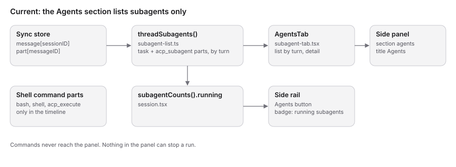
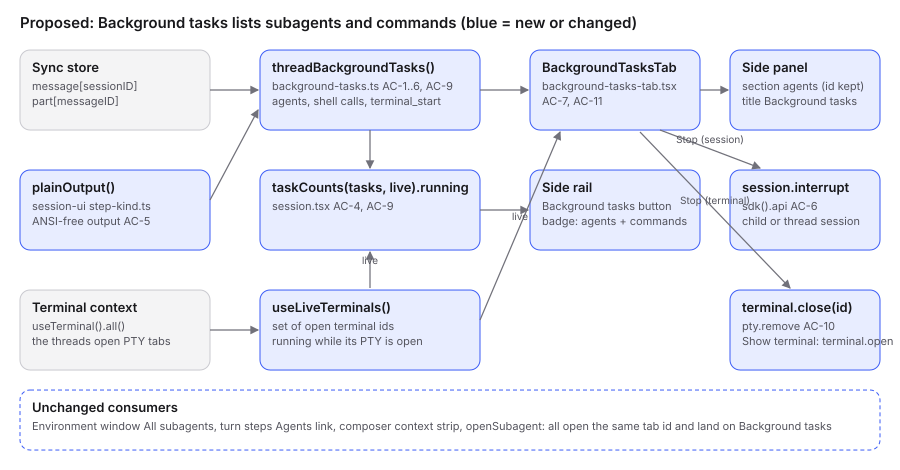
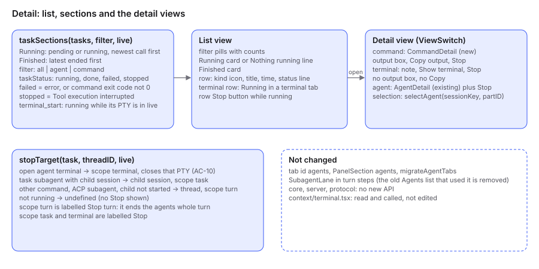

# Background tasks side panel (variant A)

Chosen in the design workshop on 2026-11-27: variant A, "Running and finished".

## Problem and expected behavior

The thread's right panel has an **Agents** section that lists subagent runs
only, grouped by turn. Shell commands the agent runs appear only in the
timeline, and nothing in the panel can stop a run.

**Before:** rail button "Agents", badge = running subagents. The panel lists
subagents by turn with All / Running / Failed filters.

**After:** the same rail button is **Background tasks**, badge = running
subagents plus running commands. The panel is one list:

- filter pills All / Agents / Commands with counts;
- **Running** (newest first), or the line "Nothing running in the background.";
- **Finished** (latest ended first);
- each row: kind icon (agent head or prompt), title (commands in monospace),
  elapsed time and the running dot while running, a status line (current step
  or last output line; "Done · 48s · exit 0"; "Failed · …"; "Stopped · …"),
  and a Stop button while running;
- a row opens a detail view with Back: a command shows its output, Copy output
  and Stop; a subagent shows the existing subagent detail plus Stop.

Example: a thread ran `bun run typecheck` (exit 0) and a subagent, and is now
running `bun run test:engine`. Running shows the test command with its last
output line; Finished shows the other two; the badge reads 1.

## Scope

Files:

- `tenon/packages/app/src/components/session/background-tasks.ts` (new, pure model)
- `tenon/packages/app/src/components/session/background-tasks-tab.tsx` (new, list + command detail)
- `tenon/packages/app/src/components/session/subagent-tab.tsx` (export the detail, drop the old list, Stop, Back label)
- `tenon/packages/app/src/pages/session/session-side-panel.tsx`, `session-side-rail.tsx`, `pages/session.tsx` (wiring, title, badge)
- `tenon/packages/session-ui/src/components/step-kind.ts` (`plainOutput`)
- `tenon/packages/app/src/i18n/en.ts` (new `secondBrain.tasks.*` keys; English only, as the design guide allows)
- `tenon/packages/app/e2e/regression/subagent-child-navigation.spec.ts` (tab name)
- `docs/design.md`, `docs/architecture/README.md`, `docs/architecture/uml.md` (wording where they name the Agents tab)

Kept as they are (invariants):

- The tab id `agents`, `PanelSection` `"agents"`, `AGENTS_TAB`, `selectAgent` /
  `selectedAgent` and `migrateAgentTabs`: stored layouts keep working, and every
  existing entry point (Environment window, turn steps, composer strip,
  `openSubagent`) lands on the new section.
- Existing English strings and keys are not edited; new copy uses new keys.
- No new server, protocol or core API. A "command" is a shell tool call in
  the thread (`bash`, `shell`, `acp_execute`, `command_execution`, i.e.
  step kind `run`) or, since revision 2, an agent terminal started with
  `terminal_start`.
- No colour coding: kinds differ by icon and typeface; only failure uses the
  danger text colour, as subagent lanes already do.

Excluded: starting commands from the panel, a background-shell runtime,
per-command cancel in the engine, translations.

**Stop, honestly:** the server can interrupt a session, not one tool call.
A built-in (`task`) subagent has its own child session, so Stop interrupts just
that. A command, or an ACP subagent, runs inside the thread's turn, so its
button is labelled **Stop turn** and interrupts the thread's session.

No docs sync tool exists in this repository (`tools/docs_sync.py` is absent).

## Revision 2 (after review panel round 1)

The first plan said Tenon has no background shell. That was wrong: agents
start long-running commands with the `terminal_start` app tool
(`tenon/packages/tenon/src/agents/terminal-tools.ts`), which opens a PTY tab
in the thread and returns `{ terminalId, title, folder }` at once. Reviewer R3
pointed this out. These are the closest thing Tenon has to a background
command, so they belong in the list. AC-9 to AC-11 and part P4 were added; no
earlier criterion or test changed. New tests live in separate files
(`terminal-tasks.test.ts`, `terminal-tasks.verify.test.ts`).

Added map rows: the renderer keeps a thread's terminal tabs in
`context/terminal.tsx` (`useTerminal().all()`; agent terminals are adopted
on `pty.created` and from `pty.list`, and leave on `pty.exited` /
`pty.deleted`); `terminal.close(id)` removes the PTY (`sdk.api.pty.remove`);
`view().terminal.open()` plus `terminal.open(id)` shows a tab. Assumption,
not exercised against a live server: the tool part is named `terminal_start`
(or ends with `_terminal_start` when a harness prefixes it) and its completed
output contains the `pty_…` id.

## Feature map

| Part | Responsibility | In → out | Source |
| --- | --- | --- | --- |
| Sync store | messages and parts per session | server events → `message[id]`, `part[id]` | `context/sync` (observed) |
| `threadSubagents` | subagent parts grouped by turn | messages, parts → groups | `components/session/subagent-list.ts` (observed) |
| `stepOf` | classifies a tool part (`run`, `subagent`, …) | part → kind, target | `session-ui/src/components/step-kind.ts` (observed) |
| `AgentsTab` | list + detail in the panel | groups, selection | `components/session/subagent-tab.tsx` (observed) |
| Side panel | hosts the section, title | `section() === "agents"` | `pages/session/session-side-panel.tsx:210,227,394` (observed) |
| Side rail | button and badge | `running` prop | `pages/session/session-side-rail.tsx:160` (observed) |
| `session.tsx` | computes the badge count | `subagentCounts(...).running` | `pages/session.tsx:704` (observed) |
| Interrupt | stops a session's run | `sdk().api.session.interrupt({ sessionID })` | `components/prompt-input/submit.ts:313` (observed) |
| Shell output | `state.output` when done, `state.metadata.output` while running, exit in `metadata.exit` or `structured.exit` | part state → text | `session-ui/.../message-part.tsx:2283`, `utils/session-message.ts:196`, `server-session-v2-reducer.ts:613` (observed) |
| Child interrupt ends only the subagent | | | assumption, not exercised at runtime here |

Consumers that open the tab and must keep working: `thread-environment.tsx`
(All subagents), `turn-steps-summary.tsx:775` (Agents link),
`prompt-input/context-strip.tsx:197`, `pages/directory-layout.tsx:66`
(`openSubagent`), `e2e/regression/subagent-child-navigation.spec.ts`.

## Diagrams







## Acceptance criteria

- **AC-1** `threadBackgroundTasks(messages, parts)` returns every subagent part
  (`kind: "agent"`) and every shell-command part (`kind: "command"`) in call
  order with its turn number, the calling message's harness and model, and
  nothing else. An assistant message whose user message is missing joins the
  latest turn. `findTask` finds one by part id.
- **AC-2** `taskStatus(part)` is `running` (pending or running), `done`,
  `failed` (error, or a command whose numeric exit code is not 0) or `stopped`
  (the error is "Tool execution interrupted"). `commandExit` reads a numeric
  exit from `metadata.exit` or `structured.exit`.
- **AC-3** `taskSections(tasks, filter)` returns `running` newest call first
  and `finished` latest ended first, filtered by `all | agent | command`.
- **AC-4** `taskCounts(tasks)` gives `all`, `agent`, `command`, `running`; the
  rail badge shows `running`.
- **AC-5** `commandOutput(part)` is the live output while running, the final
  output when done (falling back to the streamed output), the error when it
  failed, with ANSI codes removed and `\r\n` as `\n`; empty when there is none.
  `lastOutputLine` returns the last non-blank line.
- **AC-6** `stopTarget(task, threadID)`: a running built-in subagent with a
  child session → `{ sessionID: child, scope: "task" }`; any other running
  task → `{ sessionID: threadID, scope: "turn" }` (undefined without a thread
  id); a task that isn't running → undefined.
- **AC-7** In the app: the rail tab is named "Background tasks" and its badge
  counts running tasks; the panel title is "Background tasks"; Running and
  Finished show the rows; the filters narrow the list and an empty Running
  shows "Nothing running in the background."; a command row opens its output
  with Back; Stop on a running command interrupts the thread's session; a
  finished command has no Stop; a subagent row opens the subagent detail, whose
  Back returns to the list; existing entry points still open the section.
- **AC-8** `docs/design.md` describes the section; other docs that name the
  Agents tab say Background tasks. (Manual review.)

- **AC-9** A `terminal_start` call (tool `terminal_start`, or a name ending
  `_terminal_start`) is a `command` task. `terminalID(part)` is the `pty_…`
  id from the completed call (`metadata.terminalId`, else the first `pty_…`
  in the output); `commandTitle(part)` is its `command` input (for other
  commands, the step target). The status functions take the set of the
  thread's open terminal ids: with its terminal open the task is `running`
  (and counted); once the terminal is gone, or no set is given, it is `done`.
  A failed call is `failed`. `taskElapsed(part, now, live)` counts from the
  call's start while the terminal is open and is undefined once it has closed
  (the end time is not known); for every other task it is the call's
  duration.
- **AC-10** `stopTarget` for a task whose terminal is open is
  `{ terminalID, scope: "terminal" }`: Stop closes that one terminal.
- **AC-11** In the app: an open agent terminal shows under Running with its
  command, counts on the badge, and its row Stop removes that terminal (no
  session interrupt); its detail says the output is in the terminal and offers
  Show terminal and Stop.

| Criterion | Acceptance | Verification |
| --- | --- | --- |
| AC-1 … AC-6 | `acceptance/app/background-tasks.test.ts` | `verification/app/background-tasks.verify.test.ts` |
| AC-7 | `tenon/packages/app/e2e/regression/background-tasks.spec.ts`, `subagent-child-navigation.spec.ts` | screenshots of the running app (manual) |
| AC-8 | manual | manual |
| AC-9, AC-10 | `acceptance/app/terminal-tasks.test.ts` | `verification/app/terminal-tasks.verify.test.ts` |
| AC-11 | `tenon/packages/app/e2e/regression/background-tasks-terminal.spec.ts` | screenshot (manual) |

## Parts

- **P1 Model** — outcome: the pure task list API exists. Covers AC-1…AC-6.
  Files: `background-tasks.ts`, `step-kind.ts`. No dependencies.
- **P2 Panel, rail and detail** — outcome: the section works in the app.
  Covers AC-4 (badge), AC-7. Files: `background-tasks-tab.tsx`,
  `subagent-tab.tsx`, `session-side-panel.tsx`, `session-side-rail.tsx`,
  `session.tsx`, `en.ts`, the two e2e specs. Depends on P1.
- **P3 Docs** — outcome: the design guide and architecture text match. Covers
  AC-8. Depends on P2.

- **P4 Agent terminals** (revision 2) — outcome: `terminal_start` commands
  are tasks with a per-terminal Stop. Covers AC-9…AC-11. Files:
  `background-tasks.ts`, `background-tasks-tab.tsx`, `session.tsx`,
  `en.ts`, the new e2e spec, docs. Depends on P2.

## Verification

Unit sets, from `tenon/packages/app`:

```sh
bun test --conditions=solid --preload ./happydom.ts ../../../implementations/background-tasks-panel/acceptance/app
bun test --conditions=solid --preload ./happydom.ts ../../../implementations/background-tasks-panel/verification/app
```

E2E (mocked server, dev build), from `tenon/packages/app`:

```sh
bunx playwright test e2e/regression/background-tasks.spec.ts e2e/regression/background-tasks-terminal.spec.ts e2e/regression/subagent-child-navigation.spec.ts
```

Repository checks, from the root: `bun run typecheck`, `bun run lint`,
`bun run format:check`, `bun run check:generated`, `bun run test`,
`bun run build`.

## Completion evidence

One agent wrote the plan, both test sets and the code; the verification set is
a separately designed set of cases, not an independently authored or hidden one.

Base SHA `9538b1f6`. Work is uncommitted on `claude/background-tasks-sidebar-cafd03`.

**Baseline (before product edits):** both unit sets failed with
`Cannot find module …/background-tasks` (the module is the feature). The e2e
spec was not run on the baseline; it needs the "Background tasks" tab, which
did not exist.

**After:**

| Check | Result |
| --- | --- |
| Acceptance + verification unit sets, four files (commands above) | 45 pass, 0 fail |
| `bunx playwright test e2e/regression/background-tasks.spec.ts e2e/regression/background-tasks-terminal.spec.ts e2e/regression/subagent-child-navigation.spec.ts` | 8 pass (6 new, 2 existing) |
| `bun run check` (typecheck, lint, format:check, check:generated, test, build) | exit 0 |
| Screenshots of the list, command detail and subagent detail, light and dark (mocked server) | reviewed |

Criteria: AC-1…AC-6 and AC-9, AC-10 met by the unit sets; AC-7 and AC-11 met
by the e2e specs (AC-7 also by screenshots); AC-8 met by the edits to
`docs/design.md`, `docs/architecture/README.md`, `docs/architecture/uml.md`
and `docs/product/NAVIGATION-MAP-V1.md`.

**Review panel round 1** (Opus 5.5, medium, read-only on the working tree):
R1 9/10, R2 10/10, R3 7/10. Fixed: the navigation map still said Agents (R1);
the architecture README still described the old Agents list, and two diagram
labels were wrong (R3). Taken from the notes: `terminal_start` terminals
(revision 2), the unused `findSubagent`, and streamed output no longer
trimmed.

**Review panel round 2:** R1 10/10, R2 10/10, R3 9/10 (the proposed and detail
diagrams did not show the terminal Stop path). Both diagrams were redrawn.
**Round 3** (R3 only, since only the two SVGs changed): 10/10. The panel ran
on the uncommitted working tree, so there is no SHA; R1 and R2 did not rescore
after the diagram-only change.

**Revision 2 baseline:** the two new unit files failed on missing exports
(`terminalID`, `commandTitle`, `taskElapsed`) before the model changed.

**Test change after the revision-2 freeze (one):** the terminal e2e spec's
mock routes also answer the legacy paths (`/pty`, `/pty/<id>`, plain
bodies), because the mocked server speaks the v1 protocol by default and the
app lists terminals through it. Fixture only; no assertion changed.

**Test change after the freeze (one):** in `background-tasks.spec.ts`, the
locator that opens the running command changed from
`getByRole("button", { name: /bun run test:engine/ })` to
`locator('[data-action="task-open"]').filter({ hasText: … })`. Reason, tied to
AC-7: a running row has two buttons by contract (open, and Stop, whose
accessible name includes the command), so the role locator was ambiguous. No
assertion changed. Prettier also rewrapped one line of the fixture.

**Deviations from the plan and the workshop:**

- String keys are `secondBrain.backgroundTasks.*`; `secondBrain.tasks.*`
  already belongs to calendar tasks.
- The subagent row uses the timeline's subagent step icon, not the Harnesses
  agent head, because the design guide gives each glyph one meaning.
- The command detail has no shell name in its footer: the part does not say
  which shell ran it.
- The unused `matchesFilter` / `SubagentFilter` helpers and the old Agents
  list were removed.

**Not verified:**

- The exact shape of a real `terminal_start` tool part (its name as external
  harnesses expose it, and that its output carries the `pty_…` id). The code
  accepts the bare and a suffixed name and reads the id from metadata or the
  output; the e2e fixture assumes the built-in shape.
- A terminal the agent started that has already exited shows as Done with no
  duration: the app does not record when it ended.
- Stop against a live server. The e2e test proves the interrupt request names
  the thread's session; that interrupting a child session ends only that
  subagent is an assumption from the session API.
- The app's performance benchmark (`test:bench`) was not run. `session.tsx`
  swaps one per-thread memo for another of the same shape.
- A real thread with long output or many tasks; the checks use a mocked server.
- Existing `secondBrain.agents.*` keys the old list used are left in place,
  unused, in every locale.
