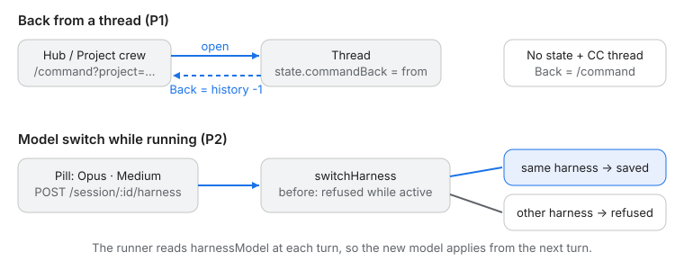

# Command Centre bug fixes (Nov 21)

Five bugs reported against the Command Centre on 2026-11-21. Features from the
same report (sounds, per-Project orchestrators, compaction settings, artifacts
canvas, inline media) are out of scope here and get their own workshops.

One agent wrote the plan, the tests and the code (TOR-1).

## Evidence and causes

Paths are under `tenon/packages/`.

1. **No back button in threads opened from the Command Centre.** The hub, a
   Project's crew and the Mission panel all `navigate(sessionHref(...))`. The
   thread header (`app/src/pages/session/timeline/message-timeline.tsx`) has no
   back control, so the user goes Hub → Project again. Notes already solves this
   with `navigate(..., { state: { fromNotes: true } })` and `navigate(-1)`
   (`pages/projects.tsx:227`).
2. **The plan's in-progress item doesn't animate.** `StepMark` in
   `features/command-centre/hub-view.tsx` uses `animate-spin`, but the Tailwind
   theme starts with `--*: initial` (`ui/src/styles/tailwind/index.css:10`) and
   defines only `--animate-pulse`. The class does nothing. The thread's own todo
   dock uses `LoaderV2`, which spins.
3. **The model stayed on Haiku after switching back to Opus.** The user's Command
   Centre thread `ses_e083218c…` (Claude Code harness) logged
   `harness.switched` to haiku at 04:41:25, deepseek at 04:41:36 and haiku at
   04:41:41, all while the thread was idle. From 04:42 delegate check-ins kept it
   busy. No switch to Opus was ever recorded. `V2Session.switchHarness`
   (`core/src/session.ts`) refuses any switch while the session executes, and a
   Command Centre lead is busy most of the time. The failed compaction was a
   separate problem: `V2Session.compact` always returns `OperationUnavailable`
   for harness threads. That is left to the compaction workshop.
4. **A Project's crew lists done and active agents together.** `ProjectView`
   renders one "Agents" grid from `projectCrew().agents`.
5. **Delegated threads behave like lead agents.** `framedTask`
   (`core/src/harness/delegation-tasks.ts`) only says who delegated and asks for
   a final report. The delegate also gets the global and Project `AGENTS.md`
   (and Claude Code's own `CLAUDE.md`), whose lead-agent workflow steps make it
   read docs broadly.

## Found while verifying (2026-11-21)

Live run against a snapshot of the dev database: a fresh Command Centre thread
on Claude Code switched to Opus over the API mid-turn kept showing "Haiku 5.5"
in its pill. The app caches each thread's harness and model and only updated
that cache after its own picks; it ignored the server's
`session.next.harness.switched` event. So the pill and the model that actually
runs can disagree, which matches the reported "pill says Opus, replies come
from Haiku". Fix (P6): `applyV2` applies the event to the cached session.

## Parts

| ID | Outcome | Criteria | Files | Depends |
| --- | --- | --- | --- | --- |
| P1 | A thread opened from the Command Centre has a Back button that returns to the exact screen it came from; a Command Centre thread opened any other way goes back to the hub | AC-1 | `app/src/features/command-centre/thread-back.ts` (new), `pages/command-centre.tsx`, `features/command-centre/command-thread-chrome.tsx`, `pages/session.tsx`, `pages/session/timeline/message-timeline.tsx` | — |
| P2 | A model or effort change on the same harness is accepted while the thread runs and applies from the next turn; changing harness while running is still refused | AC-2 | `core/src/session.ts` | — |
| P3 | The in-progress plan item spins, and no app code relies on the missing `animate-spin` | AC-3 | `features/command-centre/hub-view.tsx` | — |
| P4 | A Project's crew shows "Working" (needs you, then running) above "Finished" | AC-4 | `features/command-centre/hub-model.ts`, `hub-view.tsx`, `i18n/en.ts` | — |
| P6 | The model pill follows harness and model switches made anywhere | AC-6 | `app/src/context/server-session.ts` | P2 |
| P5 | A delegated thread's brief tells it it is a scoped delegate: use the brief, read only what the task needs, skip lead-only workflow steps, still follow code, safety and check rules | AC-5 | `core/src/harness/delegation-tasks.ts` | — |

## Acceptance criteria

- **AC-1** `threadBack({ state, commandThread })`: with `state.commandBack` set it
  returns `{ type: "history" }`; without it, a Command Centre thread returns
  `{ type: "href", href: "/command" }`; any other thread returns `undefined`.
  `commandBackState(href)` returns `{ commandBack: href }`.
- **AC-2** With the session in `execution.active`, `switchHarness` to the same
  instance with a different model succeeds and the stored `harnessModel` is the
  new one; switching to a different instance fails with
  `OperationUnavailableError("switchHarness")`.
- **AC-3** No `.tsx` under `app/src` uses `animate-spin`.
- **AC-4** `crewGroups(agents)` returns `{ working, finished }`: `working` holds
  `needs` agents before `running` ones, otherwise keeping input order;
  `finished` holds `done` agents in input order.
- **AC-5** `framedTask(from, task)` keeps the delegator line and the task text
  verbatim, says the agent is a delegate, tells it to read only what the task
  needs, and says repository instructions on code style, safety and checks still
  apply.

- **AC-6** After `session.next.harness.switched`, the cached session has the
  event's harness and model; `harnessRevision` rises only when the harness
  changes. (`server-session.test.ts`, added after the freeze for a defect found
  in verification.)

## Diagram

## Tests

- `acceptance/` is what the implementation is checked against.
- `verification/` holds extra edge cases checked after implementation.
- Frozen at base `2e2fddab`; copy in the session scratchpad.
- Tests outside a package can't resolve its bare imports, so the runnable
  copies live in the packages: `core/test/command-centre-bugs*.test.ts` and
  `app/src/features/command-centre/command-centre-bugs*.test.ts`. The files here
  are the frozen reference.
- End to end (`app/e2e/acceptance/command-centre.spec.ts`): "AC-1 Back in a
  thread opened from the Command Centre returns to that screen" and "AC-4 a
  Project's crew lists working agents above finished ones, and AC-3 the current
  step spins" (checks the computed `loader-v2-spin` animation).

## Completion evidence

- Acceptance and verification: app 9 pass, core 4 pass. Before the change, both
  failed to load (`thread-back`, `crewGroups`, `framedTask` export missing).
- E2E: both new tests pass. Existing "AC-1.6" and "AC-3 a Command Centre thread
  opens…" fail on the base too: `startBoard` waits for a Mission board on
  `/command`, which moved into the thread's side panel before this change.
- `bun run typecheck`, `bun run lint`, `bun run test`, `bun run test:routes`:
  pass. `bun run format:check`: pass after Prettier on two new files.
- `bun run build`: pass.
- `bun run test:engine`: 1458 pass, 11 fail. Nine fail the same way with the
  base versions of `session.ts` and `delegation-tasks.ts`: git operations
  hitting a 5 s timeout on this OneDrive checkout, a symlink test, and
  `harness-setup` checking POSIX mode `0o600`, which can't pass on Windows. The
  other two (`move-session.test.ts`) pass when run alone, both on base and
  with this change: they time out only under full-suite load.
- Test changes after the freeze: Prettier reflowed `core.test.ts` (whitespace
  only, `diff -w` shows no assertion change). No assertion was edited.
- Review change after the freeze: "delegating further" was dropped from the
  delegate's skip list. It contradicted "a delegated agent may delegate once"
  and the planned per-Project orchestrators. AC-5 is unaffected.
- Verified that `SessionRunner.runTurnAttempt` re-reads the session at each
  turn, so a model saved mid-run applies from the next turn.
- Live verification (dev servers on this branch, `TENON_DB` snapshot of
  `tenon-dev.db`):
  - Back: hub → Alpha X crew → agent thread → Back landed on
    `/command?project=…` with the crew shown; a Command Centre thread's Back
    went to `/command`.
  - Crew: Alpha X showed "Working · 0" and "Finished · 21" on real threads.
  - Model switch: during a running Claude Code turn, a same-harness switch to
    Opus returned 204 and was stored; a switch to Codex returned 503 "Wait for
    the current turn to finish". That turn finished on Haiku, and the next
    turn answered "Opus 5.5".
  - Pill (P6): after the fix, a server-side switch changed the pill from
    "Opus 5.5 / medium" to "Sonnet 5.5 / high" without a reload.
  - Delegate brief: not verified live. The test delegation stopped at a
    permission prompt that the agent may not approve on the user's behalf.
- Not covered: harness-thread compaction (`V2Session.compact` is still
  unavailable for harness threads). It moves to the compaction workshop.
