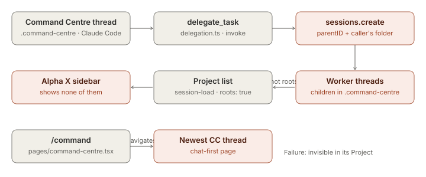
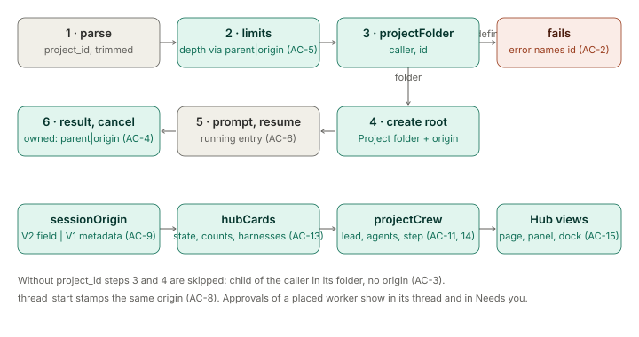

# Command Centre hub

The Command Centre becomes a hub: it opens on your running Projects and the agents in them, and
chat moves to a composer at the bottom. Its prerequisite is that work the Command Centre hands to
agents for a Project runs in that Project, where you can see it, linked back to the Command
Centre thread that started it.

The user chose the layouts on 2026-11-20 from the workshop (Hub A: Project cards, Project A:
crew). One agent writes the plan, both test sets and the code (TOR-1-Agent); a panel of three
Sonnet 5.5 reviewers checks the result at the end, at the user's request.

## Problem and expected behaviour

**Before.** In the Alpha X run, the Command Centre thread (Claude Code, in
`<vault>/.command-centre`) called `delegate_task` four times. Each worker was created as a child
of the Command Centre thread, in the Command Centre's folder
(`core/src/harness/delegation-tasks.ts`, `sessions.create({ parentID, location: session.location })`).
Project lists load only root threads (`app/src/context/global-sync/session-load.ts`,
`roots: true`), so Alpha X showed none of them, and the workers edited the Alpha X repository
through absolute paths from the Command Centre folder. `/command` itself opens the newest Command
Centre thread (`app/src/pages/command-centre.tsx`): the page is chat-first.

**After.** The Command Centre calls `delegate_task` with `project_id: "<Alpha X id>"`. The worker
is created as a root thread in Alpha X's thread folder, with `metadata.origin = { sessionID:
<the Command Centre thread>, commandCentre: true }`. It lists under Alpha X with a Command Centre
mark, and the Command Centre can still read, wait for and stop it. `/command` opens the hub: a
status band, Needs you, and a card per Project; a card opens the Project's crew.

## Scope

Files, by part:

- P1 delegation placement: `core/src/harness/delegation.ts` (input, schema, parsing),
  `core/src/harness/delegation-tasks.ts`, `core/src/harness/app-tools.ts` (provider hook),
  `core/src/tool/delegate.ts` (in-process tool input), `core/src/session.ts` (create input),
  `core/src/session/info.ts`, `packages/schema/src/session.ts`, `tenon/src/agents/app-tools.ts`
  (resolves the Project; `thread_start` stamps origin), generated client in `packages/client`.
- P2 origin in the renderer and the sidebar mark: `app/src/utils/session.ts`,
  `app/src/features/command-centre/hub-model.ts`, `app/src/components/second-brain-sidebar.tsx`.
- P3 hub: `app/src/features/command-centre/hub-model.ts`, `hub-view.tsx`,
  `app/src/pages/command-centre.tsx`, i18n `en.ts`.
- P4 Project crew and agent panel: `hub-model.ts`, `hub-view.tsx`.
- P5 composer dock and sheet: `hub-view.tsx` (uses `useCommandCentre().send`).
- P6 docs: `docs/design.md`, `docs/architecture/README.md`, `docs/security/threat-model.md`,
  `core/src/plugin/skill/customize-tenon.md` is not affected.

Exclusions: no server-side list change (`roots` stays); the Mission board, Waiting on you and
Workflows views stay; Routines unchanged; no new dependencies; existing Command Centre threads
keep their folder (no migration).

Invariants: a task without `project_id` behaves exactly as today; only the delegating thread may
read or cancel its task; `MAX_DEPTH` and `MAX_RUNNING` still bound delegation, counting
Project-placed tasks; workspace content stays data; no colour coding (design guide).

## Feature map

| Component | Responsibility | In / out | Source |
| --- | --- | --- | --- |
| `delegate_task` tool | parses `agent, task, model, reasoning_effort, title, wait_seconds` | MCP / in-process call → `Handler.delegate` | `core/src/harness/delegation.ts` (`TOOLS`, `invoke`), `core/src/tool/delegate.ts` |
| Delegation tasks | depth and running limits, creates the child, ownership checks | `SessionV2.create/prompt/resume` | `core/src/harness/delegation-tasks.ts` (`depth`, `owned`, `delegate`) |
| App-tools bridge | tenon package installs a provider; core lists and routes | `HarnessAppTools.install` | `core/src/harness/app-tools.ts` |
| Project folders | Project card → thread directory | `BrainProject.threadDirectory` | `tenon/src/agents/app-tools.ts` (`threadFolders`, `threadStart`) |
| Session create | writes `metadata` (harness, model) | `SessionV1.Event.Created` | `core/src/session.ts` (`create`) |
| Session info | V2 `Info` from the row | read by API and renderer | `core/src/session/info.ts`, `packages/schema/src/session.ts` |
| Renderer sessions | keeps harness fields, drops other metadata | sidebar, board | `app/src/utils/session.ts` (`normalizeSessionInfo`) |
| Sidebar | Project groups of root threads | `groupSidebarThreads`, `ThreadRow` | `app/src/features/second-brain/sidebar-threads.ts`, `components/second-brain-sidebar.tsx` |
| Command Centre page | navigates to the newest CC thread | `useCommandCentre`, `createMissionThreads` | `app/src/pages/command-centre.tsx` |
| Board data | root threads by Project, waiting counts | `ctrl.groups()`, `needsYou` | `app/src/features/command-centre/mission-board-view.tsx` |
| Waiting queue | approvals and questions, answered in place | `createWaitingQueue` | `app/src/features/command-centre/agent-hands-view.tsx` |
| Projects | outcome, progress, next milestone, thread folder | `useBrainProjects` | `app/src/components/sidebar/sidebar-controller.ts` |
| Todos | a thread's checklist | `serverSync().session.todo(id)` → `data.todo[id]` | `app/src/context/server-session.ts` |

Observed: the four Alpha X workers in the dev database have `directory = <vault>/.command-centre`
and `parent_id` = the Command Centre thread (2026-11-20, read-only query). Hypothesis confirmed by
source: placement comes only from `location: session.location`; nothing else moves a task.

Affected consumers of the parent link, and what changes for a Project-placed task (no parent):
ownership (`owned`) and depth (`depth`) follow `metadata.origin` too; its approvals show in its own
thread and in Needs you, not in the Command Centre thread's composer; the sidebar lists it in the
Project instead of nesting it.

## Diagrams






## Public contract (both test sets rely on it)

- `HarnessDelegation.DelegateInput.projectId?: string`, parsed from the tool argument `project_id`
  (trimmed; empty means none). The in-process `delegate_task` takes `project_id` too.
- `HarnessAppTools.Provider.projectFolder?: (caller, projectId) => Promise<{ directory: string;
  name: string } | undefined>` and `HarnessAppTools.projectFolder(caller, projectId)`, which
  resolves `undefined` when no provider or hook is installed or the hook throws.
- `SessionV2` create input `origin?: { sessionID: string; commandCentre: boolean }`, stored as
  `metadata.origin`; `Session.Info.origin` is the same object when the metadata holds a valid one.
- `hub-model.ts` (app) exports `sessionOrigin`, `todoStep`, `modelLabel`, `hubCards`,
  `projectCrew`, with the shapes in the test files.

## Acceptance criteria

P1, delegation placement:

- **AC-1** `delegate_task` with `project_id` whose Project resolves creates the worker with no
  `parentID`, `location.directory` = the Project's folder, the requested harness and model, and
  `origin = { sessionID: <caller>, commandCentre }`, where `commandCentre` is true exactly when the
  caller's folder is named `.command-centre` (either separator).
- **AC-2** When the Project doesn't resolve (unknown id, no provider, hook fails) the call fails
  with an error naming the id, and nothing is created.
- **AC-3** Without `project_id` nothing changes: a child of the caller in the caller's folder,
  without `origin`.
- **AC-4** The delegating thread reads and cancels a Project-placed task with `task_result` and
  `cancel_task`; any other thread gets "No delegated task … belongs to this thread."
- **AC-5** Depth counts `origin` links like parent links: a Project-placed worker may delegate
  once more; a task two levels down may not.
- **AC-6** Project-placed tasks count toward the delegating thread's `MAX_RUNNING`.
- **AC-7** `SessionInfo.fromRow` returns `origin` from valid metadata and omits it otherwise.
- **AC-8** `thread_start` stamps `origin` with the calling thread (commandCentre per AC-1's rule).
  Manual: read the diff; no harness for the tenon app tools' session creation.

P2, origin in the renderer:

- **AC-9** `sessionOrigin(session)` returns the origin from a V2 `origin` field or a V1
  `metadata.origin`, and `undefined` for missing or malformed values.
- **AC-10** A sidebar thread row whose origin has `commandCentre: true` shows the Command Centre
  mark with the label "Started by Command Centre"; other rows show none. Manual (screenshot).

P3 and P4, hub and crew:

- **AC-11** `todoStep(todos)`: none → `undefined`; otherwise `{ n, of, text }` with `of` the count,
  `n` the 1-based in-progress item, else the number completed, and `text` that item's content
  (the last completed one when none is in progress, the first item when none has started).
- **AC-12** `modelLabel(model, instance)`: the harness instance's model name when it lists the id,
  else the id after its last `/`; with a reasoning effort, `"<name> · <Effort>"` (capitalised).
  No model → `undefined`.
- **AC-13** `hubCards(input)` returns one card per non-archived Project, in the given order, with
  name, outcome, milestone (next milestone), progress, `state` (`needs` when any thread waits,
  else `running` when any runs, else `paused` for a paused Project, else `idle`), `working` and
  `needs` counts, the harnesses in the Project (Command Centre's first when a thread was started
  by it, then distinct harnesses of its active threads), and `now` (the most recently updated
  running thread's title and harness, else the newest thread's).
- **AC-14** `projectCrew(input)` returns `lead` (the Command Centre thread named by the newest
  `origin.commandCentre` among the Project's threads, when the caller knows it) and `agents`: the
  Project's root threads that need you, run, or changed within 24 hours, newest first, each with
  title, harness, model label, state (`needs` / `running` / `done`), its `todoStep`, and
  `commandCentre` (started by it).
- **AC-15** `/command` opens the hub instead of the newest thread; `?project=<id>` opens that
  Project's crew; Back returns to the hub; an agent opens a panel with its steps, Open thread and
  Stop; the composer sends to the newest Command Centre thread and shows the exchange in a sheet.
  Manual (dev app screenshots); the Mission board, Waiting on you and Workflows views still work.

P6:

- **AC-16** `docs/design.md`, `docs/architecture/README.md` and `docs/security/threat-model.md`
  describe the hub, the Project-placed delegation and where its approvals show. Manual review.

## Implementation sequence

| Part | Outcome | Criteria | Depends on |
| --- | --- | --- | --- |
| P1 | `project_id` places the worker in the Project with an origin link | AC-1 to AC-8 | — |
| P2 | the renderer reads origin; the sidebar marks Command Centre threads | AC-9, AC-10 | P1 |
| P3 | `/command` is the hub | AC-11 to AC-13, AC-15 | P2 |
| P4 | a Project opens its crew and agent panel | AC-14, AC-15 | P3 |
| P5 | the composer dock and sheet | AC-15 | P3 |
| P6 | docs | AC-16 | P1 to P5 |

## Verification

Both sets were written before any product edit and frozen in the scratchpad
(`scratchpad/frozen/command-centre-hub/`). Commands:

```sh
# core sets, from tenon/packages/core
bun test ../../../implementations/command-centre-hub/acceptance/core
bun test ../../../implementations/command-centre-hub/verification/core
# app sets, from tenon/packages/app
bun test --conditions=solid --preload ./happydom.ts ../../../implementations/command-centre-hub/acceptance/app
bun test --conditions=solid --preload ./happydom.ts ../../../implementations/command-centre-hub/verification/app
# repository checks, from the root
bun run check
bun run test:engine
```

| Criteria | Acceptance | Verification | Other evidence |
| --- | --- | --- | --- |
| AC-1 to AC-6 | `core/delegation-placement.test.ts` | `core/delegation-placement.test.ts` | |
| AC-7 | `core/session-origin.test.ts` | `core/session-origin.test.ts` | |
| AC-8 | | | diff read |
| AC-9, AC-11 to AC-14 | `app/hub-model.test.ts` | `app/hub-model.test.ts` | |
| AC-10, AC-15 | | | dev-app screenshots |
| AC-16 | | | doc review |

Baseline, before any product edit (base `0ea0ff0b` plus the uncommitted MCP permission change,
saved as `scratchpad/base-uncommitted-mcp.diff`):

- core sets: 7 pass, 10 fail. The failures are the intended assertions (no `origin` on the created
  input or the info, unknown `project_id` accepted, `commandCentre` absent, depth ignores origin).
  The passes are behaviour that is already right: AC-3, the blank `project_id` case, AC-4 (the
  baseline ignores `project_id`, so the task is an ordinary child), AC-6 and AC-7's no-origin cases.
- app sets: both files fail to load, `hub-model` doesn't exist yet.

Before freezing, the test harness was corrected once: the fake `resume` never ended, so
`cancel_task` waited out its 10 s settle and timed out the test. It now ends on interrupt.

## Completion evidence

One agent wrote the plan, both test sets and the code (TOR-1-Agent), so the sets are separately designed
checks of the contract, not independent authorship. A panel of three Sonnet 5.5 reviewers (medium effort,
read-only) then reviewed the result: core and security, the renderer against the design guide, and the
tests and docs.

**Tests after the freeze:** unchanged. All six test files are byte-identical to the frozen copy
(`cmp`, and reviewer 3's `sha256sum -c`). The plan and READMEs changed only in the folder's case
(`Implementations/` to `implementations/`, as git tracks it).

**Commands run on the final tree:**

- core sets, from `tenon/packages/core`: 17 pass, 0 fail; with `test/harness-delegation-tasks.test.ts`,
  `test/harness-delegation.test.ts` and `test/session-create.test.ts` (new origin round-trip): 55 pass.
- app sets, from `tenon/packages/app`, with `src/features/command-centre`, `src/context`, `src/i18n` and
  the new `hub-model.test.ts`: 432 pass, 0 fail.
- `bun run typecheck`, `bun run lint` (warnings only, none new on changed lines), `bun run format:check`:
  pass. `bun run check:generated` regenerates the client and then fails only because the regenerated
  `types.ts` (the new `origin` field) isn't committed yet; it compares against git's index.
- `bun run test`: 12 tasks, 75 pass, 0 fail. `bun run build`: pass.
- `bun run test:engine`: core 1449 pass, 3 fail (Git trees diff, the harness setup file's private mode, a
  symlinked AGENTS.md); all three also failed on the baseline run of this machine before this change
  (Windows file modes, symlinks and slow Git). `tenon` package: 2957 pass, 0 fail.

**In the dev app** (worktree backend with scratch XDG data, a test workspace with an Alpha X Project,
sessions created through the API with titles, `origin` and checklists set in the scratch database):
the hub showed the band, the Alpha X card with the Command Centre's and OpenCode's logos; the Project
view showed the lead with its plan and three agent cards (model names, harness, titles, the Command
Centre mark on the two it started); the agent panel opened with the plan and closed on Esc; the sidebar
listed the two marked threads in Alpha X; the composer opened the sheet; Back returned to the hub. Cards,
the Project view and the open panel kept their elements across live updates (no remounts in 6–8 s).

**Defects found in verification and fixed** (each re-tested):

- AC-13/AC-14: the sidebar's thread objects lost the harness and origin, because the home session index
  rebuilt them without `metadata` (`home-session-index.ts` `toLegacySummary`); every agent read as the
  Default agent. Fixed there (`legacyMetadata`) and read through `sessionHarness`.
- AC-15: cards and the Project view remounted on every update (keyed lists and a keyed `Show` on objects);
  now listed by id and keyed on the Project id.
- Reviewer 1: routines' prompt refusal didn't follow `origin` (a placed worker could wait forever);
  `thread_start`'s origin counted toward depth and ownership; the `delegate` approval didn't name the
  Project; `depth` had no cycle guard. Fixed: `refusePrompts` follows delegated origins; `thread_start`
  stamps `handOff: true`, which `starter` ignores; the approval lists `project:<id>`; a visited set.
- Reviewer 2: Esc didn't close the agent panel; counts weren't plural-aware; transitions ignored reduced
  motion; the agents' stagger was 45ms; a thread the index marks as waiting could be counted as needs with
  a zero count. All fixed.
- Reviewer 3: the `origin` write path was untested; added the create-and-read test in
  `core/test/session-create.test.ts`. Doc nits fixed (paragraph break, diagram label).

**Deviations from the plan:** `Origin` gained an optional `handOff` (contract change for AC-8, from
review); the Project view fades through (`ViewSwitch`) rather than growing out of the card as in the
workshop; the hub band has no "Full auto" or "Pause all" (no such server actions exist yet) and no
"next routine" line.

**Not verified:** a live delegation with `project_id` end to end (needs a running external harness and a
Command Centre thread calling the tool); running and needs-you states in the hub (the seeded threads were
idle); the composer actually sending (no harness answered). These paths are covered only by unit tests
and code reading.
