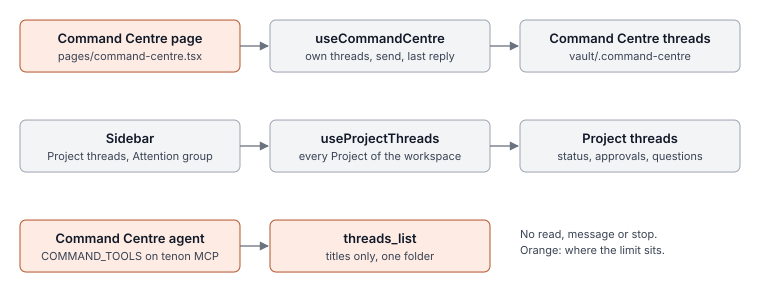
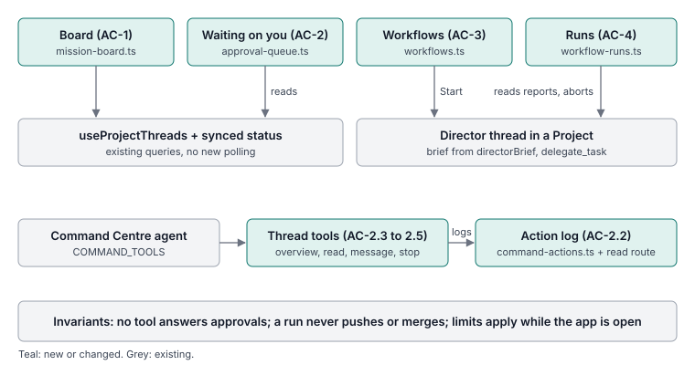
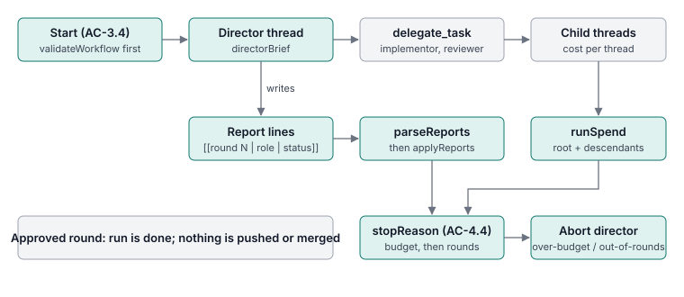

# Command Centre as orchestrator

- Status: planned (13 Nov 2026)
- Design: the approved canvas "Command Centre orchestrator" (four artboards: Mission control, Agent hands, Workflow, Loop)
- Delivery: four tasks, each built by an implementor and checked by a verifier, merged in order

## Problem and expected behaviour

Today the Command Centre is a personal agent with its own threads. Its page lists only those threads, and its
agent can list a Project's threads by title but cannot read, message or stop them.

Before: to see what every agent is doing you open each Project in the sidebar; to answer an approval you open
that thread; to run "director, implementor, reviewer" you prompt it by hand each time.

After: the Command Centre page shows every Project's threads by state, answers approvals from one queue, lets
its agent read, message and stop Project threads (with a log of what it did), and starts saved workflows with
a model per role that repeat until a reviewer approves, inside limits on rounds and spend.

## Feature map (observed in source, 13 Nov 2026)

| Piece | Responsibility | Source |
| --- | --- | --- |
| Command Centre page | Own threads, memory search, composer that starts a thread | `tenon/packages/app/src/pages/command-centre.tsx` |
| Command Centre provider | Thread list, latest reply, `send`, shared by page, card and widget | `app/src/features/command-centre/command-centre.tsx` (`useCommandCentre`) |
| Project threads query | Every Project of the workspace with its threads; shared by sidebar, Home, Projects | `app/src/components/sidebar/sidebar-controller.ts` (`useProjectThreads`, `useBrainProjects`) |
| Run state | `agentRunStatus` (approval, running, retrying) and `needsYou` (pending approvals + questions) from synced data | `app/src/pages/activity-runs.ts` |
| Approvals and questions | Replies: `api.permission.reply`, `api.question.reply`; per-folder modes Ask / Auto-edit / Full auto | `app/src/pages/session/composer/session-composer-state.ts`, `session-question-dock.tsx`, `app/src/context/permission.tsx` |
| Sending and stopping | `api.session.prompt`, abort through `app/src/utils/server-compat.ts` | same files |
| App tools | Tools on the `tenon` MCP server; a Command Centre thread gets `COMMAND_TOOLS` on top of `TOOLS`; writes are undoable | `tenon/packages/tenon/src/agents/app-tools.ts`, `core/src/harness/app-tools.ts` |
| Delegation | `list_agents`, `delegate_task`, `task_result`, `cancel_task`: a child thread in another harness and model; depth 2, 4 at once | `core/src/harness/delegation.ts`, `delegation-tasks.ts` |
| Command Centre folder | `<vault>/.command-centre`; memory and thread summaries | `tenon/src/agents/command-memory.ts`, `command-threads.ts` |

Unresolved, for the implementor to settle from source: where the Command Centre's server-side JSON state is
kept (follow `CommandMemory`), and the exact abort call the thread composer uses.







## Invariants (all tasks)

- The Command Centre agent never answers a permission request or question on the user's behalf. No tool does.
- A workflow or loop never pushes or merges. It ends with work left for the user to review.
- Command Centre threads still never appear among Project threads, and the card and widget keep working.
- No new polling: boards and queues read the queries and synced data that already exist.
- Every visible string goes through `language.t`; reuse existing keys where one fits. New keys are added to
  every locale file so `src/i18n/parity.test.ts` passes.
- Read `docs/design.md` before UI work. No colour coding beyond the existing warning and accent containers.
- Windows and macOS both work; paths are compared with the existing `sameDirectory` helpers.
- Update `docs/product/NAVIGATION-MAP-V1.md` and `docs/architecture/README.md` for what each task changes.

## Tasks and acceptance criteria

Each task also requires: `bun run check` passes from the repository root; the task's acceptance tests pass;
the implementor adds at least one Playwright test in `tenon/packages/app/e2e/acceptance/command-centre.spec.ts`
for the task's main visible flow (the spec's mock server and `start()` helper already exist).

### Task 1 · Mission control (app only)

New pure module `tenon/packages/app/src/features/command-centre/mission-board.ts` exporting:

```ts
type BoardThread = {
  id: string; title: string
  project: string          // display name
  projectID?: string       // undefined: the workspace's General group
  updated: number          // ms
  status?: "approval" | "running" | "retrying"   // AgentRunStatus
  waiting: number          // pending approvals + questions
  subagents: number
  model?: string
}
const FINISHED_WINDOW_MS = 24 * 60 * 60 * 1000
const STEER_LIMIT = 4000
boardByState(threads, now): { needsYou: BoardThread[]; running: BoardThread[]; finished: BoardThread[] }
boardByProject(threads, now): { project: string; projectID?: string; threads: BoardThread[] }[]
steerText(text): string | undefined
```

- **AC-1.1** `boardByState`: `waiting > 0` goes to `needsYou` only, whatever its status. Otherwise status
  `running` or `retrying` goes to `running`. Otherwise (idle) it goes to `finished` when
  `now - updated < FINISHED_WINDOW_MS`, and is left out when older. Each list is newest first, stable on
  ties, and the input is not mutated.
- **AC-1.2** `boardByProject`: the same threads `boardByState` keeps, grouped by `projectID`. Groups sort by
  `project` name ignoring case; the group with no `projectID` comes last. Inside a group: needs-you, then
  running, then finished, each newest first. Empty groups are left out.
- **AC-1.3** `steerText` trims; whitespace-only gives `undefined`; longer than `STEER_LIMIT` is cut to it.
- **AC-1.4** The Command Centre page shows a board (`[data-component="mission-board"]`) of every Project's
  root threads in the selected workspace, with sections `[data-group="needs-you|running|finished"]`, rows
  `[data-thread="<session id>"]`, and a By state / By project switch (`[data-action="board-view"]`). The
  existing thread list, memory search and composer stay on the page.
- **AC-1.5** A running row has Steer and Stop. Steer (`[data-action="board-steer"]`) opens a one-line field
  on the row; Enter sends `steerText(value)` to that thread and stays on the page; an empty value sends
  nothing. Stop (`[data-action="board-stop"]`) aborts that thread. A failure shows the existing request-failed
  message on the row.
- **AC-1.6** A needs-you row has Review (`[data-action="board-review"]`), and every row has Open; both open
  that thread.

### Task 2 · Agent hands (server and app)

New pure modules:

```ts
// tenon/packages/app/src/features/command-centre/approval-queue.ts
type QueueItem = { kind: "permission" | "question"; sessionID: string; requestID: string
                   title: string; project: string; asked: number }
approvalQueue(
  threads: { id: string; title: string; project: string }[],
  data: { permission: Record<string, ReadonlyArray<{ id: string; time?: { created?: number } }> | undefined>
          question:   Record<string, ReadonlyArray<{ id: string; time?: { created?: number } }> | undefined> },
): QueueItem[]

// tenon/packages/tenon/src/agents/command-actions.ts   (export * as CommandActions)
type Action = { id: string; at: number; kind: "message" | "stop" | "start"
                sessionID: string; title: string; project?: string; text?: string; by: string }
const LIMIT = 200
const TEXT_LIMIT = 500
append(log: ReadonlyArray<Action>, action: Action): Action[]
since(log: ReadonlyArray<Action>, from: number): Action[]
```

- **AC-2.1** `approvalQueue`: one item per pending request of the given threads; threads not given are
  ignored. `asked` is `time.created`, or 0 without one. Oldest first; on a tie, permissions before
  questions, then input order.
- **AC-2.2** `CommandActions.append` returns a new list, newest first, at most `LIMIT` long, with `text` cut
  to `TEXT_LIMIT`; `since` keeps actions with `at >= from`. Neither mutates its input.
- **AC-2.3** `AgentAppTools.COMMAND_TOOLS` gains `threads_overview` and `thread_read` (both
  `readOnlyHint: true`) and `thread_message` and `thread_stop` (not read-only). A Command Centre thread gets
  them; a Project thread does not (as for the existing Command Centre tools). `thread_read`,
  `thread_message` and `thread_stop` require the thread's ID in their input schema, and `thread_message`
  also requires the text. No tool whose name contains
  `approve`, `permission`, `allow` or `answer` exists.
- **AC-2.4** `threads_overview` lists the root threads of every Project in the caller's workspace with
  title, project, updated time and state (`needs_you`, `running` or `idle`). `thread_read` returns the last
  messages of one of those threads as text, capped. Both refuse a thread outside the workspace.
- **AC-2.5** `thread_message` sends the text to the thread as a steering message; `thread_stop` interrupts
  it. Each appends an `Action` (kept across restarts, in the Command Centre's folder) and both refuse a
  thread outside the workspace or the caller's own thread.
- **AC-2.6** The page gains a "Waiting on you" view listing `approvalQueue` items. A permission item offers
  Allow once, Always and Deny, sent with the existing `permission.reply`; a question item opens its thread.
  Answering removes the item.
- **AC-2.7** The same view lists today's actions ("Done on your behalf") from a new read route, newest
  first, each with Open; and shows each Project's existing permission mode (Ask, Auto-edit, Full auto) with
  the existing control to change it. Only the agent's actions are logged; the user's own Steer and Stop
  from Task 1's board are not.

### Task 3 · Workflows (app)

New pure module `tenon/packages/app/src/features/command-centre/workflows.ts`:

```ts
type WorkflowRole = { id: string; name: string; job: string
                      harnessID: string; modelID?: string
                      may: "direct" | "edit" | "read" }
type Workflow = { id: string; name: string; description: string
                  roles: WorkflowRole[]; maxRounds: number; budgetUSD?: number }
const MAX_ROUNDS = 10
const WORKFLOW_RULES: string[]          // fixed rules every brief carries
const DEFAULT_WORKFLOWS: Workflow[]     // at least "Build and review": director, implementor, reviewer
validateWorkflow(workflow): ("name" | "roles" | "director" | "role" | "rounds" | "budget")[]
directorBrief(workflow, brief: string): string
```

- **AC-3.1** `validateWorkflow` returns, in this order and each at most once: `name` (blank name), `roles`
  (no roles), `director` (first role's `may` is not `direct`), `role` (a role with a blank name or blank
  `harnessID`, or more than one `direct` role), `rounds` (not an integer from 1 to `MAX_ROUNDS`), `budget`
  (given and not above 0). A valid workflow gives `[]`. Every `DEFAULT_WORKFLOWS` entry is valid once its
  `harnessID`s are filled, and has exactly one `direct` role, first.
- **AC-3.2** `WORKFLOW_RULES` includes a rule against pushing and one against merging. `directorBrief`
  contains every rule verbatim and exactly once, every role's name, job, `harnessID` and `modelID` (when
  set; an unset model is simply not mentioned, never printed as `undefined`), the
  `maxRounds` number, the words `delegate_task`, the report line shape `[[round N | role | status]]`, and
  the user's brief verbatim, last.
- **AC-3.3** The page gains a Workflows view per the design: saved workflows on the left; role cards with a
  job, a harness and model picker (from the harness list the composer already uses) and what the role may
  do; rounds and budget; a Project picker; a brief; Start. Workflows persist across restarts. A workflow
  that fails `validateWorkflow` cannot start and says which part is wrong.
- **AC-3.4** Start creates a new thread in the chosen Project on the director's harness and model, sends
  `directorBrief(workflow, brief)`, records the run (Task 4 reads it) and shows it on the board.

### Task 4 · Loops and run limits (app)

New pure module `tenon/packages/app/src/features/command-centre/workflow-runs.ts`:

```ts
type Report = { round: number; role: string; status: "started" | "done" | "sent-back" | "approved"; summary: string }
type Round  = { n: number; entries: { role: string; status: Report["status"]; summary: string }[]
                outcome: "in-progress" | "sent-back" | "approved" }
type Run = { id: string; workflowID: string; sessionID: string; project: string; startedAt: number
             maxRounds: number; budgetUSD?: number
             status: "running" | "paused" | "stopped" | "done" | "over-budget" | "out-of-rounds"
             rounds: Round[] }
parseReports(text: string): Report[]
applyReports(run: Run, reports: Report[]): Run
runSpend(sessions: { id: string; parentID?: string; cost?: number }[], rootID: string): number
stopReason(run: Run, spend: number): "budget" | "rounds" | undefined
```

- **AC-4.1** `parseReports` reads lines of the form `[[round 2 | reviewer | sent-back]] summary text`
  anywhere in the text (case and spacing inside the brackets do not matter; role is lower-cased and
  trimmed); the summary is the rest of that line, trimmed, and may be empty. The round is a positive whole
  number. Malformed lines and unknown statuses are skipped.
- **AC-4.2** `applyReports` merges the reports into the run's existing rounds and returns a new run (the
  one passed in is not changed) whose rounds are ordered by `n`; within a round the last report
  per role wins and roles keep first-seen order; a round is `approved` if any entry is `approved`, else
  `sent-back` if any is `sent-back`, else `in-progress`. A running run becomes `done` once any round is
  approved; a run in any other status keeps it. Applying the same reports twice changes nothing.
- **AC-4.3** `runSpend` adds the cost of the root thread and every descendant by `parentID`; unrelated
  threads, missing costs and parent cycles add nothing extra, and a root that is not listed costs 0.
- **AC-4.4** `stopReason` is `undefined` unless the run is `running`; then `budget` when a budget is set and
  `spend >= budgetUSD`; else `rounds` when a reported round number is above `maxRounds`; budget wins.
- **AC-4.5** While the app is open, each running run's director thread text feeds `parseReports` and
  `applyReports`; when `stopReason` returns a reason the director thread is aborted and the run's status
  becomes `over-budget` or `out-of-rounds`. Runs persist across restarts.
- **AC-4.6** A run view per the design shows the stop condition, rounds and spend against their limits, one
  block per round with each role's latest entry, Pause (aborts, status `paused`), Stop (aborts, status
  `stopped`) and links to the threads. The view states that limits are enforced while Tenon is open and that
  a run never merges or pushes.

## Scope and exclusions

- Not in scope: an agent tool that approves anything; server-side enforcement of run limits (limits apply
  while the app is open, and the run view says so); branching or parallel roles; a system-wide shortcut.
- Likely files: the modules named above, `pages/command-centre.tsx`, `features/command-centre/*`,
  `tenon/src/agents/app-tools.ts`, the second-brain route group and handlers, `e2e/utils/mock-server.ts`,
  locale files, the two docs.

## Sequence

Task 1, then 2, then 3, then 4. Each starts from the branch that holds the tasks before it.

## Verification

Two test sets, written from the criteria above before any implementation:

- Acceptance (given to the implementor): `implementations/command-centre-orchestrator/acceptance/`
- Verification (kept from the implementor, run by the reviewer on the candidate): `.../verification/`

Commands:

```sh
# app sets, from tenon/packages/app
bun test --conditions=solid --preload ./happydom.ts ../../../implementations/command-centre-orchestrator/<set>/app/<file>
# server sets, from tenon/packages/tenon
bun test ../../../implementations/command-centre-orchestrator/<set>/tenon/<file>
# repository checks, from the root
bun run check
# the Command Centre e2e spec, from tenon/packages/app
bun run test:e2e e2e/acceptance/command-centre.spec.ts
```

| Criteria | Acceptance | Verification | Other evidence |
| --- | --- | --- | --- |
| AC-1.1 to 1.3 | `app/mission-board.test.ts` | `app/mission-board.test.ts` | |
| AC-1.4 to 1.6 | | | implementor's e2e test, reviewer's run |
| AC-2.1 | `app/approval-queue.test.ts` | `app/approval-queue.test.ts` | |
| AC-2.2, 2.3 | `tenon/command-actions.test.ts` | `tenon/command-actions.test.ts` | |
| AC-2.4 to 2.7 | | | implementor's tests, reviewer's read of the diff |
| AC-3.1, 3.2 | `app/workflows.test.ts` | `app/workflows.test.ts` | |
| AC-3.3, 3.4 | | | implementor's e2e test, reviewer's run |
| AC-4.1 to 4.4 | `app/workflow-runs.test.ts` | `app/workflow-runs.test.ts` | |
| AC-4.5, 4.6 | | | implementor's e2e test, reviewer's run |

Baseline (13 Nov 2026, before any implementation): every file in both sets fails at import, because the
modules do not exist yet. That is the expected failure; no assertion has run.

## Completion evidence

To be filled in per task: criteria met, commands run and their results, what the verifier found, and what
remains unverified.
