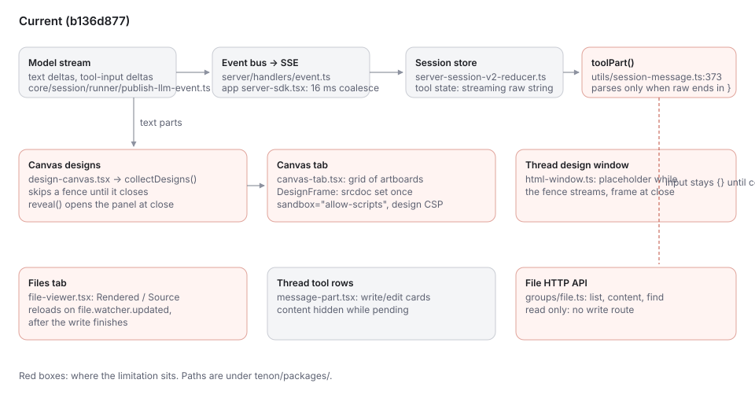
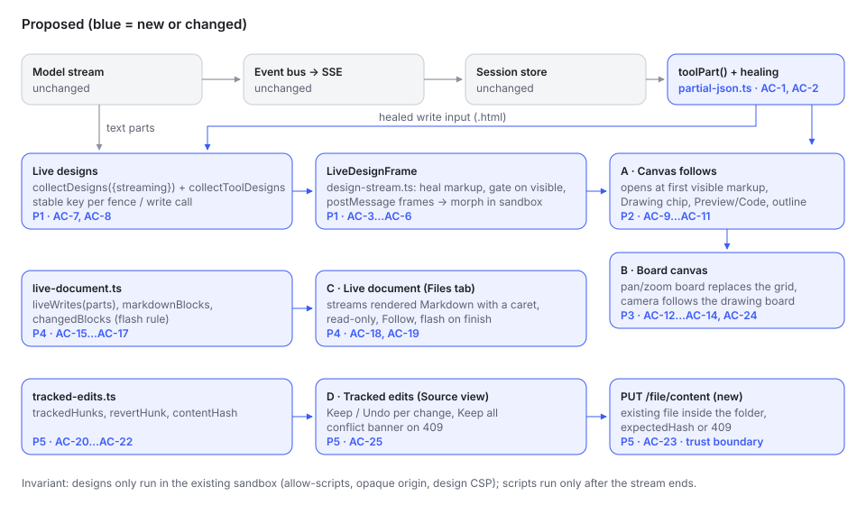
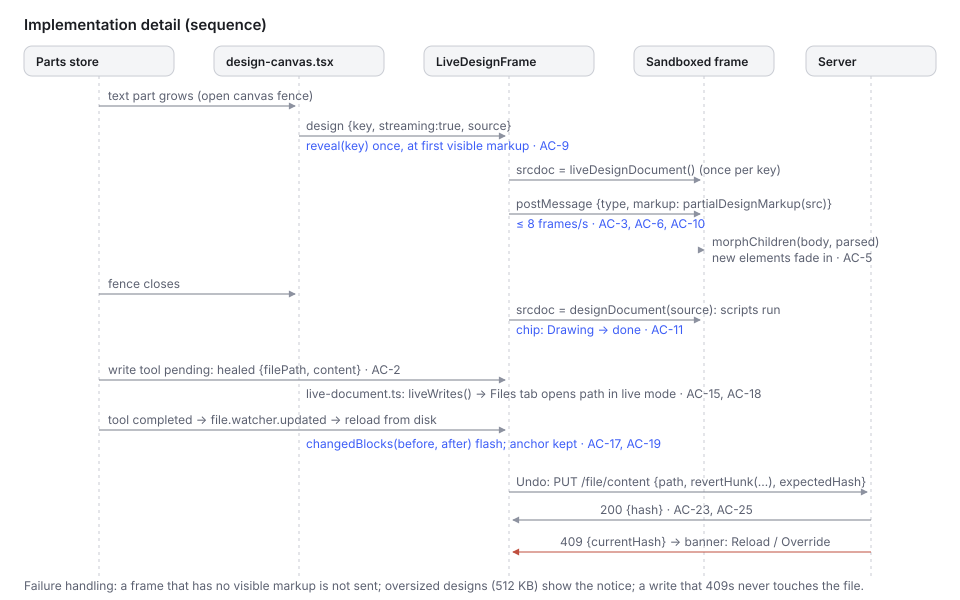

# Live agent canvas

Watch the agent draw designs and write documents live, beside the thread. Design source:
[Live Agent Canvas workshop](https://claude.ai/artifact/84CtiZRMwfvqoDMXz6UYcM), all four variants
(A Canvas follows, B Board canvas, C Live document, D Tracked edits).

## Problem and expected behaviour

Today a canvas design (```` ```html canvas ```` block) shows nothing until its fence closes, then
appears whole. A file the agent writes appears only after the tool finishes. The agent's edits
can't be undone one by one.

**Before:** the agent spends 40 s writing a pricing page in a canvas block; the Canvas tab opens
at second 40 with the finished page. **After:** the Canvas tab opens as soon as the first visible
element arrives (about second 1) and the page draws element by element, new elements fading in;
when the block closes, the page's scripts run and the status settles. A Markdown file the agent
writes types into the Files tab, rendered; when the agent later edits it, the changed blocks flash
once. In the Source view each agent change can be kept or undone.

Research behind this design (Claude desktop bundle and Tenon survey) is summarised in the workshop
page's notes: heal partial input, morph instead of reloading the frame, hold scripts until the end,
flash changed blocks, optimistic concurrency (hash check) instead of locks.

## Scope

Paths are under `tenon/packages/`.

- `app/src/utils/partial-json.ts` (new), `app/src/utils/session-message.ts` (streaming tool input).
- `session-ui/src/components/design-stream.ts` (new; export `./design-stream` in
  `session-ui/package.json`), `session-ui/src/components/design-fence.ts` (`collectDesigns`
  streaming option, `key`, `collectToolDesigns`).
- `app/src/pages/session/design-canvas.tsx`, `canvas-tab.tsx`, new live frame component, new
  `board-camera.ts`.
- `app/src/pages/session/live-document.ts` (new), `tracked-edits.ts` (new), `file-viewer.tsx`,
  `file-tabs.tsx`, `session-side-panel.tsx`, `helpers.ts` as needed.
- `tenon/src/server/routes/instance/httpapi/groups/file.ts` and `handlers/file.ts` (write route),
  regenerated client in `client/` (`bun run generate` in `packages/client`, never hand-edit
  `src/generated*`).
- `app/src/i18n/en.ts` for every new string.
- Docs: `docs/design.md` (Canvas, live document, tracked edits rules), `docs/architecture/README.md`
  (Canvas / design space and Files sections), `docs/architecture/uml.md` and `docs/diagrams/` where
  the design-space flow is drawn, `docs/security/threat-model.md` (live frame protocol, write route).

**Exclusions:** small inline ```` ```html ```` windows in the thread keep today's
placeholder-then-frame behaviour. Codex and ACP harnesses don't stream tool input; for them the
document views update when the tool finishes (file watcher), which is acceptable. No change to
`core` or the agent guidance. No desktop build or packaging.

**Invariants:**
- Designs run only in the existing frame sandbox: `sandbox="allow-scripts"` (opaque origin), the
  design CSP as the first thing in `<head>`, the WebRTC guard, the 512 KB cap. Never
  `allow-same-origin`. A design's own scripts never run while it streams.
- The frame bootstrap accepts messages only from its parent and only `{ type, markup }` of the
  frame protocol.
- The write route only changes an existing file inside the request's folder, only when the
  expected hash matches; it never creates, deletes or follows a path out of the folder.
- Canvas designs from history (closed fences) look and behave as today in the large view.
- The thread's virtualized timeline is not re-measured per frame.
- Every string through i18n; motion through `--v2-*` tokens; reduced motion shows end states.

## Feature map

| Component | Responsibility | In | Out |
| --- | --- | --- | --- |
| `core/src/session/runner/publish-llm-event.ts` | publishes `tool.input.delta` and text deltas | model stream | event bus |
| `server/src/handlers/event.ts` | SSE of the bus | bus | app |
| `app/src/context/server-sdk.tsx` | coalesces deltas per 16 ms | SSE | session store |
| `app/src/context/server-session-v2-reducer.ts` | tool state `streaming` with raw input | events | parts |
| `app/src/utils/session-message.ts` `toolPart` | raw → `pending` input (parses only whole JSON) | tool state | thread, panels |
| `session-ui/.../design-fence.ts` | fences, ids, `collectDesigns` (closed only), `designDocument` | text parts | Canvas |
| `app/src/pages/session/design-canvas.tsx` | design list, reveal, pin, Use | parts | Canvas tab |
| `app/src/pages/session/canvas-tab.tsx` | grid of artboards, large view, `DesignFrame` | designs | UI |
| `app/src/pages/session/file-viewer.tsx`, `file-tabs.tsx` | Files tab, Rendered/Source | `client.file.read`, watcher | UI |
| `tenon/src/server/.../groups/file.ts` | file routes: list, content, find (read only) | app | disk |

Adjacent consumers: thread `write`/`edit` cards (`session-ui/.../message-part.tsx`) read the same
pending input (they will now see fields earlier; they already handle partial content when it
arrives at completion); the Review tab; the e2e mock server (`app/e2e/utils/mock-server.ts`).

## Diagrams

Current: canvas designs wait for the fence to close; tool input stays `{}` until complete; no write route.



Proposed: live designs feed a morphing frame (A, B); healed input feeds the live document (C);
a hash-checked write route backs per-change undo (D).



Implementation detail: one streaming design and one streaming document, end-of-stream swap and the
write conflict path.



## Acceptance criteria

Interfaces named here are the contract both test sets use.

**P1 · Streaming foundations**
- **AC-1** `parsePartialJson(raw)` (`app/src/utils/partial-json.ts`) returns the value of a
  truncated JSON text: an open string closes with what has arrived (a dangling `\` or partial
  `\uXXXX` is dropped); a key with no complete value is dropped (incomplete numbers such as `-`,
  incomplete literals such as `nu`, keys without a colon); open arrays and objects close; a
  trailing comma is ignored. Complete JSON parses as `JSON.parse`. Empty, whitespace or non-JSON
  input returns `undefined`.
- **AC-2** A streaming tool part from `normalizeSessionMessages` has `status: "pending"`, `raw`
  unchanged, and `input` = the healed object normalized as today (`path` → `filePath`), so
  `write`'s `filePath`/`content` and `edit`'s `filePath`/`oldString`/`newString` are visible while
  they stream. Running, error and completed states are unchanged. The existing test in
  `session-message.test.ts` ("streaming tool input") asserts the old behaviour (`{}` for partial
  input); update it to this contract.
- **AC-3** `partialDesignMarkup(source)` (`session-ui/src/components/design-stream.ts`) removes
  every `<script…>…</script>` block and an unterminated `<script` to the end (case-insensitive),
  removes an unterminated `<!--` to the end, then drops a trailing unfinished tag (text from the
  last `<` that has no `>` after it). Everything else is unchanged; unclosed elements stay for the
  HTML parser to close.
- **AC-4** `hasVisibleMarkup(source)` is true when the healed markup has any element or
  non-whitespace text other than `<style>`, `<script>`, `<title>`, `<meta>`, `<link>`, comments,
  the doctype and bare `<html>`, `<head>`, `<body>` tags (and their contents for style, script,
  title).
- **AC-5** `morphChildren(to, from)` makes `to`'s children match `from`'s: a node of the same
  type and name at the same position is kept (same object), text data updates in place,
  attributes are added, changed and removed, children recurse; a different node replaces it;
  extra nodes are removed. It returns the elements it inserted (including ones inserted inside a
  kept parent), in document order, so callers can fade them in.
- **AC-6** `liveDesignDocument()` returns a document that starts with `<!doctype html>`, has the
  design CSP meta before any `<script>`, keeps the WebRTC guard, and contains a bootstrap that
  morphs `markup` from messages `{ type: DESIGN_FRAME_MESSAGE, markup }` into the body, ignoring
  any message whose `source` isn't `parent` or whose data has another shape. It makes no network
  requests. `DESIGN_FRAME_MESSAGE` is `"tenon:design-frame"`.
- **AC-7** `collectDesigns(messages, parts, pinned?, scan?, { streaming })`: every design has
  `key` = `<part id>:<index of the fence in that part>`. With `streaming: true`, the last unclosed
  canvas fence of a part is included with `streaming: true`, `id` = its key, and the source so
  far; once closed it has the same key, no `streaming` (or false) and `id` = `designID(source)` as
  today. Without the option the result is today's (plus `key`). Non-canvas fences and user
  messages are never canvas designs. The existing exact-object test in `design-fence.test.ts`
  needs `key` added.
- **AC-8** `collectToolDesigns(messages, parts)` returns a canvas design for each `write` tool
  part in an assistant message whose `filePath` ends in `.html` or `.htm` (any case): `key` = call
  ID, `title` = file name (either separator), `source` = `content`, `streaming: true` while the part
  is pending or running. Parts without a `filePath`, and other tools, give nothing.

**P2 · A · Canvas follows** (UI; e2e + visual check)
- **AC-9** When a streaming canvas design first has visible markup, the side panel opens on
  Canvas with that design large, once per key; if the user then closes the panel or goes back to
  the list, the same key doesn't reopen it. Designs from history never open the panel.
- **AC-10** The large view of a streaming design draws progressively in one frame element (no
  reload per frame): frames go to the sandbox by `postMessage` at most 8 per second, new elements
  fade in (none under reduced motion), and an outline marks the element being written. Header:
  a "Drawing" chip with the live dot, and a Preview / Code switch; Code shows the source so far
  with a caret, scrolled to the end.
- **AC-11** When the design finishes, the frame swaps to `designDocument(source)` once (scripts
  run), the outline goes, the chip settles (for example "Drawn just now"), and "Use this one" is
  available. Over 512 KB shows today's notice. A `write` to an `.html` file behaves the same, keyed
  by its call ID.

**P3 · B · Board canvas** (logic + UI)
- **AC-12** `boardLayout(count, { columns = 2, gap = 200 }?)` (`app/src/pages/session/board-camera.ts`)
  places 1280×800 artboards (`ARTBOARD`) at `x = (i % columns) * (1280 + gap)`,
  `y = floor(i / columns) * (800 + gap)`.
- **AC-13** `fitCamera(rect, viewport, pad = 32)` returns `{ x, y, scale }` with
  `scale = min((vw − 2·pad)/w, (vh − 2·pad)/h)`, centring the rectangle (screen = world·scale +
  (x, y)). `boardCamera({ layout, drawing?, viewport, pad? })` fits the drawing board when
  `drawing` is set, else the bounding box of all boards; with no boards `{ x: 0, y: 0, scale: 1 }`.
- **AC-14** `zoomAt(camera, factor, point)` scales by `factor`, clamped to 0.05–4, keeping the
  world point under `point` fixed.
- **AC-24** The Canvas list becomes a board: artboards on a dotted canvas, labels in screen size
  (letter · title, status: Drawing… / Done / Use this one), a zoom pill (− %, +), wheel/pinch zoom
  at the pointer and drag to pan. While a design streams the camera follows its board (animated
  with `--v2-duration-long` and the emphasized-decelerate easing); when none streams it shows all
  boards. Once the user pans or zooms, the camera stops following until the next design starts.
  Clicking a board opens it large (A). One design: the board shows that board.

**P4 · C · Live document** (logic + UI)
- **AC-15** `liveWrites(parts)` (`app/src/pages/session/live-document.ts`) lists `write` and `edit`
  tool parts that have a string `filePath`, in order, as `{ callID, tool, path, status, content? ,
  oldString?, newString? }` with status `streaming` (pending), `running`, `completed` or `error`.
- **AC-16** `markdownBlocks(text)` splits on blank or whitespace-only lines (`\r\n` treated as
  `\n`), keeping a fenced code block whole, including an unclosed fence to the end.
- **AC-17** `changedBlocks(before, after)` returns the indexes in `markdownBlocks(after)` of blocks
  that are new or changed (line-diff of blocks); `[]` when `before` is empty or when more than half
  of `after`'s blocks changed.
- **AC-18** When the agent starts a `write` or `edit` on a text file in the open thread, the side
  panel opens on Files with that file, in live mode: Markdown renders as it streams with a caret at
  the end and a shimmer line after the last block; Source shows the raw text. A note says the file
  is read-only while Tenon writes; a Follow pill keeps the caret in view until the user scrolls
  ("Jump to Tenon" brings it back). Opening happens once per call ID.
- **AC-19** When the tool finishes, the file reloads from disk; blocks from `changedBlocks` flash
  once (accent container fade, 1.6 s, none under reduced motion) and the block the reader is on
  keeps its position when blocks above it change. Edits from harnesses without streamed input get
  the same flash after they finish.

**P5 · D · Tracked edits** (logic + server + UI)
- **AC-20** `trackedHunks(before, after)` (`app/src/pages/session/tracked-edits.ts`) returns each
  maximal run of changed lines as `{ start, removed, added }`, `start` being the 0-based line in
  `after` where the run begins. Lines split on `\n`, a `\r` stays part of its line.
- **AC-21** `revertHunk(after, hunk)` replaces `added` at `start` with `removed`; reverting every
  hunk, last first, gives `before` exactly.
- **AC-22** `contentHash(text)` resolves to the lowercase hex SHA-256 of the UTF-8 text.
- **AC-23** `PUT FilePaths.write` (`FilePaths.write` exported from `groups/file.ts`) with JSON
  `{ path, content, expectedHash }`: when the file exists inside the request folder and the SHA-256
  of its text as the content route returns it (trimmed) equals `expectedHash`, writes the file as
  its current leading whitespace + `content` (trimmed) + its current trailing whitespace and answers
  200 `{ hash }` (hash of the new trimmed text). A different hash answers 409 `{ currentHash }`.
  A path outside the folder (relative or absolute), a missing file or a binary file answers 4xx.
  Nothing is written on any error. The client is regenerated; authorization and httpapi coverage
  checks include the route.
- **AC-25** In the Files tab Source view of a file the agent edited in this thread, each change
  shows removed lines struck through and added lines highlighted (diff colours), live while an
  edit streams. When the agent's tool finishes, each change gets Keep and Undo; the header gets
  "N edits by Tenon" with Undo all and Keep all. Keep clears the highlight; Undo writes the file
  through the route with the hash of the text last read. A 409 shows a banner: "This file changed
  since Tenon's edit" with Reload and Override (Override retries with the current hash).

## Implementation sequence (phases)

TOR-2: one implementor, one verifier, phases in order. Each phase is one commit.

| Phase | Outcome | Criteria | Edit scope | Depends |
| --- | --- | --- | --- | --- |
| P1 | Streaming foundations: healed tool input; live design primitives; streaming designs | AC-1…AC-8 | partial-json.ts, session-message.ts (+test update), design-stream.ts, design-fence.ts (+test update), session-ui package.json export | — |
| P2 | A · Canvas follows | AC-9…AC-11 | design-canvas.tsx, canvas-tab.tsx, new live frame component, html-window.ts (reveal at first visible markup only if needed), i18n, docs | P1 |
| P3 | B · Board canvas | AC-12…AC-14, AC-24 | board-camera.ts, canvas-tab.tsx (list → board), i18n, docs | P2 |
| P4 | C · Live document | AC-15…AC-19 | live-document.ts, file-viewer.tsx, file-tabs.tsx, session-side-panel.tsx, helpers.ts, i18n, docs | P1 |
| P5 | D · Tracked edits | AC-20…AC-23, AC-25 | tracked-edits.ts, server file group/handler, client regen, file-viewer source view, i18n, security + architecture docs | P4 |

Each UI phase (P2–P5) adds one Playwright spec under `app/e2e/acceptance/live-canvas-*.spec.ts`
that drives the behaviour through `mockTenonServer` events (streamed text or tool parts) and asserts
the visible outcome; follow `app/e2e/AGENTS.md` (no sleeps).

## Verification

Run from the repository root's packages folder as shown. Test files import product code by relative
path (bare package names don't resolve from `implementations/`).

| Set | Command (working directory) |
| --- | --- |
| app | `cd tenon/packages/app && bun test --conditions=solid --preload ./happydom.ts ../../../implementations/live-agent-canvas/<set>/app` |
| session-ui | `cd tenon/packages/session-ui && bun test --preload ../app/happydom.ts ../../../implementations/live-agent-canvas/<set>/session-ui` |
| tenon | `cd tenon/packages/tenon && bun test --timeout 30000 ../../../implementations/live-agent-canvas/<set>/tenon` |

`<set>` is `acceptance` (worker-visible, in this folder) or `verification` (held by the plan author
outside the repository and copied in only by the verifier).

| Criteria | Acceptance | Verification | Manual / e2e |
| --- | --- | --- | --- |
| AC-1, AC-2 | app/partial-json | app/streaming-input | — |
| AC-3…AC-8 | session-ui/design-stream, design-collect | session-ui/design | — |
| AC-9…AC-11, AC-24 | — | — | implementor e2e spec + verifier visual check |
| AC-12…AC-14 | app/board-camera | app/panels | — |
| AC-15…AC-17 | app/live-document | app/panels | — |
| AC-18, AC-19, AC-25 | — | — | implementor e2e spec + verifier visual check |
| AC-20…AC-22 | app/tracked-edits | app/panels | — |
| AC-23 | tenon/file-write | tenon/file-write | — |

Also per phase: `bun run typecheck`, `bun run lint`, `bun run format:check`, the touched packages'
own tests (`bun run test:app`, `cd tenon/packages/session-ui && bun test src`, server tests for P5),
`bun run check:generated` after P5, and `bun run test:routes` if navigation changes. Session code is
touched in P1: record `cd tenon/packages/app && bun test ./e2e/performance/unit` before and after.

E2E runs must use their own ports so they never reuse a server the user is running:
`PLAYWRIGHT_PORT=31xx PLAYWRIGHT_SERVER_PORT=41xx bun run test:e2e <spec>` from `tenon/packages/app`.
Never build or package the desktop app, never run `bun install` in the main checkout, never stop or
restart a running Tenon process.

**Baseline (b136d877, 2026-11-16):** every acceptance file fails on its missing module
(`partial-json`, `design-stream`, `board-camera`, `live-document`, `tracked-edits`; `collectToolDesigns`
missing); `tenon/file-write`: two tests fail with 404 (no write route), the out-of-folder test passes
(the guard already holds).

## Completion evidence

To be filled per phase: verified SHA, verifier results (kept apart from implementor reports),
commands run, limitations.
