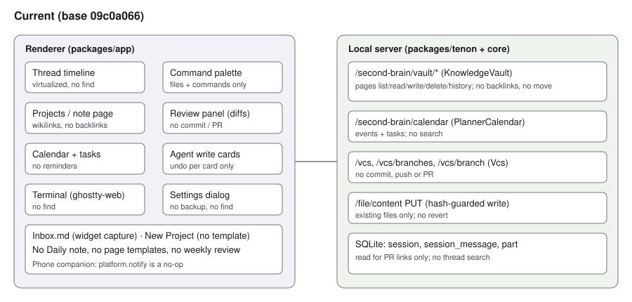
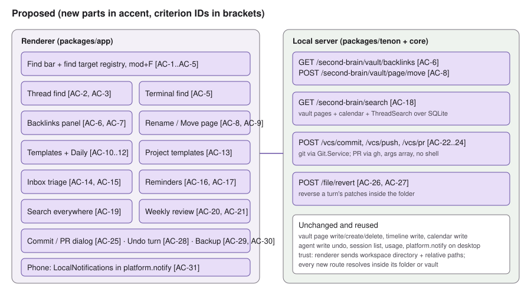
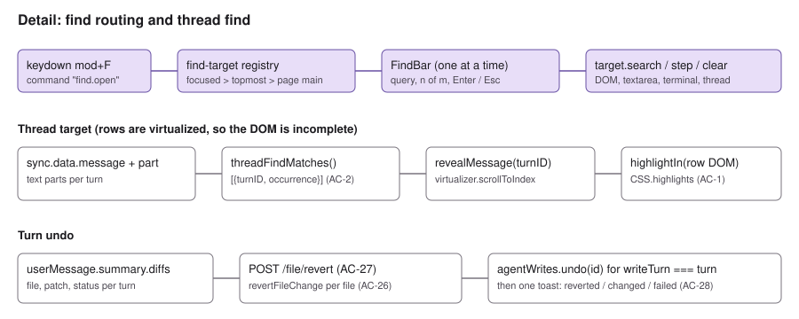

# Missing features: find, notes, planning, search, Git, turn undo, backup, phone

Base: `main` at `09c0a066`. Branch: `claude/missing-features-review-46ee54`. One agent wrote the plan, the tests and
the code (TOR-1); the verification tests are not independent. Usage budgets (backlog #5) are out of scope by request.

## Problem and expected behaviour

The feature review of 28 Nov 2026 found these gaps; the user asked for all of them except usage budgets, plus
Ctrl/Cmd+F find in a thread and wherever else it makes sense.

| Gap | Before | After |
| --- | --- | --- |
| Find | Ctrl+F does nothing; the thread is virtualized, so browser find can't reach older turns | Ctrl/Cmd+F opens one find bar for the surface you are in: thread, note page, any main page, Settings, side-panel documents, terminal |
| Backlinks | `[[links]]` resolve, a page doesn't show who links to it | "Linked from" list under every page |
| Rename / move | A page's path is fixed | Rename and Move to Project; links in other pages follow |
| Templates, Daily | None | `Templates/` pages, "New from template", "Today's note" (`Daily/YYYY-MM-DD.md`), starter templates in New Project |
| Inbox | Capture only (`Inbox.md`) | Inbox view: Make task, Add to Project, Hand to agent, Done |
| Reminders | Agent notifications only | Event lead-time and task due-day reminders, toast in view, system notification otherwise |
| Search | Palette: files and commands | Search everywhere: pages, tasks, events, thread titles and messages |
| Weekly review | None | `/review`: done, overdue, next week, threads per Project, stalled Projects |
| Git | Branch switch only | Commit, push, open a pull request from the review panel |
| Turn undo | Per write card, per tracked hunk | "Undo turn" reverts a turn's file changes and its agent writes |
| Backup | None | Settings › Backup: export and import settings (no secrets) |
| Phone | `notify` is a no-op | Local notifications when a thread needs you while the app runs |

Example (thread find): a 300-turn thread, query "rate limit". Before: Ctrl+F does nothing. After: the bar says
"1 of 7", Enter jumps to the next turn that says it, the virtualized row is scrolled in and the words are highlighted.

## Scope

New modules are listed per part. Existing interfaces reused: `KnowledgeVault` (`tenon/src/knowledge/vault.ts`),
`PlannerCalendar`, `Vcs` (`tenon/src/project/vcs.ts`), `Git.Service`, `FileMutation`, the file write route
(`handlers/file.ts`), `SessionTable`/`SessionMessageTable`/`PartTable` (`core/src/session/sql`), the app's
`useCommand` keybinds, `platform.notify`, `showToast`, `createAgentWrites`, `MessageTimeline.setRevealMessage`,
`readCalendar`/`writeCalendar`, `writeVaultPage`, `writeVaultTimeline`, `persisted("settings.v3")`.

Invariants: renderer calls carry a workspace directory and relative paths only; every new route resolves its paths
inside its folder or vault; no secrets in exports or logs; no comments in source; Windows and macOS both handled
(paths, `gh`/`git` on PATH, notifications).

Excluded: usage budgets; push notifications with the phone app closed (needs FCM/APNs and a relay); full-text index
(search uses bounded `LIKE` scans, enough for one person's history; an FTS index is recorded in deferred work).

## Feature map

| Component | Responsibility | In → out | Source |
| --- | --- | --- | --- |
| Command keybinds | Global shortcuts | keydown → `command.trigger(id)` | `app/src/context/command.tsx` |
| MessageTimeline | Virtualized rows, `setRevealMessage(id)` scrolls to a turn | rows from `projection` → DOM `[data-index]` | `pages/session/timeline/message-timeline.tsx:560` |
| Thread data | Messages and parts per session | `sync().data.message[id]`, `sync().data.part[messageID]` | `context/sync` |
| Selection highlight | CSS Custom Highlight API already in use | `CSS.highlights.set` | `pages/session/timeline/selection-reply.tsx:23` |
| Terminal | ghostty-web `Terminal`: `buffer.active.getLine(y)`, `select`, `scrollToLine` | | `components/terminal.tsx` |
| Note page | Preview (`Markdown`) and `<textarea>` editor | | `features/second-brain/note-editor.tsx` |
| Vault | Pages in `<vault>/<workspace>/`, history in `.history/`, wikilink keys = title, path, basename | | `tenon/src/knowledge/vault.ts`, `app/.../note-links.ts` |
| Inbox | `Inbox.md`, entries `## <label> · <ISO>` | widget → `appendToInbox` | `features/desktop-widget/inbox.ts` |
| Calendar | `CalendarSnapshot { events, tasks }` per workspace | `readCalendar` | `features/second-brain/client.ts`, `tenon/src/planner/calendar.ts` |
| Project create | `POST /second-brain/projects`; record has `templateId` | form → record | `project-details.tsx:320`, `tenon/src/project/brain.ts` |
| Vcs | branch, branches, switch, diff, apply | `/vcs/*` | `tenon/src/project/vcs.ts`, `handlers/instance.ts` |
| Turn diffs | `userMessage.summary.diffs: { file, patch, status }` | → TurnSteps rows | `timeline/rows.ts:302` |
| Agent writes | per-card undo, `writeTurn` maps a write to its turn | | `features/agent-writes/store.tsx` |
| Thread rows in SQLite | v2 `session_message.data`, v1 `part.data` (JSON) | | `core/src/github/threads.ts` (pattern) |
| Settings | `settings.v3` store; MCP servers in server config (`config.mcp`) | | `context/settings.tsx`, `settings-v2/mcp-servers.tsx` |
| Phone | Capacitor shell around the renderer | `platform.notify` no-op | `mobile/src/entry.tsx:26` |

Observed: the timeline only renders rows near the viewport, so a DOM-only find misses turns; `revealMessage` exists for
any user message ID. Hypothesis to verify in P2: rows render within two animation frames of `scrollToIndex`.

## Diagrams







## Parts

| Part | Outcome | Criteria | Files | Depends |
| --- | --- | --- | --- | --- |
| P1 | Find bar, find targets and mod+F; DOM find on pages, note preview/editor, Settings, side-panel documents | AC-1, AC-3, AC-4 | `app/src/features/find/*` (new), `context/command` users, `app.tsx`, `note-editor.tsx`, `dialog-settings-v2.tsx`, `index.css`, `en.ts` | — |
| P2 | Thread find over all loaded turns with reveal and highlight | AC-2, AC-3 | `features/find/thread-find.ts` (new), `pages/session.tsx` | P1 |
| P3 | Terminal find | AC-5 | `features/find/terminal-find.ts` (new), `components/terminal.tsx` | P1 |
| P4 | Backlinks route and panel | AC-6, AC-7 | `tenon/src/knowledge/wiki-links.ts` (new), `vault.ts`, second-brain group/handler, app `client.ts`, `pages/projects.tsx` | — |
| P5 | Rename / move a page with link rewrite | AC-8, AC-9 | `vault.ts`, `wiki-links.ts`, group/handler, `client.ts`, `pages/projects.tsx` | P4 |
| P6 | Templates, Daily note, Project starter templates | AC-10–AC-13 | `features/second-brain/templates.ts` (new), `pages/projects.tsx`, `project-details.tsx` | — |
| P7 | Inbox triage | AC-14, AC-15 | `features/second-brain/inbox-triage.ts`, `inbox-view.tsx` (new), `pages/projects.tsx` | P6 |
| P8 | Reminders | AC-16, AC-17 | `features/second-brain/reminders.ts`, `calendar-reminders.tsx` (new), `app.tsx`, `context/settings.tsx`, `settings-v2/calendar.tsx` | — |
| P9 | Search everywhere | AC-18, AC-19 | `tenon/src/knowledge/search.ts` (new), group/handler, app `features/search/*` (new), `dialog-command-palette-v2.tsx` | P4 |
| P10 | Weekly review page | AC-20, AC-21 | `features/second-brain/weekly-review.ts`, `pages/review.tsx` (new), `app.tsx` routes, sidebar rail | — |
| P11 | Commit, push, pull request | AC-22–AC-25 | `tenon/src/project/vcs-publish.ts` (new), `vcs.ts`, instance group/handler, app `features/git/*` (new), review panel | — |
| P12 | Undo a whole turn | AC-26–AC-28 | `tenon/src/file/revert.ts` (new), file group/handler, app `pages/session/turn-undo.ts` (new), turn footer | — |
| P13 | Settings backup | AC-29, AC-30 | `features/settings-backup/*` (new), `dialog-settings-v2.tsx` | P1 (Settings tab list) |
| P14 | Phone notifications | AC-31 | `mobile/src/notifications.ts` (new), `mobile/src/entry.tsx`, `mobile/package.json`, `bun.lock` | — |
| P15 | Docs | — | navigation map, backlog, deferred work, architecture/UML, threat model, design guide | P1–P14 |

## Acceptance criteria

Find

- **AC-1** `findRanges(text, query, { caseSensitive })` returns every non-overlapping match as `{ start, end }`,
  literally (regex characters are text), case-insensitive by default; an empty or whitespace query returns none.
  `stepIndex(count, current, direction)` wraps both ways and returns -1 when there are no matches.
- **AC-2** `threadFindTurns(messages, parts)` yields one entry per user turn (in thread order) with the user's text
  parts and the text parts of every assistant message whose `parentID` is that turn; synthetic and ignored parts are
  skipped. `threadFindMatches(turns, query)` lists `{ turnID, occurrence }` in order, `occurrence` counting from 0
  within the turn.
- **AC-3** Ctrl+F (Cmd+F on macOS) is the `find.open` command; it opens the find bar for the active target, focusing
  its input with the current selection as the query. Enter and Shift+Enter step, F3/Shift+F3 too, Escape closes and
  clears highlights. The bar shows "n of m" or "No results".
- **AC-4** `pickFindTarget(targets, focused)` chooses the target containing the focused element, else the highest
  `layer` (dialog over page), else the page's main target; disabled targets are skipped; when several targets hold focus the highest layer wins, and among equal layers the most recently registered wins. DOM targets search visible
  text only (not `hidden`, `aria-hidden`, scripts, styles, inputs); a `<textarea>` target selects the current match.
- **AC-5** `terminalMatches(lines, query)` returns `{ row, column, length }` for every match across scrollback rows,
  in row order; the terminal target selects the current match and scrolls it into view.

Notes

- **AC-6** `GET /second-brain/vault/backlinks?path=` returns `[{ path, title, snippet }]` for pages linking to the page
  by title, path or file name (case and spaces/dashes folded, `#heading` and `|alias` allowed), excluding the page
  itself and links inside code spans or fenced blocks; a missing page is 404.
- **AC-7** Under a page, "Linked from" lists those pages (opening one on click) or says no pages link here.
- **AC-8** `POST /second-brain/vault/page/move` with `{ path, expectedRevision, title?, projectId? }` (projectId
  `null` = workspace root) moves and/or renames the page: same `id`, the old file removed, its history moved; a stale
  revision or an existing target is 409; a reserved target, an invalid name or a move that changes nothing is 400. Moving does not add a history version. Links in other pages that resolved to the old page
  and would no longer resolve are rewritten to the new title, keeping `#heading` and `|alias`; the response is
  `{ page, updatedLinks }`.
- **AC-9** The page view offers Rename… and Move to Project…; afterwards the app shows the page at its new path.
- **AC-10** `applyTemplate(body, { now, title })` replaces `{{title}}`, `{{date}}` (YYYY-MM-DD, local), `{{time}}`
  (HH:mm), `{{weekday}}`, `{{yesterday}}`, `{{tomorrow}}`; unknown placeholders stay as written.
- **AC-11** Pages under `Templates/` are templates. "New page" offers them; the created page's body is the applied
  template and its title the name typed.
- **AC-12** `dailyNotePath(now)` is `Daily/YYYY-MM-DD.md` (local date). "Today's note" (Projects page and command
  palette) opens it, creating it from `Templates/Daily.md` when that page exists, else from the built-in daily
  template; an existing note is never overwritten.
- **AC-13** New Project offers Blank, Software, Research, Writing and Launch. A non-blank choice stores `templateId`,
  writes its milestones to the Project timeline and creates its starter page in the Project; Blank adds nothing.
  `projectTemplate(id)` returns undefined for an unknown id; `timelineFromTemplate(template, start, makeId)` turns
  milestones into `todo` milestone items with ascending dates from the start date.
- **AC-14** `parseInbox(body)` returns `[{ id, label, at, text }]` for every `## <label> · <ISO>` section;
  `removeInboxEntry(body, id)` removes only that section, leaving the rest unchanged; a body without sections has none.
- **AC-15** The Inbox view lists entries newest first with Make task (optional due date → local task), Add to Project
  (appends to the Project's "Inbox notes" page), Hand to agent (new thread draft in the chosen Project with the text)
  and Done. An entry is removed only after its action succeeded.

Planning

- **AC-16** `dueReminders({ snapshot, now, settings, fired })` returns event reminders for timed events starting
  within `eventLeadMinutes` (not all-day, not pending delete, not already started) and task reminders for open tasks
  due or scheduled today once `now` passes `taskTime`; each `key` once (`fired` excludes; task keys are per day); disabled settings → none.
  `reminderSettings(value)` fills defaults (on, 10 minutes, 09:00) and clamps minutes to 0–1440 and bad times to 09:00.
- **AC-17** Reminders run while the app runs: a toast when the window is in view, else a system notification; a
  click opens Calendar. Settings › Calendar has Reminders on/off, minutes before events, and the time for tasks.

Search

- **AC-18** `GET /second-brain/search?q=` returns `{ pages, tasks, events, threads }`: case-insensitive matches on
  page title/body, task title/notes, event title/details, thread title and message text, each with a snippet around
  the first hit and at most `limit` (default 8) per group. Thread hits come from user and assistant text only (JSON
  keys and tool payloads do not match), archived threads are excluded, a query under 2 characters returns empty
  groups, and `%`/`_` in the query are literal. Thread search is `ThreadSearch` in `core` (`search(query, limit)`,
  `rowText(row)`), reading both message stores.
- **AC-19** In the command palette a query of 2+ characters adds "Search everywhere" groups; choosing a result opens
  the page, thread or Calendar. Ctrl/Cmd+Shift+F opens the palette for this search.
- **AC-20** `weeklyReview({ tasks, events, threads, projects, pages, now })` reports tasks completed in the last 7
  days, open overdue tasks, events and due tasks in the next 7 days, threads updated in the last 7 days grouped by
  Project, and active Projects with no thread or page activity in 14 days.
- **AC-21** `/review` shows those sections with links; the rail and command palette open it.

Git

- **AC-22** `Vcs.commit({ message, branch? })` commits every change in the folder (`git add -A`); an empty message is
  400-class `invalid`, nothing to commit is `nothing`, an invalid branch name is `invalid-branch`; with `branch` it
  creates and switches to it first. It returns `{ sha, branch }`.
- **AC-23** `Vcs.push()` pushes the current branch with `-u origin <branch>`; no `origin` → `no-remote`; a detached
  HEAD → `detached`.
- **AC-24** `Vcs.pullRequest({ title, body, base?, draft })` runs `gh pr create` with an argument array (no shell);
  `gh` missing → `gh-missing`; returns `{ url }` from gh's output. `prCreateArgs` (refuses a base that starts with
  `-`), `prUrl` (last pull URL in the output), `validBranchName` (git's ref rules) and `branchFromTitle`
  (`tenon/<slug>`, at most 60 characters) are pure.
- **AC-25** The review panel has "Commit…" when the folder is a git repo with changes: message, a new-branch field
  pre-filled when on the default branch, "Push" and "Open a pull request" (title and body pre-filled, draft); the
  result shows the commit and the PR link.

Turn undo

- **AC-26** `revertFileChange({ status, patch, current })`: modified → `write` with the patch reverse-applied (later
  edits elsewhere in the file are kept) when the changed lines still match, else `changed` (also when the file is
  gone or the patch can't be read); added → `remove` when `current` equals the post-image (outer whitespace
  ignored), `none` when already gone, else `changed`; deleted → `create` with the pre-image when the file is gone,
  else `changed`.
- **AC-27** `POST /file/revert` with `{ files: [{ file, patch, status }] }` applies those results inside the folder
  and returns `[{ file, result: "reverted" | "changed" | "failed" }]`; a path outside the folder is `failed`, never
  touched.
- **AC-28** A finished turn with file changes or undoable agent writes shows "Undo turn"; a confirmation lists them;
  confirming reverts the files and undoes the writes, then one toast summarises reverted, changed and failed.

Backup and phone

- **AC-29** `exportSettings({ settings, mcp, now })` returns `{ format: "tenon-settings", version: 1, exportedAt,
  settings, mcp }` with MCP `environment` and `headers` values replaced by `""`; `parseSettingsBackup(text)` returns
  the sections or an error for other formats, versions or bad JSON; `mergeSettings(current, backup, sections)`
  replaces only the chosen sections; sections are the settings groups present (general, appearance, keybinds,
  notifications, sounds, calendar, reminders, commandCentre, dictation, harnesses, modelProfiles) plus `mcp` when it has
  entries; `blankedSecrets(file)` names the MCP entries whose secrets were blanked.
- **AC-30** Settings › Backup exports a `.json` file and imports one, showing its sections to choose; MCP entries with
  blanked secrets are flagged.
- **AC-31** On the phone, `notify` shows a local notification when the app is not in view (permission asked once);
  tapping it opens the thread; `notificationId(key)` is a stable positive 31-bit integer.

## Tests (frozen after the baseline run)

Acceptance tests are `*.test.ts`; verification tests are `*.verify.test.ts` beside them (different cases and
sequences, same public contract).

| Criteria | Acceptance | Verification |
| --- | --- | --- |
| AC-1, AC-4 | `app/src/features/find/find-text.test.ts`, `find-targets.test.ts` | `find-text.verify.test.ts`, `find-targets.verify.test.ts` |
| AC-2 | `app/src/features/find/thread-find.test.ts` | `thread-find.verify.test.ts` |
| AC-5 | `app/src/features/find/terminal-find.test.ts` | `terminal-find.verify.test.ts` |
| AC-6, AC-8 | `tenon/test/knowledge/wiki-links.test.ts`, `vault-links-http.test.ts` | `wiki-links.verify.test.ts`, `vault-links-http.verify.test.ts` |
| AC-10–AC-13 | `app/src/features/second-brain/templates.test.ts` | `templates.verify.test.ts` |
| AC-14 | `app/src/features/second-brain/inbox-triage.test.ts` | `inbox-triage.verify.test.ts` |
| AC-16 | `app/src/features/second-brain/reminders.test.ts` | `reminders.verify.test.ts` |
| AC-18 | `tenon/test/knowledge/search.test.ts`, `search-http.test.ts`, `core/test/thread-search.test.ts` | `search.verify.test.ts`, `core/test/thread-search.verify.test.ts` |
| AC-19 | `app/src/features/search/everywhere.test.ts` | `everywhere.verify.test.ts` |
| AC-20 | `app/src/features/second-brain/weekly-review.test.ts` | `weekly-review.verify.test.ts` |
| AC-22–AC-24 | `tenon/test/project/vcs-publish.test.ts`, `vcs-commit.test.ts` | `vcs-publish.verify.test.ts` |
| AC-26, AC-27 | `tenon/test/file/revert.test.ts` (with the route) | `revert.verify.test.ts` (with the route) |
| AC-28 | `app/src/pages/session/turn-undo.test.ts` | `turn-undo.verify.test.ts` |
| AC-29 | `app/src/features/settings-backup/backup.test.ts` | `backup.verify.test.ts` |
| AC-31 | `mobile/src/notifications.test.ts` | `notifications.verify.test.ts` |
| AC-3, AC-7, AC-9, AC-11, AC-12, AC-15, AC-17, AC-21, AC-25, AC-30 | manual in the running app (recorded below) | |

Commands (from `tenon/packages/<pkg>` unless noted):

```sh
bun test --conditions=solid --preload ./happydom.ts src/features/find src/features/second-brain src/features/search src/features/settings-backup src/pages/session/turn-undo   # app
bun test --timeout 30000 test/knowledge test/project/vcs-publish test/project/vcs-commit test/file   # tenon
bun test test/thread-search   # core
bun test src   # mobile
bun run check   # repository root
```

## Completion evidence

One agent wrote this plan, both test sets and the code (TOR-1); the verification tests are a second, separately
designed set from the same author, not independent or hidden. Tests were frozen at base `09c0a066` before any
product edit; the frozen copy is outside the repository.

### Parts

| Part | Status | Evidence |
| --- | --- | --- |
| P1 Find core | Done | `features/find/*` tests pass; note preview (1 of 7, Enter steps, Escape clears), Settings (1 of 3) driven in the browser preview |
| P2 Thread find | Done | `thread-find*.test.ts` pass; "rate limit" found and highlighted in a real thread (1 of 1) |
| P3 Terminal find | Done | `terminal-find*.test.ts` pass; "Microsoft" found and selected in a live PowerShell terminal, bar placed above the pane |
| P4 Backlinks | Done | `wiki-links*`, `vault-links-http*` pass; "Linked from" lists the linking page with its snippet |
| P5 Rename / move | Done | route tests pass; Rename (link rewritten to `[[Today plan\|today]]`, toast) and Move to Project (`Launch demo/Links.md`) driven in the preview |
| P6 Templates, Daily, Project templates | Done | `templates*` pass; Today's note created from the built-in template; Launch template seeded four milestones and `Launch demo/Launch checklist.md`; New from template asks for the name ("Standup notes" from `Templates/New template.md`: title and `{{title}}` both the typed name, Enter or Create page) |
| P7 Inbox | Done | `inbox-triage*` pass; Make task → Due today created the task and removed only that note |
| P8 Reminders | Done | `reminders*` pass; in-view toast "Buy a domain for the demo · Due today · Open"; Settings › Calendar › Reminders renders |
| P9 Search everywhere | Done | `search*`, `search-http`, `core/test/thread-search*`, `everywhere*` pass; Ctrl+Shift+F opens the palette, page hits render |
| P10 Weekly review | Done | `weekly-review*` pass; `/review` rendered from live data, rail entry |
| P11 Commit / push / PR | Done | `vcs-publish*`, `vcs-commit` pass (real git); Commit… committed `ab6b348` on a suggested branch; push without a remote reports the error and keeps the commit (`3fae0fd`) |
| P12 Turn undo | Done (route and logic) | `revert*` (with the route), `turn-undo*` pass; full-context patch with a later edit reverts. The button in a real agent turn was not exercised: the free model was over its limit |
| P13 Settings backup | Done (logic, tab) | `backup*` pass; Backup tab renders. Export/Import clicks not driven (browser download and native file picker) |
| P14 Phone notifications | Done (build) | `notifications*` pass; Android debug APK builds with the plugin; not run on a device |
| P15 Docs | Done | architecture README and UML coverage index, threat model (route table + three sections), navigation map, backlog, deferred work, design guide, mobile README |

### Commands

Run on the final tree (after the review panel's round 1 fixes), Windows 11, Bun 1.3.14:

| Command | Result |
| --- | --- |
| `bun run check` (repository root: typecheck, lint, format:check, check:generated, test, build) | exit 0; test 13/13 tasks (app 1610 + 63 browser, desktop 289, 0 fail); build done. Codegen rewrote `packages/client` with line endings only (`git diff --ignore-cr-at-eol` empty); restored |
| `bun run test:engine` | tenon 3048 pass, 57 skip, 0 fail. core 1626 pass, 17 skip, 1 fail: `device file > is private to the user` (folder access list under the parallel run); `bun test test/remote-access/registry.test.ts` alone: 16 pass, 0 fail. The file and its module are unchanged by this work |
| app plan tests (`src/features/find src/features/second-brain src/features/search src/features/settings-backup src/pages/session/turn-undo`) | 219 pass, 0 fail |
| app `bun test --conditions=browser --preload ./happydom.ts ./test-browser` | 63 pass, 0 fail (includes `file-find-shortcut.test.ts`) |
| tenon `bun test --timeout 60000 test/knowledge test/project/vcs-publish test/project/vcs-commit test/file` | 73 pass, 0 fail (includes `revert-link.test.ts`) |
| core `bun test test/thread-search` | 4 pass, 0 fail |
| mobile `bun test src` | 14 pass, 0 fail |
| Timeline benchmark (`test:bench` timeline project, `PLAYWRIGHT_PORT=3917`), base vs candidate | 5/5 pass on both. Candidate p95 rAF gap 567–633 ms vs base 733–1583 ms; long-task time 105–128 s vs 126–258 s. The base run overlapped other load, so read this as "no regression", not a speed-up |
| Android `node scripts/cap.cjs sync android` and debug APK build | build succeeds with `@capacitor/local-notifications` |

### Corrections after the first verification

- i18n parity: new keys outside `secondBrain.` lacked translations in 64 locales; moved them under `secondBrain.`
  (English fallback, as the parity test allows) and restored the `find.open` command id the rename caught.
- Dialog focus: Rename/Move opened from a menu lost focus to the menu trigger; the dialog now opens on the next
  frame and the first field carries `autofocus`.
- Commit dialog: a push or PR failure after a successful commit now shows the commit and the error.
- Project templates: the Project page's page count refreshes after the starter page is written.
- Terminal find bar sits above the terminal so it doesn't hide the match.
- Lint: unused imports in the test harness, an empty spread fallback, an unneeded conversion.
- Review panel round 1 (AC-11): New from template used the template's file name as the page title; it now asks
  for the page name in a dialog (`template-page-dialog.tsx`) and uses it for the title and `{{title}}`.
- Review panel round 1 (AC-3, P1/P2): a mounted file viewer (`session-ui/src/pierre/file-find.ts`) caught
  Ctrl/Cmd+F on `window` before the find bar and fell back to the first viewer; it now takes the key only when
  focus is inside a viewer, and the page find paints with its own highlight names (`tenon-page-find*`). New test
  `app/test-browser/file-find-shortcut.test.ts` fails on the old handler.
- Review panel round 1 (AC-27): `/file/revert` checked only the immediate parent's real path, so a junction
  higher up let a recreated file land outside the folder; it now checks the nearest existing ancestor. New test
  `tenon/test/file/revert-link.test.ts` fails on the old check.
- Review panel round 1 (AC-28): turn diffs are relative to the repository root; undo turn now rebases them onto
  the thread's folder (`folderPrefix`) and lists files outside it as not undoable. New test
  `app/src/pages/session/turn-undo-folder.test.ts`.

### Review panel

Three read-only reviewers (Claude Opus 5.5, medium effort, per the user's standing preference over the panel's
Sonnet default) on the shared checkout without worktrees, because nothing was committed.

| Reviewer | Round 1 | Round 2 |
| --- | --- | --- |
| R1 Plan conformance | 8.5 (AC-11 template page title; evidence placeholder and `vault-harness.ts` row) | 10 |
| R2 Correctness and regressions | 6.5 (Ctrl/Cmd+F swallowed by file viewers; `/file/revert` through a junction; undo turn in a repo subfolder) | 10 |
| R3 Integrity and scope | 9 (evidence placeholder) | 10 |

Notes left open (no plan item): settings import replaces same-named MCP servers with blanked secrets (disabled,
flagged); page move is not atomic; thread search `LIKE` folds ASCII case only and counts tool parts toward its
row cap; thread find highlights by DOM occurrence; terminal find uses string columns; the Undo turn button's
"undone" state is local to the row; `git push` has no timeout; the folder prefix match in undo turn is
case-sensitive (a differently cased folder skips every file, failing safe); the Podfile and gradle paths point at
hashed `node_modules/.bun` folders written by `cap update`.

### Test changes after the freeze

| Test | Change | Reason (contract) |
| --- | --- | --- |
| `vault-links-http.test.ts` (AC-8), `vault-links-http.verify.test.ts` (AC-8 ×2) | Body assertions compare `body.trimEnd()` | The vault stores pages through gray-matter, which ends the body with a newline; the existing `vault-http.test.ts` already compares `saved.body.trimEnd()`. The tests asserted an exact body, which contradicts that established contract, not a defect in the move. |
| `test/knowledge/vault-harness.ts` (fixture for AC-6, AC-8) | Unused imports (`FileMutation`, `FSUtil`, `Global`, `Location`, `LocationServiceMap`, `locationServiceMapLayer`, `AbsolutePath`) and a blank line removed; no helper or assertion changed | Lint (`no-unused-vars`) failed on the imports; behaviour is identical |

Prettier reformatted several test files; after formatting the frozen copy the same way, those three lines and
the `vault-harness.ts` import cleanup are the only differences.

### Limits

- Not run on macOS; paths and `gh`/`git` lookup use the shared helpers (`which`, `execFile` without a shell),
  and `path.posix` handles page paths.
- iOS: Podfile updated by `cap update ios`; `pod install` and a build need a Mac.
- `bun run test:httpapi` already failed before this work on routes without a scenario; the four new vcs/file
  routes have passing scenarios.
- Known environment failures: `device file > is private to the user` (folder access list), `Npm.add` reify
  timeout under load (passes alone).
