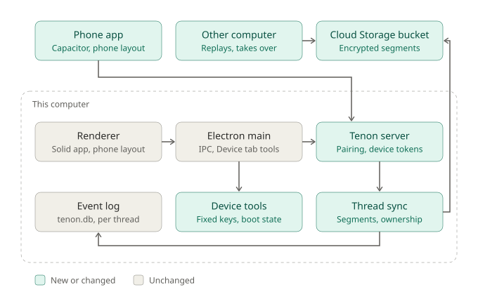
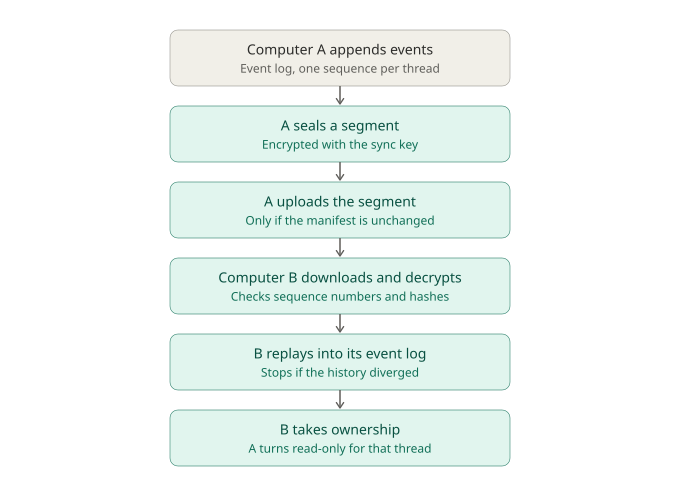

# Mobile companion, thread sync and full test pass

- Mode: TOR-Workflow with TOR-3-Agents (two implementors, one verifier), then the review panel.
- Subagents: Opus 5.5, medium effort (the user's choice, panel included).
- Base commit: `9623f3030f85e5128b118b8a6f3a9873bc4562e9` on `claude/mobile-app-planning-84f916`.
- Plan author: the orchestrating agent. It wrote both test sets; `verification/` is kept outside the
  repository and is given only to the verifier and the reviewers.
- This folder uses the repository's existing lower-case `implementations/`.

## Problem and expected behaviour

Tenon Workbench runs on one computer. The user wants:

1. every feature inventoried and tested, with the gaps closed;
2. the Device tab working for Android and, as far as code can show, iOS;
3. a thread started on one computer continued on another, stored in Google Cloud;
4. a phone app for Android and iOS;
5. a ranked list of further features, then the best of them built.

Before: the server listens on loopback with one generated password, a thread's events live only in the
local `tenon.db`, the Device tab sends Home for every iOS key, and there is no list of what is tested.

After: a feature test matrix says how each feature is tested; a phone paired with the computer can read
and steer threads; a thread's encrypted event segments sit in the user's own Cloud Storage bucket and a
second computer can take the thread over.

## Decisions already made by the user

| Decision | Choice |
| --- | --- |
| Mobile scope | A companion to the computer, built with Capacitor around the existing renderer |
| iOS | Written but unverified: there is no Mac |
| Android SDK | Installed on this computer |
| Sync storage | A Cloud Storage bucket in the user's own GCP project, personal use |
| Merging | Pull requests, merged only after the user approves |

## Diagrams






Sources for the current view: `tenon/packages/desktop/src/main/server.ts` (`spawnLocalServer`, loopback
and password), `tenon/packages/core/src/event.ts` (`replay`, `replayAll`, owner check),
`tenon/packages/tenon/src/server/routes/instance/httpapi/handlers/sync.ts` (existing replay and steal
routes), `tenon/packages/desktop/src/main/device.ts`, `tenon/packages/app/src/components/settings-v2/servers.tsx`.
The proposed and detail views are proposals until each phase's verified commit exists.

## Phases

Later phases get their detailed criteria and both test sets written by the plan author before that phase
starts; this section fixes their outcome, scope and order now.

| ID | Outcome | Edit scope | Depends on | Runs with |
| --- | --- | --- | --- | --- |
| P1 | A feature test matrix and a recorded baseline of every existing suite | `docs/records/feature-test-matrix.md`, `docs/records/test-baseline-2026-11-26.md`, `docs/README.md` link | independent | P2 |
| P2 | Device input, SDK discovery and boot feedback are correct on both platforms | `tenon/packages/desktop/src/main/device.ts`, `device.test.ts`, `tenon/packages/desktop/src/main/browser.ts` (device tool branch only), `tenon/packages/core/src/harness/browser-tools.ts` (`device_*` descriptions only), `tenon/packages/app/src/pages/session/device-tab.tsx`, new `device-boot.ts` and its test beside it, `tenon/packages/app/src/i18n/*`, the Device tab paragraph of `docs/architecture/README.md` | independent | P1 |
| P3 | Every `gap` row of the matrix has an automated test or a recorded manual run; bugs found are fixed or filed | new specs under `tenon/packages/app/e2e/`, unit tests beside code, small fixes | P1 | P4 |
| P4 | Thread sync engine: export, encrypt, upload, download, replay and ownership transfer behind a storage interface with a local-folder store and a Cloud Storage store | new `tenon/packages/core/src/thread-sync/`, server routes, docs | independent | P3 |
| P5 | Thread sync in the app: Settings page, per-thread state, "Continue here" | `tenon/packages/app`, `tenon/packages/desktop/src/main` | P4 | P6 |
| P6 | Remote access: pairing by QR code, per-device tokens that can be revoked, a scope that leaves out terminals and computer use | server auth, `tenon/packages/desktop/src/main`, Settings › Servers | independent | P5 |
| P7 | Phone layout of the renderer below 600 px | `tenon/packages/app`, `tenon/packages/ui` | P6 | alone |
| P8 | Capacitor shell: Android build verified on an emulator, iOS project written and unverified | new `tenon/packages/mobile` | P7 | alone |
| P9 | Ranked feature backlog, then the features the user picks | set per feature | P3 | set per feature |

Each phase is one pull request. Nothing is merged without the user's approval.

## P1: feature test matrix and baseline

### Contract

`docs/records/feature-test-matrix.md` holds one or more Markdown tables with exactly this header:

```text
| ID | Area | Feature | Source | Coverage | Evidence | Status | Notes |
```

- `ID` is `F-` and three or more digits, unique in the file.
- `Source` holds one or more identifiers in backticks: a route path, an IPC channel, a tool name, an
  HTTP route, `settings:<tab>`, or a repository-relative file path.
- `Coverage` is one of `unit`, `e2e`, `unit+e2e`, `none`.
- `Evidence` holds repository-relative paths of existing test files in backticks; empty only when
  `Coverage` is `none`. `e2e` coverage cites at least one file under an `e2e/` folder; `unit` coverage
  cites at least one test file outside it.
- `Status` is one of `covered`, `gap` (needs a new automated test in P3), `manual` (can only be checked
  by driving the app) or `blocked` (needs something this computer lacks: a Mac, an account, a microphone).
- `Notes` is required for `manual` and `blocked` rows and says what is needed.

`docs/records/test-baseline-2026-11-26.md` holds one table with the header
`| Command | Working directory | Result | Passed | Failed | Notes |` and one row per command below, with
`Result` one of `pass`, `fail`, `not run`. A `not run` row says why in `Notes`. Every failing test is
named under the table with the matrix ID it belongs to.

Commands: `bun run typecheck`, `bun run lint`, `bun run format:check`, `bun run check:generated`,
`bun run test`, `bun run build`, `bun run test:engine`, `bun run test:routes`, `bun run test:desktop`,
`bun run test:app`, and `bun run test:e2e` in `tenon/packages/app`.

### Acceptance criteria

- **AC-P1-1** The matrix exists, every table has the header above, IDs are unique and well formed, and
  `Coverage` and `Status` use only the listed words.
- **AC-P1-2** A row whose `Coverage` is `none` has status `gap`, `manual` or `blocked`; every other row
  has at least one `Evidence` path, and every `Evidence` path is an existing file.
- **AC-P1-3** Every literal route path in `tenon/packages/app/src/app.tsx` (`<Route path="…">`) appears
  in a `Source` cell.
- **AC-P1-4** Every IPC channel registered in `tenon/packages/desktop/src/main/ipc.ts` (`trustedHandle`,
  `trustedOn`, `ipcMain.handle`, `ipcMain.on`) appears in a `Source` cell.
- **AC-P1-5** Every tool name in `tenon/packages/core/src/harness/browser-tools.ts` appears in a `Source` cell.
- **AC-P1-6** Every Settings tab in `tenon/packages/app/src/components/settings-v2/dialog-settings-v2.tsx`
  (`TabsV2.Trigger value="…"`) appears as `settings:<value>` in a `Source` cell.
- **AC-P1-7** Every `/second-brain/…` and `/command-centre/…` route path in
  `tenon/packages/tenon/src/server/routes/instance/httpapi/groups/second-brain.ts` appears in a `Source` cell.
- **AC-P1-8** Every Playwright spec under `tenon/packages/app/e2e/{acceptance,regression,smoke,user-story}`
  is the `Evidence` of at least one row.
- **AC-P1-9** `manual` and `blocked` rows have notes.
- **AC-P1-10** The matrix has rows for the features the user named: subagents and child threads, dragging
  threads with the mouse, file upload and attachments, cross-harness delegation, terminals, the Browser
  tab, the Device tab, dictation, routines, the desktop widget, harness sync, Calendar and Google sync,
  the Command Centre, token usage, and the note editor. The test looks for these words in `Feature`,
  ignoring case: `subagent`, `drag`, `upload`, `delegat`, `terminal`, `browser tab`, `device tab`,
  `dictation`, `routine`, `widget`, `harness sync`, `calendar`, `command centre`, `usage`, `editor`.
- **AC-P1-11** The baseline file exists with a row per command and a valid `Result`; no product code,
  test or configuration file changes in this phase.
- **AC-P1-12** The matrix is accurate, not only complete: a row describes a real feature a user or agent
  can reach, one row covers one feature (channels and routes of the same feature share a row), and a
  `covered` row's evidence exercises that feature. The verifier and reviewers read at least 15 rows
  against the code and the cited tests; a wrong row is a defect.

| Criterion | Acceptance set | Verification set |
| --- | --- | --- |
| AC-P1-1, 2, 3, 4, 5 | `acceptance/p1-matrix.test.ts` | `verification/p1-matrix.test.ts` (different extraction and row checks) |
| AC-P1-6, 7, 8, 9, 10, 11 | stated here | `verification/p1-matrix.test.ts` |
| AC-P1-12 | | reading rows against the code |

## P2: Device tab and device tools

### Contract

`tenon/packages/desktop/src/main/device.ts` exports two pure functions; `deviceInput` runs exactly the
commands the first one returns, in order, and stops at the first failure.

```ts
inputCommands(platform: DevicePlatform, id: string, input: DeviceInput): Array<{ tool: "adb" | "idb"; args: string[] }>
sdkRootCandidates(input: { env: Record<string, string | undefined>; platform: NodeJS.Platform; home: string }): string[]
```

`tenon/packages/app/src/pages/session/device-boot.ts` exports:

```ts
bootStage(input: { requestedAt: number | undefined; now: number; running: boolean }): "idle" | "starting" | "slow" | "timeout"
deviceHint(device: { platform: "android" | "ios"; state: string }): "unauthorized" | "offline" | undefined
```

### Acceptance criteria

- **AC-P2-1** iOS keys: `home` is `idb ui button --udid <id> HOME`; `enter` is `idb ui key --udid <id> 40`
  (the HID Return key); `back` throws an error whose message contains `Back` and runs nothing.
  Before: all three pressed Home (`device.ts:156`).
- **AC-P2-2** Android keys are unchanged: `KEYCODE_HOME`, `KEYCODE_BACK`, `KEYCODE_ENTER` through
  `adb -s <id> shell input keyevent`.
- **AC-P2-3** Android text: any character that is neither printable ASCII (space to `~`) nor a line
  break throws an error whose message contains `ASCII` and runs nothing; a line break (`\n` or `\r\n`) types the text before it, then
  `KEYCODE_ENTER`, then the rest; an empty line sends only the key; empty text returns no commands. Each
  typed piece uses the existing `androidText` escaping.
- **AC-P2-4** Tap and swipe coordinates are rounded and never negative, on both platforms; Android
  swipes keep the 300 ms duration. iOS text is one `idb ui text --udid <id> <text>`; empty text returns
  no commands.
- **AC-P2-5** `sdkRootCandidates` returns, in order, `ANDROID_HOME`, `ANDROID_SDK_ROOT`, then the
  platform default: `<LOCALAPPDATA>\Android\Sdk` on Windows (built with `path.win32`),
  `<home>/Library/Android/sdk` on macOS, `<home>/Android/Sdk` elsewhere (built with `path.posix`). Unset
  or empty variables add nothing, so no relative path is ever returned. Before: an unset `LOCALAPPDATA`
  produced the relative `Android\Sdk`.
- **AC-P2-6** `bootStage`: `idle` with no request or once the device is running; `starting` for the
  first 60 s after a request; `slow` from 60 s; `timeout` from 180 s. The Device tab shows a line for
  `starting`, `slow` and `timeout` (i18n keys, English source copy) and refreshes the device list every
  2 s while a boot is pending.
- **AC-P2-7** `deviceHint`: an Android device in state `unauthorized` or `offline` returns that word;
  `device`, any iOS state and anything else return `undefined`. The Device tab lists such a device with a
  hint line instead of showing nothing.
- **AC-P2-8** The `device_key` tool's description says Back is Android only and that Enter works on
  both; on iOS a `back` call returns the AC-P2-1 error to the agent.
- **AC-P2-9** No new IPC channel, route or tool name. Existing `device.test.ts` cases keep passing. The
  Device tab paragraph in `docs/architecture/README.md` describes the new behaviour. No comments in
  source code; user-visible text goes through i18n.

Invariants: `ipc.ts` handlers stay thin; no shell string is built (arguments stay an array to
`execFile`); the renderer still passes only platform, device ID and input.

| Criterion | Acceptance set | Verification set |
| --- | --- | --- |
| AC-P2-1 to 5 | `acceptance/p2-device.test.ts` | `verification/p2-device.test.ts` (other inputs and orders) |
| AC-P2-6, 7 | `acceptance/p2-device-boot.test.ts` | `verification/p2-device-boot.test.ts` (boundaries) |
| AC-P2-8, 9 | diff review | diff review, `bun run typecheck`, `bun run lint` |
| Manual | | the orchestrator drives an Android emulator through the Device tab after the SDK install; iOS stays unverified |

## Verification commands

Run from `tenon/packages/desktop` unless noted. Verification tests are copied to
`implementations/mobile-sync-programme/verification/` in the verifier's checkout only.

```sh
bun test ../../../implementations/mobile-sync-programme/acceptance/p1-matrix.test.ts
bun test ../../../implementations/mobile-sync-programme/acceptance/p2-device.test.ts
bun test src/main/device.test.ts
cd ../app && bun test ../../../implementations/mobile-sync-programme/acceptance/p2-device-boot.test.ts
```

```sh
bun test ../../../implementations/mobile-sync-programme/verification/p1-matrix.test.ts
bun test ../../../implementations/mobile-sync-programme/verification/p2-device.test.ts
cd ../app && bun test ../../../implementations/mobile-sync-programme/verification/p2-device-boot.test.ts
```

Standard checks for a phase that changes code, from the repository root: `bun run typecheck`,
`bun run lint`, `bun run format:check`, `bun run test:desktop`, `bun run test:app`.

Baseline on the base commit: recorded under Completion evidence.

## Completion evidence

Filled in as phases pass. Implementor reports and verifier results are kept apart.
