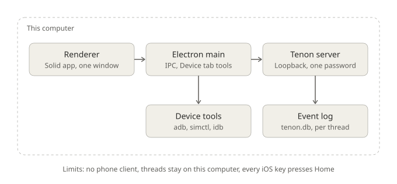

# Mobile companion, thread sync and full test pass

- Mode: TOR-Workflow with TOR-3-Agents (two implementors, one verifier), then the review panel.
- Subagents: Opus 5.5, medium effort (the user's choice, panel included).
- Base commit: `9623f3030f85e5128b118b8a6f3a9873bc4562e9` on `claude/mobile-app-planning-84f916`.
- Plan author: the orchestrating agent. It wrote both test sets; `verification/` is kept outside the
  repository and is given only to the verifier and the reviewers.
- This folder uses the repository's existing lower-case `implementations/`.

## Problem and expected behaviour

Tenon Workbench runs on one computer. The user wants:

1. every feature inventoried and tested, with the gaps closed;
2. the Device tab working for Android and, as far as code can show, iOS;
3. a thread started on one computer continued on another, stored in Google Cloud;
4. a phone app for Android and iOS;
5. a ranked list of further features, then the best of them built.

Before: the server listens on loopback with one generated password, a thread's events live only in the
local `tenon.db`, the Device tab sends Home for every iOS key, and there is no list of what is tested.

After: a feature test matrix says how each feature is tested; a phone paired with the computer can read
and steer threads; a thread's encrypted event segments sit in the user's own Cloud Storage bucket and a
second computer can take the thread over.

## Decisions already made by the user

| Decision | Choice |
| --- | --- |
| Mobile scope | A companion to the computer, built with Capacitor around the existing renderer |
| iOS | Written but unverified: there is no Mac |
| Android SDK | Installed on this computer |
| Sync storage | A Cloud Storage bucket in the user's own GCP project, personal use |
| Merging | Pull requests, merged only after the user approves |

## Diagrams




Sources for the current view: `tenon/packages/desktop/src/main/server.ts` (`spawnLocalServer`, loopback
and password), `tenon/packages/core/src/event.ts` (`replay`, `replayAll`, owner check),
`tenon/packages/tenon/src/server/routes/instance/httpapi/handlers/sync.ts` (existing replay and steal
routes), `tenon/packages/desktop/src/main/device.ts`, `tenon/packages/app/src/components/settings-v2/servers.tsx`.
The proposed and detail views are proposals until each phase's verified commit exists.

## Phases

Later phases get their detailed criteria and both test sets written by the plan author before that phase
starts; this section fixes their outcome, scope and order now.

| ID | Outcome | Edit scope | Depends on | Runs with |
| --- | --- | --- | --- | --- |
| P1 | A feature test matrix and a recorded baseline of every existing suite | `docs/records/feature-test-matrix.md`, `docs/records/test-baseline-2026-11-26.md`, `docs/README.md` link | independent | P2 |
| P2 | Device input, SDK discovery and boot feedback are correct on both platforms | `tenon/packages/desktop/src/main/device.ts`, `device.test.ts`, `tenon/packages/desktop/src/main/browser.ts` (device tool branch only), `tenon/packages/core/src/harness/browser-tools.ts` (`device_*` descriptions only), `tenon/packages/app/src/pages/session/device-tab.tsx`, new `device-boot.ts` and its test beside it, `tenon/packages/app/src/i18n/*`, the Device tab paragraph of `docs/architecture/README.md` | independent | P1 |
| P3 | Every `gap` row of the matrix has an automated test or a recorded manual run; bugs found are fixed or filed | new specs under `tenon/packages/app/e2e/`, unit tests beside code, small fixes | P1 | P4 |
| P4 | Thread sync engine: export, encrypt, upload, download, replay and ownership transfer behind a storage interface with a local-folder store and a Cloud Storage store | new `tenon/packages/core/src/thread-sync.ts` and `src/thread-sync/`, `tenon/packages/core/test/thread-sync/`, `docs/architecture/README.md` (new section), `docs/architecture/uml.md`, `docs/security/threat-model.md` (new section), `docs/diagrams/` (new file) | independent | P3 |
| P5 | Thread sync in the app: Settings page, per-thread state, "Continue here" | `tenon/packages/app`, `tenon/packages/desktop/src/main` | P4 | P6 |
| P6 | Remote access: pairing by QR code, per-device tokens that can be revoked, a scope that leaves out terminals and computer use | server auth, `tenon/packages/desktop/src/main`, Settings › Servers | independent | P5 |
| P7 | Phone layout of the renderer below 600 px | `tenon/packages/app`, `tenon/packages/ui` | P6 | alone |
| P8 | Capacitor shell: Android build verified on an emulator, iOS project written and unverified | new `tenon/packages/mobile` | P7 | alone |
| P9 | Ranked feature backlog, then the features the user picks | set per feature | P3 | set per feature |

Each phase is one pull request. Nothing is merged without the user's approval.

## P1: feature test matrix and baseline

### Contract

`docs/records/feature-test-matrix.md` holds one or more Markdown tables with exactly this header:

```text
| ID | Area | Feature | Source | Coverage | Evidence | Status | Notes |
```

- `ID` is `F-` and three or more digits, unique in the file.
- `Source` holds one or more identifiers in backticks: a route path, an IPC channel, a tool name, an
  HTTP route, `settings:<tab>`, or a repository-relative file path.
- `Coverage` is one of `unit`, `e2e`, `unit+e2e`, `none`.
- `Evidence` holds repository-relative paths of existing test files in backticks; empty only when
  `Coverage` is `none`. `e2e` coverage cites at least one file under an `e2e/` folder; `unit` coverage
  cites at least one test file outside it.
- `Status` is one of `covered`, `gap` (needs a new automated test in P3), `manual` (can only be checked
  by driving the app) or `blocked` (needs something this computer lacks: a Mac, an account, a microphone).
- `Notes` is required for `manual` and `blocked` rows and says what is needed.

`docs/records/test-baseline-2026-11-26.md` holds one table with the header
`| Command | Working directory | Result | Passed | Failed | Notes |` and one row per command below, with
`Result` one of `pass`, `fail`, `not run`. A `not run` row says why in `Notes`. Every failing test is
named under the table with the matrix ID it belongs to.

Commands: `bun run typecheck`, `bun run lint`, `bun run format:check`, `bun run check:generated`,
`bun run test`, `bun run build`, `bun run test:engine`, `bun run test:routes`, `bun run test:desktop`,
`bun run test:app`, and `bun run test:e2e` in `tenon/packages/app`.

### Acceptance criteria

- **AC-P1-1** The matrix exists, every table has the header above, IDs are unique and well formed, and
  `Coverage` and `Status` use only the listed words.
- **AC-P1-2** A row whose `Coverage` is `none` has status `gap`, `manual` or `blocked`; every other row
  has at least one `Evidence` path, and every `Evidence` path is an existing file.
- **AC-P1-3** Every literal route path in `tenon/packages/app/src/app.tsx` (`<Route path="…">`) appears
  in a `Source` cell.
- **AC-P1-4** Every IPC channel registered in `tenon/packages/desktop/src/main/ipc.ts` (`trustedHandle`,
  `trustedOn`, `ipcMain.handle`, `ipcMain.on`) appears in a `Source` cell.
- **AC-P1-5** Every tool name in `tenon/packages/core/src/harness/browser-tools.ts` appears in a `Source` cell.
- **AC-P1-6** Every Settings tab in `tenon/packages/app/src/components/settings-v2/dialog-settings-v2.tsx`
  (`TabsV2.Trigger value="…"`) appears as `settings:<value>` in a `Source` cell.
- **AC-P1-7** Every `/second-brain/…` and `/command-centre/…` route path in
  `tenon/packages/tenon/src/server/routes/instance/httpapi/groups/second-brain.ts` appears in a `Source` cell.
- **AC-P1-8** Every Playwright spec under `tenon/packages/app/e2e/{acceptance,regression,smoke,user-story}`
  is the `Evidence` of at least one row.
- **AC-P1-9** `manual` and `blocked` rows have notes.
- **AC-P1-10** The matrix has rows for the features the user named: subagents and child threads, dragging
  threads with the mouse, file upload and attachments, cross-harness delegation, terminals, the Browser
  tab, the Device tab, dictation, routines, the desktop widget, harness sync, Calendar and Google sync,
  the Command Centre, token usage, and the note editor. The test looks for these words in `Feature`,
  ignoring case: `subagent`, `drag`, `upload`, `delegat`, `terminal`, `browser tab`, `device tab`,
  `dictation`, `routine`, `widget`, `harness sync`, `calendar`, `command centre`, `usage`, `editor`.
- **AC-P1-11** The baseline file exists with a row per command and a valid `Result`; no product code,
  test or configuration file changes in this phase.
- **AC-P1-12** The matrix is accurate, not only complete: a row describes a real feature a user or agent
  can reach, one row covers one feature (channels and routes of the same feature share a row), and a
  `covered` row's evidence exercises that feature. The verifier and reviewers read at least 15 rows
  against the code and the cited tests; a wrong row is a defect.

| Criterion | Acceptance set | Verification set |
| --- | --- | --- |
| AC-P1-1, 2, 3, 4, 5 | `acceptance/p1-matrix.test.ts` | `verification/p1-matrix.test.ts` (different extraction and row checks) |
| AC-P1-6, 7, 8, 9, 10, 11 | stated here | `verification/p1-matrix.test.ts` |
| AC-P1-12 | | reading rows against the code |

## P2: Device tab and device tools

### Contract

`tenon/packages/desktop/src/main/device.ts` exports two pure functions; `deviceInput` runs exactly the
commands the first one returns, in order, and stops at the first failure.

```ts
inputCommands(platform: DevicePlatform, id: string, input: DeviceInput): Array<{ tool: "adb" | "idb"; args: string[] }>
sdkRootCandidates(input: { env: Record<string, string | undefined>; platform: NodeJS.Platform; home: string }): string[]
```

`tenon/packages/app/src/pages/session/device-boot.ts` exports:

```ts
bootStage(input: { requestedAt: number | undefined; now: number; running: boolean }): "idle" | "starting" | "slow" | "timeout"
deviceHint(device: { platform: "android" | "ios"; state: string }): "unauthorized" | "offline" | undefined
```

### Acceptance criteria

- **AC-P2-1** iOS keys: `home` is `idb ui button --udid <id> HOME`; `enter` is `idb ui key --udid <id> 40`
  (the HID Return key); `back` throws an error whose message contains `Back` and runs nothing.
  Before: all three pressed Home (`device.ts:156`).
- **AC-P2-2** Android keys are unchanged: `KEYCODE_HOME`, `KEYCODE_BACK`, `KEYCODE_ENTER` through
  `adb -s <id> shell input keyevent`.
- **AC-P2-3** Android text: any character that is neither printable ASCII (space to `~`) nor a line
  break throws an error whose message contains `ASCII` and runs nothing; a line break (`\n` or `\r\n`) types the text before it, then
  `KEYCODE_ENTER`, then the rest; an empty line sends only the key; empty text returns no commands. Each
  typed piece uses the existing `androidText` escaping.
- **AC-P2-4** Tap and swipe coordinates are rounded and never negative, on both platforms; Android
  swipes keep the 300 ms duration. iOS text is one `idb ui text --udid <id> <text>`; empty text returns
  no commands.
- **AC-P2-5** `sdkRootCandidates` returns, in order, `ANDROID_HOME`, `ANDROID_SDK_ROOT`, then the
  platform default: `<LOCALAPPDATA>\Android\Sdk` on Windows (built with `path.win32`),
  `<home>/Library/Android/sdk` on macOS, `<home>/Android/Sdk` elsewhere (built with `path.posix`). Unset
  or empty variables add nothing, so no relative path is ever returned. Before: an unset `LOCALAPPDATA`
  produced the relative `Android\Sdk`.
- **AC-P2-6** `bootStage`: `idle` with no request or once the device is running; `starting` for the
  first 60 s after a request; `slow` from 60 s; `timeout` from 180 s. The Device tab shows a line for
  `starting`, `slow` and `timeout` (i18n keys, English source copy) and refreshes the device list every
  2 s while a boot is pending.
- **AC-P2-7** `deviceHint`: an Android device in state `unauthorized` or `offline` returns that word;
  `device`, any iOS state and anything else return `undefined`. The Device tab lists such a device with a
  hint line instead of showing nothing.
- **AC-P2-8** The `device_key` tool's description says Back is Android only and that Enter works on
  both; on iOS a `back` call returns the AC-P2-1 error to the agent.
- **AC-P2-9** No new IPC channel, route or tool name. Existing `device.test.ts` cases keep passing. The
  Device tab paragraph in `docs/architecture/README.md` describes the new behaviour. No comments in
  source code; user-visible text goes through i18n.

Added on 2026-11-26 at the user's request, after seeing the Device tab with a live emulator ("please fix
the layout of the phone inside the emulators"). Before: the bezel was as tall as the panel, so black
bands sat above and below the screen; the phone hugged the left edge; Home, Back and "Screenshot to
thread" were bare text beside it and wrapped.

- **AC-P2-10 Phone layout.** The bezel wraps the screen image with the same inset on all four sides (no
  band above or below it) at the image's own aspect ratio, portrait or landscape. The phone is centred
  in the panel and always fits inside it, at any panel width from 320 px and any height, without being
  clipped or covered. The placeholder shown before the first frame has the same shape. The controls
  (Home, Back on Android, Screenshot to thread) are one tidy toolbar of the app's own v2 buttons with
  tooltips and accessible names, placed so they never wrap or push the phone off-centre. The image
  element's box equals the displayed bitmap, so a tap still lands where it is clicked.
- **AC-P2-11 Gone device.** When the device being shown disappears, its last frame and any screenshot
  error are cleared and the tab returns to "Start a device"; errors shown in the tab carry no
  `Error invoking remote method '…':` prefix.

Added after review panel round 1 (bugs the reviewers found that no criterion covered):

- **AC-P2-12 Input robustness.** A coordinate that is not a finite number is sent as `0`. An input whose
  `kind` or `key` is not one of the listed values, or whose text is not a string, is refused with an
  error before any command is built, on both platforms. The Device tab never shows a frame at a shape
  that is not its own (a landscape device's first frame is not stretched, and a new device's
  placeholder does not take the previous device's shape), and its boot timer runs only while a boot is
  starting or slow.

Checked by the orchestrator against the live emulator: bezel and image rectangles, centring and fit at
three panel sizes, a tap on a known target, and screenshots.

Invariants: `ipc.ts` handlers stay thin; no shell string is built (arguments stay an array to
`execFile`); the renderer still passes only platform, device ID and input.

| Criterion | Acceptance set | Verification set |
| --- | --- | --- |
| AC-P2-1 to 5 | `acceptance/p2-device.test.ts` | `verification/p2-device.test.ts` (other inputs and orders) |
| AC-P2-6, 7 | `acceptance/p2-device-boot.test.ts` | `verification/p2-device-boot.test.ts` (boundaries) |
| AC-P2-8, 9 | diff review | diff review, `bun run typecheck`, `bun run lint` |
| Manual | | the orchestrator drives an Android emulator through the Device tab after the SDK install; iOS stays unverified |

## P3: repair the baseline, then close the gaps

P1's baseline on the base commit found `bun run test:e2e` failing 66 of 221 tests and
`bun run test:engine` failing 3 (plus 2 in the half that never ran). P3 has four parts. P3a and P3b run
as a pair from the integrated P1 and P2 commit; P3c and P3d follow.

| Part | Outcome | Edit scope |
| --- | --- | --- |
| P3a | The thread-view end-to-end failures are repaired | `tenon/packages/app/e2e/regression/session-*.spec.ts`, `e2e/regression/terminal-*.spec.ts`, `e2e/regression/prompt-thinking-level.spec.ts`, `e2e/smoke/**`, shared `e2e/utils/**` and fixtures; product fixes under `tenon/packages/app/src/pages/session/**`, `tenon/packages/app/src/context/terminal.tsx`, `tenon/packages/session-ui/**`; `docs/records/e2e-repair-2026-11-26-thread-view.md` |
| P3b | The other end-to-end failures and the engine failures are repaired | every other failing spec (`e2e/acceptance/**`, `e2e/user-story/**`, the remaining `e2e/regression/*.spec.ts`); product fixes elsewhere in `tenon/packages/app/src` and `tenon/packages/ui`; `tenon/packages/core/test/{git,harness-setup,workspace-instructions}.test.ts`, the harness key file code in `tenon/packages/core/src/harness/`, `tenon/packages/tenon/test/server/httpapi-session.test.ts`, `tenon/packages/tenon/test/tool/registry.test.ts`, the root `package.json` `test:engine` script and the `AGENTS.md` line that names it; `docs/records/e2e-repair-2026-11-26-app.md` |
| P3c | Every `gap` row of the matrix has an automated test, or is reclassified with a reason the plan author accepts | new test files only, plus the matrix |
| P3d | Every `manual` row has a recorded run in the real app with evidence | `docs/records/` only; bugs found become fixes in their own change |

A fix that needs a file in the other part's scope is reported, not made.

P3b also refreshes the matrix to the tree it works on. The matrix records the base commit `e125392b`
(its header says so), and P1 and P2 are separate pull requests, so P1 cannot cite P2's new tests.
The integration check found three rows P2 changes: F-1010 (its note must say input commands and SDK
discovery are now tested and what is left), F-1212 (coverage `unit`, citing `device.test.ts`, still
`blocked` for a real run) and F-1210 (add `device-boot.test.ts`). P3b updates them along with the rows
its own repairs change.

### Acceptance criteria (P3a and P3b)

- **AC-P3-1** `bun run test:e2e` in `tenon/packages/app` ends with no failed test, at least as many
  tests run as on the baseline (221) and no more skipped (1).
- **AC-P3-2** Each of the 66 baseline failures has a row in that part's repair record, a table with the
  header `| Spec | Test | Decision | Evidence | Change |`. `Spec` and `Test` are copied from the
  baseline's failing-test table. `Decision` is `spec drifted` (the app is right and the spec was
  updated to what the app is meant to do), `app regressed` (the spec is right and the app was fixed) or
  `feature removed` (the test was deleted because the feature no longer exists). `Evidence` names the
  commit, document or code that shows which side is right. `Change` names the files changed.
- **AC-P3-3** Nothing is weakened: no new `.skip`, `.fixme` or `.only`; a test is deleted only for
  `feature removed`; a repaired test still asserts the behaviour its title names; timeouts are raised
  only with a measured reason in the record.
- **AC-P3-4** `Failed to list terminals` is fixed in `context/terminal.tsx` (a non-array answer is
  handled) with a unit test. A locator that matched two elements is fixed by naming the element
  precisely, unless the two elements share an accessible name by mistake, which is then fixed in the app.
- **AC-P3-5** `bun run test:engine` passes on this Windows computer and runs both packages even when
  the first fails, exiting non-zero if either fails. Symlink tests skip, with the reason printed, only
  when the operating system refuses to create a symlink (probed at run time, not decided by platform
  name). The harness key file is private on Windows as well (its access list names only the current
  user) and the test checks the protection the platform really has. The session compact test and the
  plugin registry time-out are each decided like AC-P3-2 and recorded.
- **AC-P3-6** `bun run typecheck`, `bun run lint`, `bun run format:check`, `bun run test` and
  `bun run test:app` still pass. No source comments.

| Criterion | Acceptance set | Verification set |
| --- | --- | --- |
| AC-P3-1, 5, 6 | the suites themselves | the verifier runs them on the candidate |
| AC-P3-2, 3 | stated here | `verification/p3-repair.test.ts` (every baseline failure has a decided row; skip, spec and test counts) and reading repaired specs against their titles |
| AC-P3-4 | the implementor's unit test | diff review |

## P4: thread sync engine

A library in `tenon/packages/core` that moves one thread's event log between computers through an
object store. It has no server route, no setting and no UI; P5 adds those, with the Google sign-in that
supplies the Cloud Storage token.

Facts it builds on (verified on the base commit): both thread formats write durable events to the
`event` table with one sequence per thread (`aggregate_id` is the session ID); `EventV2.replayAll`
rebuilds the session, messages and inputs in another database and stops when history differs;
replaying into a database without the thread's project row fails, so the engine must create what the
replay needs.

### Contract

`tenon/packages/core/src/thread-sync.ts` exports the namespace `ThreadSync` (the repository's
self-export pattern, importable as `@tenon/core/thread-sync`); supporting files go in
`tenon/packages/core/src/thread-sync/`.

```ts
ThreadSync.generateKey(): { key: Uint8Array; phrase: string }
ThreadSync.keyFromPhrase(phrase: string): Uint8Array

ThreadSync.seal(input: { key: Uint8Array; sessionID: string; previous: string | null; events: ReadonlyArray<EventV2.SerializedEvent> }):
  Promise<{ bytes: Uint8Array; hash: string; first: number; last: number }>
ThreadSync.open(input: { key: Uint8Array; sessionID: string; previous: string | null; bytes: Uint8Array }):
  Promise<{ events: EventV2.SerializedEvent[]; hash: string; first: number; last: number }>

type ThreadSync.Store = {
  get(name: string): Promise<{ bytes: Uint8Array; generation: string } | undefined>
  put(name: string, bytes: Uint8Array, options?: { ifGeneration?: string | null }): Promise<{ generation: string }>
  list(prefix: string): Promise<Array<{ name: string; generation: string; size: number }>>
  remove(name: string): Promise<void>
}
ThreadSync.folderStore(directory: string): ThreadSync.Store
ThreadSync.gcsStore(input: { bucket: string; token: () => Promise<string>; endpoint?: string; prefix?: string }): ThreadSync.Store

ThreadSync.make(input: {
  db: Database.Interface["db"]; events: EventV2.Interface; store: ThreadSync.Store
  key: Uint8Array; machine: { id: string; name: string }
}): {
  push(sessionID: string): Effect.Effect<{ uploaded: number; head: number }, ThreadSync.SyncError>
  pull(sessionID: string): Effect.Effect<{ applied: number; head: number }, ThreadSync.SyncError>
  takeOver(sessionID: string): Effect.Effect<{ applied: number; head: number }, ThreadSync.SyncError>
  list(): Effect.Effect<Array<{ sessionID: string; head: number; owner: { id: string; name: string }
    updatedAt: number; directory: string; title: string }>, ThreadSync.SyncError>
  remove(sessionID: string): Effect.Effect<void, ThreadSync.SyncError>
}
```

`ThreadSync.SyncError` is an error with a string `code`. The promise functions reject with it (or throw
it, for `keyFromPhrase`); the engine's effects fail with it in the error channel, not as a defect. Codes:
`invalid_key`, `invalid_segment`, `unreadable`, `invalid_name`, `conflict`, `unauthorized`,
`unavailable`, `not_found`, `not_owner`, `diverged`, `foreign_path`, `unsupported`.

### Acceptance criteria

- **AC-P4-1 Keys.** A generated key is 32 random bytes; its phrase gives the same key back, also with
  surrounding white space; anything else is `invalid_key`. A key that is not 32 bytes is `invalid_key`
  wherever it is used.
- **AC-P4-2 Segments.** `seal` encrypts a run of one thread's events with authenticated encryption and a
  fresh nonce, so two seals of the same input differ and no event text is readable in the bytes. `hash`
  is the lower-case hex SHA-256 of `bytes`; `first` and `last` are the first and last sequence numbers.
  `open` returns the same events. A segment is bound to its thread and to `previous` (the hash of the
  segment before it, `null` for the first), so segments open only in order. Events must be non-empty,
  of the given thread and of consecutive sequence numbers, else `invalid_segment`.
- **AC-P4-3 Unreadable.** `open` fails with `unreadable` for another key, a changed, truncated or empty
  input, another `sessionID` or another `previous`.
- **AC-P4-4 Stores.** `get` of a missing name is `undefined`. `put` with `ifGeneration: null` writes only
  when the name is free, with a generation only when that is the current generation, and without the
  option always; a failed condition is `conflict`. Every write gives a new generation. `list` returns the
  names under a prefix sorted by name with their generation and byte size. `remove` of a missing name
  succeeds. A name is one or more `/`-separated parts of `A-Z a-z 0-9 . _ -`, none of them `.` or `..`;
  anything else is `invalid_name` on every method (for `list`, the prefix may end in `/`) and touches
  nothing. Two `folderStore`s on one directory see each other's writes.
- **AC-P4-5 Cloud Storage.** `gcsStore` uses the Cloud Storage JSON API at `endpoint` (default
  `https://storage.googleapis.com`) with `Authorization: Bearer <token>` from `token()` on every request:
  `GET /storage/v1/b/<bucket>/o/<name>?alt=media` (generation from the `x-goog-generation` header, 404 is
  `undefined`), `POST /upload/storage/v1/b/<bucket>/o?uploadType=media&name=<name>` with
  `ifGenerationMatch=<generation>` (`0` for "must not exist"; 412 is `conflict`),
  `GET /storage/v1/b/<bucket>/o?prefix=<prefix>` following `nextPageToken`, and
  `DELETE /storage/v1/b/<bucket>/o/<name>` (404 is fine). Object names in the path are percent-encoded,
  slashes included. With `prefix`, objects are stored under it and names come back without it. 401 and
  403 are `unauthorized`; a network failure or a 5xx after the store's own retries is `unavailable`. The
  retries of one call take at most two seconds in total, and no single request waits longer than
  fifteen seconds.
- **AC-P4-6 Push and pull.** `push` uploads the events the store does not have yet as a sealed segment
  and returns how many (`0` and no write when up to date) and the head sequence; the first push makes
  this machine the owner. `pull` applies the events this computer lacks through the event log's replay,
  into a database that has never seen the thread or its project, and returns how many; afterwards the
  thread reads through `SessionStore` like a local one and can be prompted. Both work across new engine
  instances and reopened databases. A thread with no local events (`push`) or no stored copy (`pull`) is
  `not_found`; a wrong key is `unreadable` and changes nothing locally. A thread whose folder is a path this
  operating system cannot hold (a Windows drive path on macOS) fails with `foreign_path` before anything
  local changes; mapping it to a local folder is P5's job. A pull is all or nothing: if any stored event
  cannot be applied here (a type this version does not know, data that fails its schema, or a replay
  that fails for any other reason), `pull` and `takeOver` fail with `unsupported`, no event of that pull
  stays in the local log and the local owner is unchanged. `diverged` means only that a local event
  differs from the stored one at the same sequence.
- **AC-P4-7 Ownership.** Only the owner pushes; anyone else gets `not_owner`. `takeOver` pulls to the
  head, then makes this machine the owner with a conditional write, and is a no-op for the owner. If
  this computer's log holds an event at a sequence where the stored thread has a different one, `pull`
  and `takeOver` fail with `diverged` and the local log and ownership stay as they were.
- **AC-P4-8 At rest.** Everything the engine stores is under `threads/<sessionID>/`. Names hold only the
  session ID and sequence numbers or hashes. All contents are sealed with the key, the manifest included
  (owner, title, directory), so no prompt text, path, machine ID or machine name is readable in the
  store. Every `put` the engine makes carries `ifGeneration` (`null` for a new object).
- **AC-P4-9 List and remove.** `list` returns every stored thread, newest `updatedAt` first, where
  `updatedAt` is the time in epoch milliseconds of the last push that uploaded events, `directory` is the
  thread's folder on the computer that pushed it and `title` its title. `remove` deletes the stored copy
  (never the local thread) and is `not_owner` for anyone but the owner.
- **AC-P4-10 Documentation.** `docs/architecture/README.md` gains a "Thread sync" section with an SVG in
  `docs/diagrams/`; `docs/architecture/uml.md` gains the subsystem in its coverage index;
  `docs/security/threat-model.md` gains a section saying what is encrypted, what a bucket reader still
  learns (session IDs, sizes, timing, count), where the key is expected to live and what losing it means.
  No source comments. Nothing outside the P4 edit scope changes.

- **AC-P4-11 Robust against a flaky or rolled-back store** (added after review panel round 1; a reviewer's
  probes found these, no earlier criterion covered them).
  - A write whose reply is lost does no harm. If the manifest write reaches the store but the engine sees
    a failure, the stored thread stays readable and complete: the engine removes the segment it just
    wrote only when the store definitely refused the manifest write (a `conflict`) and a re-read shows
    the segment is not listed. After any other failure (a timeout, a dropped connection, `unavailable`)
    it cannot tell whether the write will still land, so it leaves the segment; an orphan costs nothing. The next `push` then succeeds or reports up to date truthfully, and a `pull` on
    another computer applies every event.
  - A stored copy that is behind this computer changes nothing here. When the stored head is lower than
    the local log's, `pull` applies nothing and does not change the local owner.
  - `gcsStore` treats a success reply it cannot parse as `unavailable` on every method (a listing never
    comes back empty because its body was malformed), stops with `unavailable` when a listing repeats a
    page token or runs past 1,000 pages, and counts the time `token()` takes inside the same limits.
  - The threat model says plainly what someone who can write to the store without the key can still do:
    delete objects, and put back an older genuine manifest, which can hand the lock back to a previous
    owner and let two computers continue from the same point; the engine reports that later as
    `diverged`, and each computer keeps its own copy.

Known limit, recorded rather than solved here: files an event only points to (the tool-output store,
image blobs) are not synced. P5 decides what to do about them.

The acceptance tests import `effect`, which resolves only inside the package. They are kept in
`implementations/mobile-sync-programme/acceptance/p4/` and the implementor copies both files unchanged
to `tenon/packages/core/test/thread-sync/` as its first step and commits them there.

| Criterion | Acceptance set | Verification set |
| --- | --- | --- |
| AC-P4-1 to 8 | `acceptance/p4/acceptance.test.ts` (main flows) | `verification/p4/verification.test.ts` (chains, bad segments, unsafe names, paging, error codes, restart, divergence, conditional writes, leaks through Cloud Storage) |
| AC-P4-9 | stated here | `verification/p4/verification.test.ts` |
| AC-P4-10 | diff review | diff review |

Commands, from `tenon/packages/core`: `bun test test/thread-sync` and, in the verifier's checkout after
copying `verification.test.ts` and `verification-gcs-fake.ts` into `test/thread-sync/`, the same command.
Standard checks: `bun run typecheck`, `bun run lint`, `bun run format:check`, `bun run test:engine`.
Baseline: on the base commit the acceptance file fails at the import of `../../src/thread-sync`.

## P5 and P6, split into a core half and an app half

P5 (thread sync in the app) and P6 (remote access for the phone) each have a half that can be built
and tested without the desktop window, and a half that needs it. The core halves run as a pair, then
the app halves.

| Part | Outcome | Edit scope |
| --- | --- | --- |
| P5a | A sync manager in the server: settings, the list of stored threads with their local state, push after a thread goes idle, and "continue here" with a local folder | `tenon/packages/core/src/thread-sync/` (new files, plus additive exports in `thread-sync.ts`), `tenon/packages/core/test/thread-sync/`, a new route group in `tenon/packages/protocol/src/groups/` and `tenon/packages/server/src/handlers/` with its lines in `protocol/src/api.ts` and `server/src/handlers.ts`, the generated client, docs |
| P6a | Device pairing, per-device tokens and a companion scope enforced by the server | `tenon/packages/core/src/remote-access.ts` and `src/remote-access/`, `tenon/packages/core/test/remote-access/`, `tenon/packages/server/src/auth.ts` and `middleware/`, `tenon/packages/tenon/src/server/` (authorization middleware, network guard, a pairing route), their tests, docs |
| P5b | Google sign-in for Cloud Storage, the key in the system credential store, Settings › Sync, and "Continue here" in the app | `tenon/packages/desktop/src/main`, `tenon/packages/app/src` |
| P6b | The second listener, pairing by QR code and device management in Settings › Servers | `tenon/packages/desktop/src/main`, `tenon/packages/app/src` |

P5a's base is the integration branch with P4 merged. Where both core halves must touch the same
registration file (`protocol/src/api.ts`, `server/src/handlers.ts`, the generated client), each adds
only its own lines; the generated client is regenerated at integration.

### P5a: sync manager

#### Contract

`tenon/packages/core/src/thread-sync/manager.ts`, exported from the `ThreadSync` namespace:

```ts
ThreadSync.manager(input: {
  db: Database.Interface["db"]; events: EventV2.Interface
  settingsFile: string
  credentials: { key(): Promise<Uint8Array | undefined>; store(bucket: string): Promise<ThreadSync.Store | undefined> }
  projects: { resolve(directory: string): Promise<{ id: string; worktree: string }> }
  hostname: string
}): {
  status(): Effect<Status>
  configure(change: { enabled?: boolean; bucket?: string; machineName?: string }): Effect<Status, SyncError>
  threads(): Effect<Array<StoredThread>, SyncError>
  push(sessionID: string): Effect<{ uploaded: number; head: number }, SyncError>
  pull(sessionID: string): Effect<{ applied: number; head: number }, SyncError>
  continueHere(sessionID: string, input: { directory: string }): Effect<{ applied: number; head: number }, SyncError>
  settled(sessionID: string): Effect<{ pushed: boolean; reason?: string }>
  remove(sessionID: string): Effect<void, SyncError>
}
type Status = { ready: boolean; enabled: boolean; bucket: string; machine: { id: string; name: string }
  missing: Array<"bucket" | "key" | "store">; lastError: string | null }
type StoredThread = { sessionID: string; title: string; directory: string; head: number; updatedAt: number
  owner: { id: string; name: string }; mine: boolean
  local: "absent" | "behind" | "current" | "ahead" | "diverged"; folder: string | null }
```

New error code: `not_ready` (sync is off, or the bucket, key or store is missing).

#### Acceptance criteria

- **AC-P5a-1 Settings.** `settingsFile` is a JSON file the manager creates on first use, written through
  a temporary file and a rename. It holds `enabled`, `bucket`, the machine (`id` made once from the
  hostname plus six random hex characters, and a `name` that defaults to the hostname) and the folder
  choices; it never holds the key or a token. A file that cannot be parsed is renamed aside and
  defaults are used. `configure` validates the bucket name (3 to 63 characters of lower-case letters,
  digits, `-`, `_` and `.`, starting and ending with a letter or digit) and a machine name of 1 to 64
  characters after trimming (stored trimmed), else `invalid_name`. `status().missing` lists what is absent, and `ready` is
  true only when sync is enabled and nothing is missing.
- **AC-P5a-2 Not ready.** `threads`, `push`, `pull`, `continueHere` and `remove` fail with `not_ready`
  when `ready` is false, and touch neither the store nor the database. `settled` never fails: it returns
  `{ pushed: false, reason }`.
- **AC-P5a-3 Stored threads with local state.** `threads` returns every stored thread, newest first,
  with `mine` (this machine owns it) and `local`: `absent` (no local events), `behind` (the store has
  more), `current` (equal), `ahead` (this computer has more and the same history up to the stored
  head), `diverged` (a local event differs from the stored one at the same sequence). `folder` is the
  local folder chosen for it, or null.
- **AC-P5a-4 Push after a turn.** `settled(sessionID)` pushes when sync is ready and the thread is either
  owned by this machine or not stored yet, and reports `pushed: false` with a reason otherwise (owned by
  another computer, nothing new, not ready, or a store failure, which it records as `status().lastError`
  instead of failing; a later successful push clears it).
- **AC-P5a-5 Continue here.** `continueHere(sessionID, { directory })` takes the thread over (pulling
  first) and records `directory` as this computer's folder for it. From then on, on this computer only,
  the thread's session row has that directory and the project `projects.resolve` names for it (creating
  the project row when it is new), so the thread is listed under that folder and its next turn runs
  there. The choice survives later pulls and a new
  manager on the same files (it is re-applied after every pull, including one that applies nothing), is
  never written to the event log, and does not change the thread's folder on any other computer; the
  stored manifest's `directory` keeps meaning the folder on the computer that last pushed. A failed
  `continueHere` records nothing. A relative or empty
  `directory` is `invalid_name`. Continuing a thread this computer already owns only records the folder.
- **AC-P5a-6 Routes.** A new group serves the manager under `/api/thread-sync`: `GET` (status), `PUT`
  (configure), `GET /threads`, `POST /threads/:sessionID/push`, `/pull`, `/continue` (body
  `{ directory }`) and `DELETE /threads/:sessionID`. Handlers are thin. A `SyncError` answers with its
  code in the body and a fitting status (409 for `conflict`, `not_owner` and `diverged`; 404 for
  `not_found`; 400 for `invalid_name`; 412 for `not_ready`; 502 for `unavailable` and `unauthorized`;
  422 for `unreadable`, `unsupported` and `foreign_path`). The server's credentials come from the
  desktop over the existing loopback bridge (two bridge calls, never listed as agent tools); without a
  bridge the status is `missing: ["key", "store"]` and nothing else works. The server calls `settled`
  when a thread becomes idle. The generated client is current (`bun run check:generated`).
- **AC-P5a-7 Documentation.** The architecture section gains the manager, the settings file, the routes
  and the folder choice; the threat model says the key and token live only in memory in the server
  process and what the settings file holds; `docs/deferred-work.md` records that a Windows thread
  cannot be continued on macOS yet. No source comments.

| Criterion | Acceptance set | Verification set |
| --- | --- | --- |
| AC-P5a-1 to 5 | `acceptance/p5a/manager.test.ts` | `verification/p5a/manager.test.ts` |
| AC-P5a-6 | the implementor's route test | reading the handlers; `bun run check:generated` |
| AC-P5a-7 | diff review | diff review |

### P6a: remote access core

#### Contract

`tenon/packages/core/src/remote-access.ts` exports the namespace `RemoteAccess`:

```ts
RemoteAccess.registry(input: { file: string; now?: () => number }): {
  pairingCode(): { code: string; expiresAt: number }
  pair(input: { code: string; name: string }): Promise<{ id: string; name: string; token: string }>
  authenticate(token: string): Promise<{ id: string; name: string } | undefined>
  devices(): Promise<Array<{ id: string; name: string; createdAt: number; lastSeenAt: number | null }>>
  revoke(id: string): Promise<boolean>
}
RemoteAccess.allows(request: { method: string; path: string }): boolean
```

`pair` rejects with an error whose `code` is `bad_code`, `expired`, `locked` or `invalid_name`.

#### Acceptance criteria

- **AC-P6a-1 Pairing codes.** A code is eight characters from `23456789ABCDEFGHJKLMNPQRSTUVWXYZ`, made
  with the system's secure random source, valid for five minutes and for one use. Asking for a new code
  cancels the previous one. Matching ignores case, spaces and hyphens. After five wrong attempts the
  current code is cancelled and `pair` answers `locked` until a new code is made; an attempt with no
  current code is `bad_code`; a code past its time is `expired`. Codes are never written to disk.
- **AC-P6a-2 Devices.** A successful `pair` creates a device with a random ID, the given name (1 to 64
  characters after trimming, else `invalid_name`) and a 32-byte random token returned once. `file` stores
  only the SHA-256 of each token, written through a temporary file and a rename and private to the
  user. Devices survive a new registry on the same file; a file that cannot be parsed is renamed aside
  and treated as empty. `authenticate` finds a device by its token without leaking timing and records
  when it was last seen (at most one write a minute per device); a revoked or unknown token is
  `undefined`. `revoke` removes the device and reports whether it existed.
- **AC-P6a-3 Companion scope.** `allows` is a default-deny list over method and path (query strings
  ignored, a trailing slash tolerated, both the `/api/...` routes and the older instance routes). Allowed
  for a device: reading threads and their messages, creating a thread, prompting, steering, interrupting,
  answering permission requests and questions, the event streams, health, model and harness lists (read),
  the vault's pages, timelines and logs (read and write), calendar (read and write), the Command Centre,
  project threads and usage (read). Denied: terminals and their sockets, the session shell and command
  routes, file content writes and file search outside the vault routes, configuration, credentials,
  provider and MCP sign-in, harness setup, sign-in, install, upgrade and registry changes, computer use,
  workspace instructions writes, project scan, link and unlink, thread sync settings, device management
  and pairing-code creation, dispose and upgrade. The full table lives in `docs/security/threat-model.md`,
  and a test checks that every route the server registers is in exactly one of the two lists.
- **AC-P6a-4 Enforcement.** The authorization middleware accepts `Authorization: Bearer <device token>`
  beside the existing password. A device request outside the scope answers 403 with nothing done; an
  unknown or revoked token answers 401. A device token in a query string is refused: tokens travel in
  the header only, except for the event-stream and socket routes that cannot set a header, where a
  short-lived ticket is used as terminals already do. The password keeps working exactly as before.
  `POST /remote/pair` is the one unauthenticated route: body `{ code, name }`, answers the token once,
  and is limited to ten attempts a minute per address. The owner manages devices through
  `POST /api/remote/pairing-code`, `GET /api/remote/devices` and `DELETE /api/remote/devices/:id`, which a
  device token can never call. Paths are matched exactly as registered: a different letter case, a
  doubled slash, an encoded or literal `..` segment, or a backslash is denied.
- **AC-P6a-5 Documentation.** The threat model gains remote access: the device registry, pairing, the
  scope table, what a stolen phone can do until revoked, and that the link is plain HTTP on a network
  the user trusts (local network or VPN) until a later phase adds a relay. No source comments.

| Criterion | Acceptance set | Verification set |
| --- | --- | --- |
| AC-P6a-1, 2, 3 | `acceptance/p6a/remote-access.test.ts` | `verification/p6a/remote-access.test.ts` |
| AC-P6a-4 | the implementor's HTTP tests, modelled on `tenon/test/server/httpapi-authorization.test.ts` | reading the middleware; the verifier's own requests |
| AC-P6a-5 | diff review | diff review |

## Verification commands

Run from `tenon/packages/desktop` unless noted. Verification tests are copied to
`implementations/mobile-sync-programme/verification/` in the verifier's checkout only.

```sh
bun test ../../../implementations/mobile-sync-programme/acceptance/p1-matrix.test.ts
bun test ../../../implementations/mobile-sync-programme/acceptance/p2-device.test.ts
bun test src/main/device.test.ts
cd ../app && bun test ../../../implementations/mobile-sync-programme/acceptance/p2-device-boot.test.ts
```

```sh
bun test ../../../implementations/mobile-sync-programme/verification/p1-matrix.test.ts
bun test ../../../implementations/mobile-sync-programme/verification/p2-device.test.ts
cd ../app && bun test ../../../implementations/mobile-sync-programme/verification/p2-device-boot.test.ts
```

Standard checks for a phase that changes code, from the repository root: `bun run typecheck`,
`bun run lint`, `bun run format:check`, `bun run test:desktop`, `bun run test:app`.

Baseline on the base commit: recorded under Completion evidence.

## Completion evidence

Filled in as phases pass. Implementor reports and verifier results are kept apart. All subagents ran
on Opus 5.5 at medium effort.

### P1 and P2 (2026-11-26)

| Item | P1 feature test matrix | P2 Device tab |
| --- | --- | --- |
| Pull request | #368, branch `claude/feature-test-matrix` | #369, branch `claude/device-tab-fixes` |
| Verified commit | `3e4ac333` | `099c7618` |
| Correction rounds before the panel | 1 (F-1407 was `covered`; rows with failing evidence did not say so) | 3 (key errors and a lint warning; the phone layout the user asked for; the toolbar detached in landscape) |
| Verifier, independent of the implementor | acceptance 8, verification 12, 32 rows read against code, two specs re-run | acceptance 13 + 5, verification 14 + 3, `typecheck`, `lint`, `format:check`, `test:desktop` (262), `test:app` (1482 + 61), diff read against every criterion |
| Orchestrator's own checks | diff read; the baseline's numbers cross-checked | `bun run check` exit 0 on the tip; device functions and the Device tab driven against a live Android emulator (API 35), screenshots in `evidence/` |

Integration: both merge onto the base with no conflict (verifier's local merge `1b67879f`); every test and
check above passes on the merged tree. Local branch `claude/mobile-sync-integration` (`57ec14e9`) is the
plan plus both phases and is the base for P3.

Review panel (plan conformance, correctness and regressions, integrity and scope): round 1 on `79b3de3c`
scored 9.5, 10 and 9. Deductions: F-1307 cited a spec that does not drive Settings › Servers; nine
`Source` paths did not exist. The second reviewer's notes became AC-P2-12. Round 2 on `1b67879f`
scored 10, 10 and 10.

Diagrams: the proposed view's "Device tools: fixed keys, boot state" node is now built as drawn; the
phone layout and input validation were added during the phase and are described in AC-P2-10 to 12.

Left unverified: anything on iOS (no Mac; the `idb` argument lists, including Return as HID key 40, are
unit tested only); wide and short panel sizes were simulated by forcing the panel size; the boot line
after a three-minute timeout rests on a code read. Open notes, not fixed: a literal `%s` cannot be
typed on Android; very long text goes to `adb` as one argument; each frame is decoded twice.

The verification set gained one check the panel showed was missing (every `Source` file path exists).

### P4 thread sync engine (2026-11-26)

- Verified commit: `56dcc9be` (base `688ce713`), six commits. Implementor report and verifier results
  agree: acceptance 11, independent verification 16, the implementor's own 28; `typecheck`, `lint`,
  `format:check` pass; the core suite shows only the three Windows failures already on the base.
- Corrections before the panel: two defects in the plan author's own acceptance files (a cast and
  formatting); the verifier's probe found a pull that failed partway left part of the thread behind and
  reported `diverged` (now all or nothing, code `unsupported`).
- Review panel: round 1 on `e266061c` scored 10, 10, 10 against the plan, but the correctness
  reviewer's probes found a lost reply to a manifest write could leave the stored thread unreadable, a
  rolled-back manifest could flip the local owner, and three `gcsStore` weaknesses; these became
  AC-P4-11. Round 2 on `a29d856e` scored 10, 10, 9 (a stale Ownership sentence) and found the late-commit
  variant of the first bug, which tightened AC-P4-11's first bullet. Round 3 on `56dcc9be` scored 10,
  10, 10; the correctness reviewer could not make a stored thread unreadable or make `push` report
  something untrue.
- Plan changes made during the phase, each from evidence: codes `foreign_path` and `unsupported`, the
  two-second retry bound and fifteen-second request limit, the all-or-nothing pull, AC-P4-11.
- The verification set grew from 13 to 16 tests (lost reply, rolled-back store, late commit); the last
  was run against the previous commit first and failed there as intended.
- Diagram: the detail view's six steps are built as drawn, with one addition it does not show: the
  manifest is re-read after a failed write before anything is removed.

Left unverified: the real Google Cloud Storage API (only local stand-ins were used; the conflict
reasoning relies on its documented behaviour). Known limits recorded in the architecture section: files
an event only points to and child threads are not synced; a pull downloads the whole stored thread and
holds the database connection while it applies; a macOS path is accepted on Windows; one unreadable
manifest fails the whole `list`; orphan segments are never cleaned up except by `remove`; a store
writer without the key can delete objects or roll a thread back.
