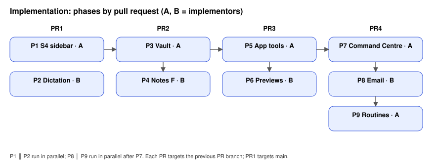

# Notes vault, Command Centre agent and dictation

Planned 2026-11-02. Product decisions: [build plan](../../docs/product/BUILD-PLAN-NOTES-COMMAND-CENTRE.md)
and the design canvas (private Claude artifact `PcvPbxAZma5gfTEcuRqkcM`). Mode: TOR-3-Agents,
four pull requests, stacked: PR1 → PR2 → PR3 → PR4.

## Problem and expected behaviour

Today notes are written next to code (`<workspace>/notes`, `.tenon/projects/<id>/notes`), the
Notes page asks the user to tick every Project, agents cannot record progress anywhere the user
sees, Activity repeats the sidebar, and there is no assistant that spans workspaces.

Before → after, one example per area:

| Area | Before | After |
| --- | --- | --- |
| Storage | A note on Acme API lands in `C:/dev/acme/.tenon/projects/project_01/notes/x.md`. | It lands in `Documents/Tenon/acme/Acme API/x.md`; `C:/dev/acme` gets no new file. |
| Notes UI | One list plus a checkbox per Project. | A page tree; a Project page opens on Timeline with Board, Table, Docs and Log tabs. |
| Agents | A thread finishes; nothing outside the thread changes. | The project agent ticks the timeline item and appends to the Project log; an inline card shows the write with Open and Undo. |
| Assistant | None. | Ctrl/Cmd+J pulls up a 70 px strip on any page; the Command Centre page holds its threads, memory and routines. |
| Dictation | None. | A mic button in the composer transcribes locally through a bundled engine built on Handy's stack. |

## Scope

In: `tenon/packages/app` (sidebar, Notes, previews, Command Centre, K3, Settings panels,
composer mic), `tenon/packages/tenon` (vault, app tools, memory, routines, HTTP routes),
`tenon/packages/core` (MCP app-tool hook), `tenon/packages/desktop` (dictation supervisor,
mail providers, vault root, IPC), new `tenon/packages/dictation` (Rust engine), docs.

Out: Harness Sync integration (open item; P3 only makes the vault sync-safe), tray and
launch-at-login for routines, sending email, the iOS/Android device tools.

Invariants:
- Project code folders are never written by Notes, the vault, app tools or routines.
- No absolute machine path is stored inside the vault.
- Email is never sent: no adapter calls a send endpoint.
- Workspace and email content stays data, never agent instructions.
- Windows and macOS both work: paths via `path.win32`/`path.posix` fixtures, credentials via
  Electron `safeStorage`, microphone permission per platform.
- User-visible text goes through i18n (`language.t`), English byte-for-byte as written here.
- Reduced motion: every animation in this plan has a no-motion path.

## Feature map

| Component | Responsibility | In → out | Source |
| --- | --- | --- | --- |
| Sidebar | Rail + Projects panel | layout state → DOM | `app/src/components/second-brain-sidebar.tsx` |
| Notes page | List/edit notes | `/second-brain/notes*` → editor | `app/src/pages/notes.tsx`, `features/second-brain/note-editor.tsx` |
| KnowledgeNote | Note files in the workspace | HTTP → files under workspace | `tenon/src/knowledge/note.ts` |
| BrainProject | Project cards `.tenon/projects/<id>` | HTTP → card files | `tenon/src/project/brain.ts` |
| Planner calendar | Calendar snapshot + tasks | HTTP → `.tenon/calendar-v1.json` | `tenon/src/planner/calendar.ts` |
| Google service | Calendar/Tasks OAuth + outbox | IPC → Google APIs | `desktop/src/main/google-calendar*.ts` |
| `tenon` MCP server | Tools for every harness | JSON-RPC → handlers | `core/src/harness/delegation.ts`, `browser-tools.ts` |
| Sessions | Threads by directory | SQLite | `tenon/src/session/*` |
| Sidecar supervisor | Restart policy | spawn → restart | `desktop/src/main/sidecar-supervisor.ts` |
| Composer | Prompt input | DOM → session prompt | `app/src/components/prompt-input-v2.tsx` |

## Diagrams

## Phases

| ID | PR | Owner | Outcome | Depends on | Edit scope |
| --- | --- | --- | --- | --- | --- |
| P1 | 1 | A | S4 sidebar container with open/close motion | independent | `app/src/components/second-brain-sidebar.tsx`, `app/src/pages/layout-new.tsx`, app i18n |
| P2 | 1 | B | Local dictation: engine, supervisor, Settings › Dictation, composer mic | independent | `packages/dictation/**`, `desktop/src/main/dictation*`, `desktop/src/preload/*`, `desktop/src/main/ipc.ts`, `app/src/components/settings-v2/dictation.tsx`, `settings-v2/dialog-settings-v2.tsx`, `app/src/components/prompt-input*`, `app/src/context/platform.tsx`, notices, release workflow docs |
| P3 | 2 | A | Vault service, routes, migration, conflicts, history | PR1 | `tenon/src/knowledge/**`, second-brain HTTP group, `desktop/src/main` vault root env, docs |
| P4 | 2 | B | Notes F UI over the vault | P3 | `app/src/pages/notes*.tsx`, `app/src/features/second-brain/notes-*`, `client.ts`, i18n |
| P5 | 3 | A | App tools on the `tenon` MCP server, write events, undo | P3 | `core/src/harness/delegation.ts`, `core/src/harness/app-tools.ts`, `tenon/src/agents/**`, HTTP group |
| P6 | 3 | B | Write previews W5/W3/W4 with Open and Undo | P5 | `app/src/features/agent-writes/**`, session timeline hook point, layout mount |
| P7 | 4 | A | Command Centre page, K3 strip, separate threads, memory, settings, project setup | P5, P6 | `app/src/pages/command-centre*`, `app/src/features/command-centre/**`, sidebar rail item, `tenon/src/agents/command-*`, HTTP group, settings |
| P8 | 4 | B | Email providers and mail tools, Settings › Accounts | P7 | `desktop/src/main/mail/**`, IPC/preload mail, `settings-v2/accounts.tsx`, `tenon/src/agents/mail-tools.ts` |
| P9 | 4 | A | Routines: storage, scheduler, catch-up, page | P7 | `tenon/src/agents/routines*`, HTTP group (routines routes), `app/src/pages/routines.tsx` |

Parallel pairs: P1 ∥ P2 (disjoint). P8 ∥ P9 after P7: both may add one route registration line to
the second-brain HTTP group and one tool registration line; B owns `mail-*` files, A owns
`routines*` files; the shared group file conflict is resolved by A during integration.
P3 → P4 and P5 → P6 run in sequence.

## Acceptance criteria

### P1 · S4 sidebar
- **AC-1.1** The rail and the Projects panel sit in one container (`[data-component="second-brain-sidebar"]`) with a visible 1 px outline and a rounded corner; the panel's background has no accent colour (the blue tint is gone).
- **AC-1.2** Toggling the sidebar changes the container's width between rail-only (80–90 px) and rail plus panel (300–360 px). Opening transitions `width` over 300 ms with `--v2-ease-emphasized-decelerate`; closing over 200 ms with `--v2-ease-emphasized-accelerate`.
- **AC-1.3** With `prefers-reduced-motion: reduce`, the container's transition duration is 0.
- **AC-1.4** Rail destinations stay Home, Notes, Calendar, Activity, Settings in that order; Settings opens the Settings dialog.

### P2 · Dictation
- **AC-2.1** `tenon/packages/dictation` builds a binary `tenon-dictation` (`cargo build --release`) on Windows and macOS using `transcribe-cpp`, `handy-recorder` and `earshot`. It speaks JSON lines on stdio: requests `{"id","type":"load","model"}`, `{"id","type":"start"}`, `{"id","type":"stop"}`, `{"id","type":"cancel"}`, `{"id","type":"transcribe_file","path"}`; events `{"type":"ready"}`, `{"type":"level","rms"}`, `{"type":"final","id","text"}`, `{"type":"error","id"?,"code","message"}`. An unknown request type yields an `error` event with code `bad_request` and the engine keeps running.
- **AC-2.2** `desktop/src/main/dictation.ts` exports `createDictation({ command, args, log })` returning `{ start(), stop(): Promise<string>, cancel(), status() , onLevel(fn) }`. `stop()` resolves with the `final` text for the matching request. If the engine exits mid-recording, `stop()` rejects with code `engine_exited` and the next `start()` respawns it (supervised like `superviseSidecar`).
- **AC-2.3** `dictationPermissionHelp(platform, state)` (same module) returns, for `darwin` + `denied`, the i18n key `dictation.permission.macos` and the URL `x-apple.systempreferences:com.apple.preference.security?Privacy_Microphone`; for `win32` + `denied`, key `dictation.permission.windows` and URL `ms-settings:privacy-microphone`; for `granted`, `undefined`.
- **AC-2.4** The composer shows a mic button (accessible name "Dictate") when the platform exposes dictation; clicking it starts recording (button pressed state), clicking again stops and inserts the transcript at the caret. Without the platform API (web build) no mic button renders.
- **AC-2.5** Settings › Dictation lists models (Whisper Small, Whisper Turbo, Parakeet V3), downloads one on request into the app's data folder, and shows "Speech recognition built on Handy by CJ Pais" linking `https://github.com/cjpais/Handy`. `THIRD_PARTY_NOTICES.md` at the repository root contains Handy's MIT licence text with "Copyright (c) 2025 CJ Pais" and entries for `transcribe-cpp` and `handy-recorder`.
- **AC-2.6** macOS builds declare `NSMicrophoneUsageDescription`; `docs/release-operations.md` describes the Rust build step for both platforms.

### P3 · Vault
- **AC-3.1** `GET /second-brain/vault` (workspace from `x-opencode-directory`) returns `{ root, workspace: { id, name, folder } }`, creating `<root>/<folder>/` once. The root is `TENON_VAULT_DIR`, else `<home>/Documents/Tenon`. Repeated calls return the same `id`.
- **AC-3.2** `PUT /second-brain/vault/page?path=
` with `{ body, title?, projectId?, properties?, expectedRevision?, create? }` writes a Markdown page inside the workspace's vault folder and returns `{ info, body, revision }`; `GET /second-brain/vault/page?path=` reads it; `GET /second-brain/vault/pages?project=&search=` lists `info` (`id, path, title, projectId, properties, updatedAt`). A page with `projectId` is stored under that Project's readable folder. Paths with `..`, absolute paths, backslashes or non-`.md` names return 400; a stale `expectedRevision` returns 409.
- **AC-3.3** Nothing the vault writes contains the workspace's absolute directory string, and the Project's code folder receives no new files.
- **AC-3.4** `GET/PUT /second-brain/vault/timeline?project=<id>` reads and writes `{ projectId, revision, items: [{ id, title, kind: "task"|"milestone", status: "todo"|"doing"|"done", start?, end? }], progress }` where `progress` is done ÷ tasks (milestones excluded), 0 when there are no tasks; stale revision → 409.
- **AC-3.5** `POST /second-brain/vault/log?project=<id>` with `{ text, author }` appends an entry; `GET` returns entries newest first. Each machine appends only to its own log file (named after a stable machine id), and entries from other machines' files are merged in the response.
- **AC-3.6** `POST /second-brain/vault/migrate` copies notes from `<workspace>/notes/**` and `.tenon/projects/<id>/notes/**` into the vault, writes a backup under `<root>/.backups/<timestamp>/`, then removes the originals; returns `{ moved, backup }`. A second call returns `moved: 0`. Project notes keep their Project.
- **AC-3.7** `GET /second-brain/vault/conflicts` lists vault files whose name contains `conflicted copy` or `(conflict` (any case) as `{ path, original }`.
- **AC-3.8** Overwriting a page keeps the previous version: `GET /second-brain/vault/page/history?path=` lists earlier revisions (newest first, at most 20) and each can be read back.
- **AC-3.9** The desktop app sets `TENON_VAULT_DIR` to `app.getPath("documents")/Tenon` unless the user chose another folder.

### P4 · Notes F
- **AC-4.1** `/notes` shows a page tree with a "Projects" group (one node per Project, its pages beneath) and a "Workspace pages" group, built from `/second-brain/vault/pages`. No Project checkboxes appear anywhere on the page.
- **AC-4.2** Opening a Project (`/notes?project=<id>`) shows tabs Timeline, Board, Table, Docs, Log; Timeline is selected first. `&tab=board` selects Board.
- **AC-4.3** Timeline draws one bar per item with a start and end and a marker per milestone; Board groups items into To do, Doing, Done; Table lists items with title, status, start, end; Docs lists the Project's pages; Log lists log entries newest first.
- **AC-4.4** Clicking an item or page opens it full width; Back returns to the same tab.
- **AC-4.5** "New page" creates a page through `PUT /second-brain/vault/page` (with `create: true`) in the selected Project or workspace and opens it; edits save with the current revision; a 409 shows a conflict message instead of overwriting.
- **AC-4.6** When `/second-brain/vault/conflicts` is not empty, a banner names each conflicting file.

### P5 · App tools
- **AC-5.1** With app tools installed, `tools/list` on the `tenon` MCP server includes `notes_search`, `notes_read`, `notes_write`, `timeline_get`, `timeline_update`, `log_append`, `calendar_list`, `calendar_apply`, `tasks_create`, `threads_list`.
- **AC-5.2** A session whose directory is a Project's thread directory can write only that Project's pages, timeline and log; a write to another Project returns `isError: true` with "outside this Project". Reads of other Projects are allowed.
- **AC-5.3** Every write tool returns `{ revision, undo }` and publishes a bus event `agent.write` with `{ sessionID, kind: "note"|"tasks"|"calendar"|"timeline"|"email", phase: "started"|"done", target, preview }`.
- **AC-5.4** `POST /second-brain/writes/<undo>/undo` restores the state before that write and returns 200; a second undo returns 409.
- **AC-5.5** `calendar_apply` adds events to the workspace calendar snapshot; `tasks_create` adds `PlannerTask`s (with an `accountId` when given, so the existing Google outbox syncs them). Neither touches files outside the workspace's `.tenon` and the vault.
- **AC-5.6** Tool arguments and file content are passed as data; a page body containing "ignore previous instructions" is stored verbatim and does not change tool behaviour.

### P6 · Write previews
- **AC-6.1** On a project thread page, an `agent.write` event for that session renders an inline card (`[data-agent-write][data-variant="inline"]`) with the kind's preview; on `done` it folds to one line with Open and Undo buttons.
- **AC-6.2** On the Command Centre page, consecutive writes of one turn render one step list (`data-variant="steps"`) with a row per write and the active row's preview.
- **AC-6.3** On any other page, a write renders the top pill (`data-variant="pill"`) that expands while writing and collapses to "Saved" with Open and Undo, then hides.
- **AC-6.4** Each of the five kinds has a preview: note text, task rows, calendar event blocks, timeline bars, email draft (To, Subject, body, "Saved as a draft. Tenon never sends email.").
- **AC-6.5** Undo calls the undo endpoint and shows "Undone"; a 409 shows "Already changed".
- **AC-6.6** With reduced motion, previews render final content without typing or growth animations.

### P7 · Command Centre
- **AC-7.1** The rail item Activity becomes "Command Centre" (`/command`); `/activity` redirects to `/command`.
- **AC-7.2** Command Centre threads run in `<vault root>/.command-centre`; `/second-brain/project-threads` and the Projects sidebar never list them; the Command Centre page lists only them.
- **AC-7.3** Ctrl+J (Cmd+J on macOS) toggles the K3 strip on every page except `/command`: an 18 px handle while hidden, a strip at most 90 px tall when open with the latest reply on one line, Undo when the last reply made a write, a composer and "Open full" (→ `/command?thread=<id>`). Esc hides it. Opening uses 300 ms emphasized-decelerate, closing 200 ms emphasized-accelerate; reduced motion snaps.
- **AC-7.4** Settings › Command Centre sets the default harness, model and memory age in days (default 45, 1–365). Lowering the age shows "Threads older than this are summarised and deleted for good."
- **AC-7.5** `GET /command-centre/memory?search=` searches Command Centre messages and summaries (FTS5). `POST /command-centre/memory/compact` summarises Command Centre threads older than the memory age into memory entries, then deletes those threads; project threads are never touched. A second compact is a no-op.
- **AC-7.6** The Command Centre agent gets the app tools across all workspaces (not Project-scoped) plus `memory_search` and `project_setup`. `project_setup({ workspace, name, folder? })` creates the folder, runs `git init`, writes `AGENTS.md`, `docs/system.md`, `docs/security.md` from templates that reference tor-project-setup, tor-implementation, tor-feature-map-verification and tor-workflow, and creates the Project card and an empty timeline; an existing non-empty folder is refused.

### P8 · Email
- **AC-8.1** `desktop/src/main/mail/` defines providers `gmail`, `graph` and `imap` with `search(query)`, `readThread(id)`, `createDraft({ to, subject, body, replyTo? })`. No provider calls a send endpoint (Gmail `messages/send`/`drafts/send`, Graph `/send`, SMTP).
- **AC-8.2** Gmail requests `gmail.readonly` and `gmail.compose`; Graph requests `Mail.Read`, `Mail.ReadWrite`, `offline_access` through PKCE on a loopback redirect; IMAP stores the app password through `safeStorage` and refuses to save when encryption is unavailable.
- **AC-8.3** Gmail and Graph responses are parsed into `{ id, subject, from, date, snippet }` for search and `{ id, messages: [{ from, to, date, text }] }` for threads; HTML bodies are reduced to text.
- **AC-8.4** The server's mail tools `mail_search`, `mail_read`, `mail_draft` reach the desktop over a loopback URL and bearer token (`TENON_MAIL_URL`, `TENON_MAIL_TOKEN`); without them the tools are absent. `mail_draft` publishes an `agent.write` event of kind `email`.
- **AC-8.5** Settings › Accounts lists connected mail accounts with provider and address, and can add or remove each.

### P9 · Routines
- **AC-9.1** A routine is a vault page under `Routines/` with front matter `schedule` (`daily HH:MM`, `weekdays HH:MM`, `weekly <mon..sun> HH:MM`, or 5-field cron), `harness?`, `model?`, `tools?`, `enabled`; the body is the prompt. `nextRun(schedule, after)` (exported from `tenon/src/agents/routines.ts`) returns the next local time.
- **AC-9.2** `GET /second-brain/routines` lists routines with `nextRun`, `lastRun`, `lastStatus`; `POST /second-brain/routines/<id>/run` starts a Command Centre thread with the prompt and records a run.
- **AC-9.3** On start, a routine whose scheduled time passed while the app was closed runs once, however many runs were missed.
- **AC-9.4** A run's result is appended to the workspace's `Inbox` page and emits a `routine.finished` bus event.
- **AC-9.5** The Routines page (`/routines`, linked from the Command Centre page) lists routines with schedule, last run, next run and Run now.

## Test sets

Acceptance tests (worker-visible) live in the package that runs them; see
[acceptance/README.md](acceptance/README.md). Verification tests are kept outside the repository
at the reviewer's location (path given only to verifiers) and copied into the candidate checkout
at the same relative paths.

| Phase | Acceptance command (from repo root unless noted) |
| --- | --- |
| P1, P4, P6, P7 UI | `cd tenon/packages/app && bunx playwright test e2e/acceptance/<file> --workers=1` |
| P2 desktop | `cd tenon/packages/desktop && bun test src/main/dictation.acceptance.test.ts` |
| P2 engine | `cd tenon/packages/dictation && cargo test` |
| P3, P5, P7, P9 server | `cd tenon/packages/tenon && bun test test/acceptance/<file>` |
| P5 MCP hook | `cd tenon/packages/core && bun test test/harness/app-tools.acceptance.test.ts` |
| P8 desktop | `cd tenon/packages/desktop && bun test src/main/mail/mail.acceptance.test.ts` |

Standard checks per PR: `bun run typecheck`, `bun run lint`, `bun run test`, plus
`bun run test:routes` for PRs that touch navigation (1, 2, 4) and `bun run test:engine` for PRs
that touch `core` or `tenon` (2, 3, 4).

Baseline: every acceptance test fails before implementation because its route, module or DOM
does not exist yet (404, missing export, or missing element). Missing-module import failures are
expected for new modules and are recorded as such, not as passing or broken tests.

Manual checks (not automatable): real transcription with a downloaded model on Windows and
macOS; real Gmail/Outlook/IMAP accounts; animation feel in the desktop app.

## Implementation sequence

1. PR1: P1 (A) ∥ P2 (B) from the plan commit; verifier checks each, then the merge.
2. PR2: P3 (A) from PR1's tip; then P4 (B) from P3's verified commit.
3. PR3: P5 (A) from PR2's tip; then P6 (B) from P5's verified commit.
4. PR4: P7 (A) from PR3's tip; then P8 (B) ∥ P9 (A) from P7's verified commit; integration check.

Each PR targets the previous PR's branch (PR1 targets `main`). Nothing is merged without the
user's approval.

## Completion evidence

Filled in as phases pass. Verifier results and implementor reports are kept apart.

| Phase | Verified SHA | Rounds | Verifier result | Implementor report |
| --- | --- | --- | --- | --- |
| P1 | | | | |
| P2 | | | | |
| P3 | | | | |
| P4 | | | | |
| P5 | | | | |
| P6 | | | | |
| P7 | | | | |
| P8 | | | | |
| P9 | | | | |
