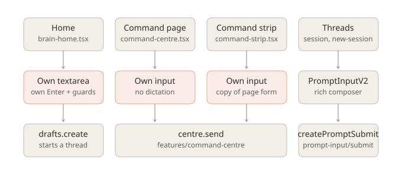
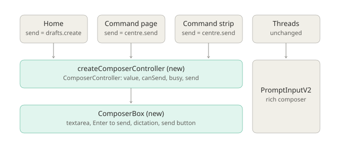
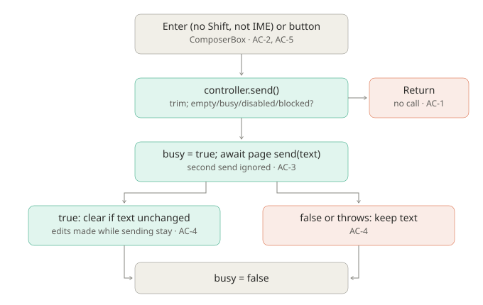

# Shared composer for Home and the Command Centre

## Problem

Home, the Command Centre page and the command strip each build their own text box and their own send
rules, so a change to one composer does not reach the others. The Command Centre page and strip have
no dictation, use a one-line `<input>`, and copy the same submit form. Home hand-writes a `<textarea>`,
its own Enter handling and its own guards.

Before: changing the send button or Enter behaviour on Home leaves the Command Centre and strip as they were.
After: all three render `ComposerBox` over a `ComposerController`; a change to either reaches all three.

The thread composer (`PromptInputV2Composer`) stays as is. It needs a folder-scoped session context
(SDK, sync, files, prompt) and carries attachments, history, stash and skills that these three pages don't.

## Feature map

| Component | Responsibility | In → out | Source |
|---|---|---|---|
| Home composer | Start a thread in the sidebar's workspace | text → `drafts.create(..., {send: true})` | `pages/brain-home.tsx` `startSession`, `<textarea id="brain-home-prompt">` |
| Command Centre page composer | Send to the open thread or start one | text → `centre.send(text, thread)` → URL `?thread=` | `pages/command-centre.tsx` `submit`, `<input>` |
| Command strip composer | Send to a new Command Centre thread | text → `centre.send(text, null)` | `features/command-centre/command-strip.tsx` `submit`, `<input ref={input}>` |
| `centre.send` | Create/continue the session, resolves the id or `undefined` | sets `sending`, `error` | `features/command-centre/command-centre.tsx:192` |
| `PromptDictationButton` | Record and insert text at the caret via `execCommand("insertText")` | needs a focused field | `components/prompt-input/dictation-button.tsx` |
| Thread composer | Rich composer, out of scope | — | `components/prompt-input-v2.tsx` |

Observed facts: the three pages repeat the same guard (trim, empty, busy, no workspace), the same
"keep text on failure" rule, and similar markup. Consumers that depend on the markup:
`e2e/acceptance/command-centre.spec.ts` (strip `textbox` role, strip height ≤ 90 px, focus on open),
`e2e/regression/brain-home-*.spec.ts` (textbox named "Start a Run").

## Diagrams







## Scope

- New: `tenon/packages/app/src/components/prompt-input/composer-controller.ts`
  (`ComposerController`, `createComposerController`, `composerKeySends`) and
  `components/prompt-input/composer-box.tsx` (`ComposerBox`).
- Changed: `pages/brain-home.tsx`, `pages/command-centre.tsx`, `features/command-centre/command-strip.tsx`.
- Excluded: the thread composer, the folder/branch row (separate refactor), Command Centre message rendering.
- Invariants: i18n keys and accessible names unchanged ("Start a Run", "Message the Command Centre",
  "Send", "Start"); the strip stays ≤ 90 px and focuses its field on open; a failed send keeps the text;
  Home still waits for a non-built-in harness list before sending.

## Contract

```ts
type ComposerController = {
  value(): string
  setValue(text: string): void
  busy(): boolean
  disabled(): boolean // no typing or sending (e.g. no workspace)
  canSend(): boolean // non-empty, not busy, not disabled, not blocked
  send(): Promise<boolean> // true when the page's send succeeded
}
createComposerController(input: {
  send: (text: string) => boolean | Promise<boolean>
  disabled?: () => boolean
  blocked?: () => boolean // can type, can't send yet (e.g. harness list loading)
  initial?: string
}): ComposerController
composerKeySends(event: { key: string; shiftKey: boolean; isComposing: boolean }): boolean
```

`ComposerBox` takes the controller plus `label`, `placeholder`, `sendLabel`, optional `header`
and `controls` slots, `size` (`"large"` for Home, `"medium"` for the Command Centre page,
`"compact"` for the strip), and `ref`. It renders the dictation button whenever the platform has dictation.

## Acceptance criteria

- **AC-1 Guards.** With empty or whitespace text, or when `disabled()` or `blocked()` is true, `send()`
  resolves `false`, the page's send is not called, and the text is unchanged. `canSend()` is false.
- **AC-2 Keyboard.** Enter sends; Shift+Enter (new line), IME composition and other keys don't.
- **AC-3 Busy.** While the page's send is pending, `busy()` is true, `canSend()` is false and a second
  `send()` resolves `false` without calling the page's send. Busy clears afterwards, even on failure.
- **AC-4 Result.** The page's send receives trimmed text. On success the box clears if its text is
  unchanged since the send started; text typed during the send is kept. On `false` or a thrown error the
  text stays and `send()` resolves `false`.
- **AC-5 One composer.** Home, the Command Centre page and the strip render `ComposerBox` with
  `createComposerController` and no longer contain their own `<textarea>` or text `<input>`.
- **AC-6 Preserved behaviour (manual + existing e2e).** Accessible names above are unchanged; the strip
  is ≤ 90 px tall, focuses the field when opened and Esc still closes it; dictation shows on all three
  when available; Home sends with the selected harness/model and the Command Centre page opens the new thread.

| AC | Acceptance set | Verification set | Manual |
|---|---|---|---|
| AC-1 | yes | reactive guard changes, newline-only | — |
| AC-2 | yes | — | Enter / Shift+Enter in the browser |
| AC-3 | yes | sync send, retry after failure | — |
| AC-4 | yes | edit during failing send, initial value | — |
| AC-5 | yes (source check) | — | — |
| AC-6 | — | — | browser preview, existing e2e specs |

## Implementation sequence

1. Add `composer-controller.ts` (AC-1 to AC-4), then `composer-box.tsx` (AC-2, AC-5).
2. Move Home to it: `send` wraps `drafts.create`, `blocked` = waiting for the harness list.
3. Move the Command Centre page and strip: `send` wraps `centre.send`; `disabled` = no `centre.directory()`.
4. Run checks, then the browser preview.

## Verification

Run from `tenon/packages/app`:

```sh
bun test --conditions=solid --preload ./happydom.ts ../../../Implementations/shared-composer/acceptance/app/
bun test --conditions=solid --preload ./happydom.ts ../../../Implementations/shared-composer/verification/app/
bun typecheck
```

From the repository root: `bun run lint`, `bun run test`, `bun run build`.
Manual: Home, `/command` and the strip (Cmd+J) in the web preview.

Baseline (before implementation): both sets fail at import, because `composer-controller.ts` does not
exist yet. This is the expected missing-behaviour failure, not a setup error.

The same author (Claude) wrote the plan, both test sets and the implementation, so the verification set
is a separately designed set of cases, not an independently authored or hidden one.

## Completion evidence

Implemented as proposed; the diagrams match the diff. All checks below were run by the same author.

- Acceptance set: 9 pass. Verification set: 6 pass. The verification set caught a real defect: the
  page's send started a tick late. Fixed so it starts immediately.
- `bun typecheck` (app): pass. `bun run lint`: 0 errors; the warnings in changed files are on untouched lines.
- `bun run test:unit` (app): 937 pass, 1 fail in `src/utils/date.test.ts` (date formatting). This change
  doesn't touch that file, and I didn't re-run it on `main`.
- Browser (isolated web preview, scratch workspace):
  - Home renders `ComposerBox` with its folder row and model pill; Shift+Enter adds a line.
  - The Command Centre page renders it with the "Message the Command Centre" textbox.
  - The strip card is 83 px tall (≤ 90), Esc closes it, and the closed card is hidden.
- Found while verifying, on the original code too: opening the strip left focus on its handle, because
  the card transitioned `visibility` and still read `hidden` when the field tried to take focus. Fixed in
  `command-strip.tsx` by transitioning visibility only on close; the field now takes focus on open.
- Not verified:
  - Pressing Enter or the send button for a real send. That would start a model run, so it's covered
    only by the unit tests.
  - Dictation, which isn't available in the web preview.
  - The Playwright specs (`e2e/acceptance/command-centre.spec.ts`, `brain-home-*`). Their run was stopped
    before it finished.
  - `bun run build`.
