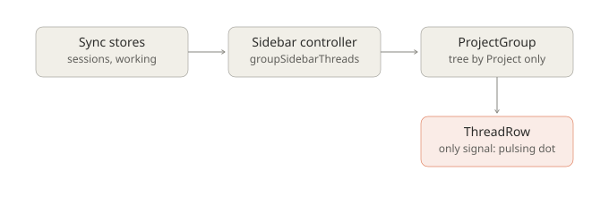
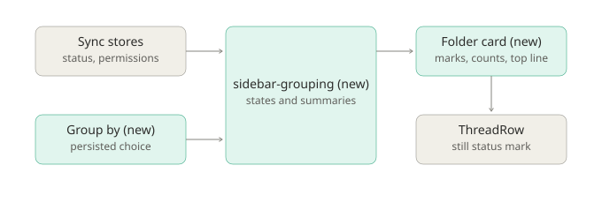
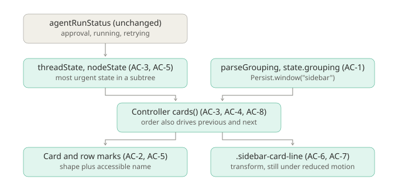

# Sidebar folder cards

Design: [Sidebar threads workshop](https://claude.ai/artifact/Mc9at1soYHTQtL5ncpCK7Q), boards **C · Folder cards**
and **3 · Top line**, chosen 2026-11-04.

## Problem

Threads only group by Project, so a thread waiting for approval can sit inside a closed folder. A row shows one
signal, a small pulsing dot, and nothing on a collapsed folder shows that work is running.

Before: Acme API is collapsed, one of its threads wants approval and another is running, and the sidebar looks idle.
After: Acme API is a card. Its header shows a running mark and an approval mark, and a thin line runs along the top
of the whole card while any thread in it works. Group by switches to Attention, where Needs you comes first.

## Decisions

- **D-1 Attention has three groups for now:** Needs you, Running, Other threads. The workshop's Failed, Ready to merge
  and Merged need data the app doesn't have: `agentRunStatus` gives only approval, running and retrying, and nothing
  in the app reads pull request state. A separate change can add them.
- **D-2** `retrying` counts as Running. A thread's state is the most urgent state of itself and its children.
- **D-3** Group by is remembered per window, with the rest of the sidebar's state.
- **D-4** The line animates with `transform`, so it runs on the compositor and doesn't repaint each frame.

## Feature map

| Component | Responsibility | In → out | Source |
|---|---|---|---|
| Sidebar view | Rail, workspace header, Project and workspace groups, rows | controller → DOM | `components/second-brain-sidebar.tsx`: `ProjectGroup`, `ThreadGroup`, `ThreadList`, `ThreadRow` |
| Sidebar controller | Projects, sessions, expansion, navigation order | sync stores → `groups()`, `working()` | `components/sidebar/sidebar-controller.ts` |
| Thread tree | Projects and workspace grouping, node cache | sessions → `ThreadNode[]` | `features/second-brain/sidebar-threads.ts` |
| Run status | Approval, running, retrying | `session_status`, `permission` → status | `pages/activity-runs.ts` `agentRunStatus` |
| Persisted state | `Persist.window("sidebar")` | `current`, `expanded` | `sidebar-controller.ts:127` |
| Running dot | Pulsing ring | `.running-pulse` | `index.css:280`; also used by `pages/brain-home.tsx`, which stays |
| Segmented control | Pill switch | | `SegmentedControlV2` in `@tenon/ui`, used by `features/second-brain/project-controls.tsx` |

Consumers to keep working: `e2e/utils/sidebar.ts` and specs use `data-sidebar-thread`, `data-sidebar-thread-open`,
`data-sidebar-project`, and `tenon.window.browser.dat:sidebar` with `expanded`.

Observed: only expanded Projects load their own thread list, and the recent-session index covers the rest, up to
`HOME_SESSION_LIMIT`. Attention and Recent therefore list what `groups()` already holds. Assumption to confirm in P2:
`session_status` and `permission` update for threads in collapsed Projects, as Home relies on.

P1 verification found that the index drops child threads, so a collapsed Project's roots have no children and a
child's approval didn't reach its root. `context/global-sync/home-session-index.ts` is therefore in P1's scope: state
rolls up through child-to-parent links, without any new per-directory load.

## Diagrams







## Contract

New pure module `tenon/packages/app/src/features/second-brain/sidebar-grouping.ts`:

```ts
export type ThreadGrouping = "project" | "attention" | "recent"
export type ThreadState = "approval" | "running" | "idle"
export type CardSummary = { running: number; approvals: number; total: number }
export type ThreadCard<S> = { id: string; threads: ThreadNode<S>[]; summary: CardSummary }

parseGrouping(value: unknown): ThreadGrouping // anything unknown is "project"
threadState(status: SessionStatus | undefined, approvals: number): ThreadState
nodeState<S>(node: ThreadNode<S>, stateOf: (session: S) => ThreadState): ThreadState // most urgent in the subtree
cardSummary<S>(nodes, stateOf): CardSummary // counts every thread in the subtrees; total counts root nodes
attentionCards<S>(roots, stateOf): ThreadCard<S>[] // ids "attention:needs", "attention:running", "attention:other"
recentCards<S>(roots, stateOf, now: number): ThreadCard<S>[] // ids "recent:today", "recent:yesterday", "recent:earlier"
```

Both card builders leave out empty cards, keep the order of `roots` inside a card, and use local calendar days.
`nodeState`, `cardSummary` and both builders take an optional trailing `linked` argument from `linkedStates`, which
carries states of children that aren't loaded. The controller sorts Attention and Recent roots newest first, so pins
order only Project mode.

## Scope

- New: `features/second-brain/sidebar-grouping.ts` and its unit test.
- Changed: `sidebar-controller.ts`, `second-brain-sidebar.tsx`, `index.css`, `i18n/en.ts`, plus any locale files the
  i18n types require, `e2e` specs, `docs/architecture/README.md` (sidebar) and `docs/product/NAVIGATION-MAP-V1.md`.
- Excluded: Failed, Ready to merge and Merged groups, Approve or Retry actions on rows, drag and drop, the rail, Home.
- Invariants: every thread menu, rename, pin, fork, archive, delete and drag-to-attach keeps working. Project actions
  keep working. Workspaces never share threads. `.running-pulse` stays for Home. Unsaved `expanded` values still load.

## Acceptance criteria

- **AC-1 Group by.** The sidebar has a Group by switch with Project, Attention and Recent. The choice survives a
  reload, and a stored value that isn't one of these falls back to Project.
- **AC-2 Cards.** In Project mode each Project and the workspace group is a rounded card on a tonal surface, in the
  same order as today, with its actions and New thread intact.
- **AC-3 Attention.** Roots sort into Needs you, Running and Other threads, in that order. A root takes its most urgent
  child's state. Empty groups don't show.
- **AC-4 Recent.** Roots sort into Today, Yesterday and Earlier by last update. Empty groups don't show.
- **AC-5 Status marks.** A row and a card header show approval and running with different shapes, and each mark has an
  accessible name. Idle shows no mark. Approval uses the semantic warning colour, running the accent.
- **AC-6 Top line.** While any thread in a card runs, including one in a collapsed card, a thin line runs along the top
  edge of the card. It stops when none does. Row dots no longer pulse. The sidebar's `.running-pulse` is gone.
- **AC-7 Reduced motion.** With reduced motion the line is still and visible, so the state still shows.
- **AC-8 Keyboard order.** Previous and next thread follow the order of cards on screen in every mode. Stepping into
  a child that is hidden until opened stays as it is today.
- **AC-9** `bun run check` and `bun run test:routes` pass.

| AC | Acceptance | Verification | Manual |
|---|---|---|---|
| AC-1 | yes | yes | |
| AC-2 | source check, e2e | | M-1 |
| AC-3 | yes | yes | |
| AC-4 | yes | yes | |
| AC-5 | source check, e2e | yes | M-1 |
| AC-6 | source check | yes | M-1 |
| AC-7 | yes | yes | M-1 |
| AC-8 | | yes | |
| AC-9 | commands | commands | |

**M-1.** In the installed app, run a thread in a collapsed Project and confirm the line appears, then stops.

## Phases (TOR-2)

| Phase | Outcome | Criteria | Edit scope | Depends on |
|---|---|---|---|---|
| P1 | Grouping and state logic exist, tested, and the controller exposes them | AC-1 (logic, persistence), AC-3, AC-4, AC-8 | `sidebar-grouping.ts` and test, `sidebar-controller.ts`, `home-session-index.ts` and test | none |
| P2 | The sidebar renders cards, marks, the switch and the top line | AC-1, AC-2, AC-5, AC-6, AC-7, AC-9 | `second-brain-sidebar.tsx`, `index.css`, i18n, e2e, docs | P1 |

Run from `tenon/packages/app`, with dependencies installed by `bun install --frozen-lockfile` in `tenon/`:

```bash
bun test --conditions=solid --preload ./happydom.ts ../../../implementations/sidebar-folder-cards/acceptance/app/
bun test --conditions=solid --preload ./happydom.ts ../../../implementations/sidebar-folder-cards/verification/app/
```

From the repository root: `bun run check` and `bun run test:routes`.

## Baseline test results

Run on `main` at `d4e05465`, before implementation. Acceptance: 11 of 12 fail. Verification: 12 of 13 fail. The two
passes guard behaviour that must not change: Home keeps its pulse, and the sidebar's existing test hooks stay.

## Completion evidence

Mode: TOR-2. Branch `codex/sidebar-folder-cards`, not pushed or merged. Verified tip `478b9296`, base `d4e05465`.

| Phase | Verified SHA | Correction rounds |
|---|---|---|
| P1 | `398faa5e` | 1: a child's state didn't reach its root in a collapsed Project |
| P2 | `478b9296` | 0 |

Verifier results at `478b9296`: acceptance 12 of 12, verification 13 of 13, `bun run check` exit 0, `bun run test:routes`
11 passed, `sidebar-cards.spec.ts` 12 passed, `thread-menu-rename` 3 passed, `sidebar-s4` 4 passed.

Plan author's check at `478b9296`: acceptance 12 of 12 and verification 13 of 13, read the view and CSS diff, and
confirmed the switch's indicator settles on Attention in both themes. The screenshot showing it on Project was taken
mid-slide. The verifier was a separate agent, but the plan author wrote both test sets, and the implementor never saw
`verification/`.

Baseline failure, not caused by this work: `session-timeline.spec.ts:320` fails the same way at `d4e05465`.

Diagrams match the diff. The parent-link rollup sits inside the proposed grouping box, and the implementation view's
`threadState` and `nodeState` take the optional `linked` argument.

Not verified, or left open:

- **M-1 mostly done on 2026-11-04,** in the installed app at `b3c7b16e`, which adds the alignment fix and merges `main`
  (typecheck and `sidebar-cards.spec.ts` passed; the two test sets weren't rerun and the verifier hasn't seen it). With
  real Codex and Claude Code threads: the top line ran and stopped, including on a collapsed card, and Group by
  switched and survived a reopen. Still unconfirmed against a real server: the approval mark, and the session list
  returning child threads.
- A pending approval already waiting at launch in a folder that hasn't been opened stays invisible until that folder
  loads or a new event arrives. Home has the same limit. Live events work in any folder.
- A thread that moves to another Attention card remounts, so its own open menu or rename is lost. Other rows keep theirs.
- A grandchild under an archived child doesn't reach its root.
- Marks are `role="img"`, so state changes are no longer announced live as the old `role="status"` dot was.
- Today and Yesterday go stale past midnight until the next thread or status change.
- The warning colour in the light theme is about 2.4:1 on the card, from the shared token. Its shape and name still
  carry the state.
- Performance wasn't measured. Each row reads a shared memo, so rows re-evaluate on any status change.
- The comment on `ThreadList` about `For` recreating rows is stale.
- Everything ran on Node 22.21.0, not the required 24.
